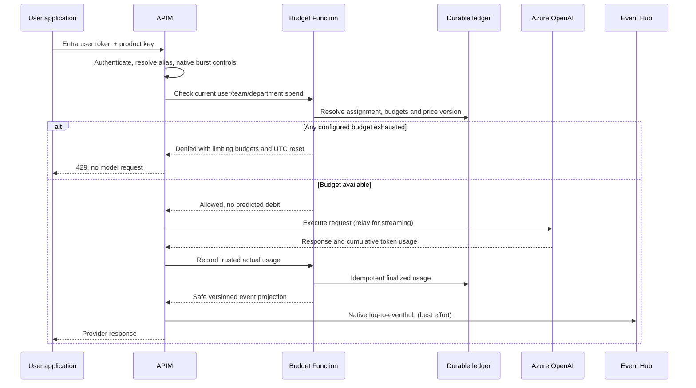

# Architecture

The sample enforces **monthly, calendar-UTC dollar budgets** for an authenticated
user and their configured team and department. It supports Azure OpenAI Chat
Completions and Responses, with incremental streaming and non-streaming requests.

## Responsibilities

| Component | Owns |
| --- | --- |
| APIM | Entra/product-key validation, native RPM/TPM protection, model alias/backend routing, budget-check and usage-record callouts, native Event Hub publication |
| Budget Function | Membership, all-level budget decisions, price snapshots, actual accounting, audit, scoped reports and dashboard query API |
| Streaming Function | Bounded incremental OpenAI SSE relay, trusted terminal usage and internal APIM event callback |
| Table Storage | Authoritative configuration, request accounting context, finalized usage and audit |
| Redis | Disposable projection/coordination for monthly counters, never historical authority |
| React/Node portal | Authenticated administration, actual spend, chargeback and shared Azure dashboard |
| Event Hubs | Best-effort downstream usage transport; not budget enforcement |
| Application Insights/Log Analytics | Operational traces and the Azure dashboard, not canonical billing |

The portal's same-origin Node proxy preserves the user's delegated API token and
adds a server-only APIM product key resolved through managed identity and Key
Vault. Readers do not gain workspace-wide Azure Monitor access.

## Request and accounting flow

The relay performs the record/callback steps after observing the stream's
terminal usage. It does not buffer the complete response, parse prompts into
estimated charges, or publish directly to Event Hubs.

## Identity and hierarchy

Tenant plus validated Entra object ID identifies the user. An APIM subscription
is application attribution, not an alternative budget identity. Explicit managed
configuration maps the user to one team and department; teams belong to the same
tenant and their assigned department. Membership must be unambiguous and enabled.

All matching budgets apply, including model-specific and wildcard budgets.
Unconfigured levels impose no implicit financial cap. Each request contributes
to the relevant user/team/department totals but remains **one financial charge**:
never add three hierarchy totals together as if they were separate consumption.
Business-unit and cost-center dimensions are snapshotted for historical chargeback.

## Financial meaning and failures

There are no monetary reservations, holds, refunds or settlement deltas. A check
only tests already-recorded spend; concurrent work can overshoot. An `$80` monthly
budget means `80,000,000` micro-USD. Cost uses decimal price arithmetic and integer
micro-USD, not binary floating point.

Usage and its original price/membership context remain durable and idempotent.
Redis loss must not reopen an empty budget: reconstruct from finalized records
before allowing checks. Redis/Table are not a distributed ACID transaction.
This sample rebuilds the disposable projection and reads authoritative finalized
records during each check. It favors simple crash recovery over a high-throughput
hot path; validate ledger size and latency before production use.
Missing or malformed terminal usage is **unknown**, never a zero-cost success.
Unknown usage limits financial completeness; see [token accounting](docs/token-accounting.md).

Event Hub failure must not change an inference response. No application retry
queue or outbox is introduced. Lost export events can be found by reconciling
against the durable ledger; this is deliberately not exactly-once delivery.

## Dashboard and deployment

The Terraform-managed Azure dashboard contains finalized spend, hierarchy
utilization/denials, tokens, chargeback and Event Hub health views. The Admin-only
portal dashboard reads that same persisted layout and KQL rather than duplicating
queries. Scoped chargeback reports use the durable ledger.

Azure Commercial and Government are explicit deployment configurations, not
interchangeable DNS suffixes. The resource group/network are pre-created.
Terraform does not manage policy-owned private DNS zone groups. A reviewed
cutover is required before applying resource deletions from the old sample.

See [topology](docs/azure-topology.md), [migration](docs/migration.md),
[observability](docs/observability.md) and [implementation](docs/code-guide.md).
