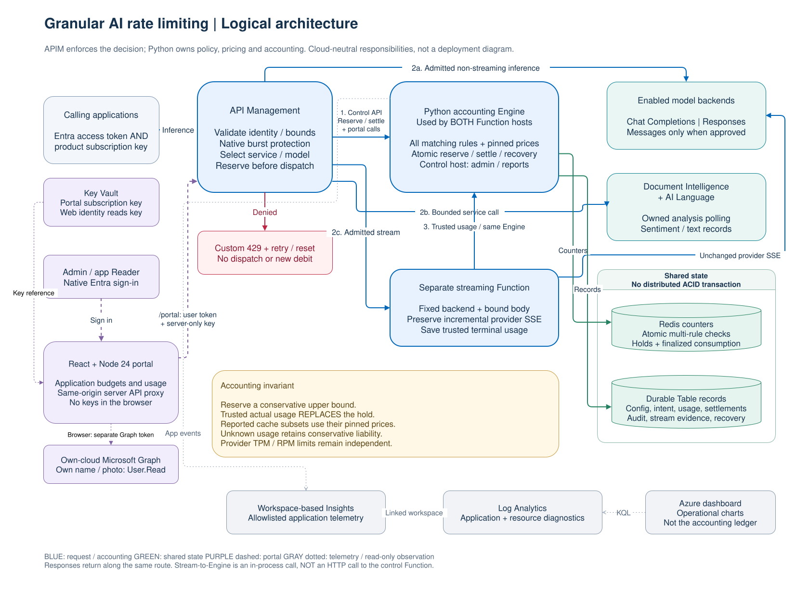
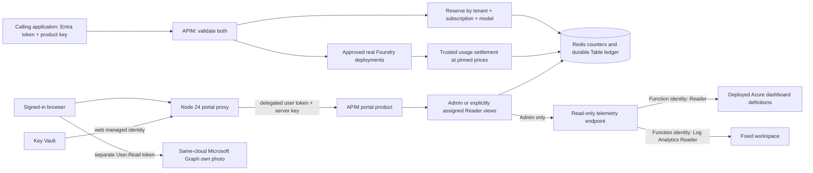
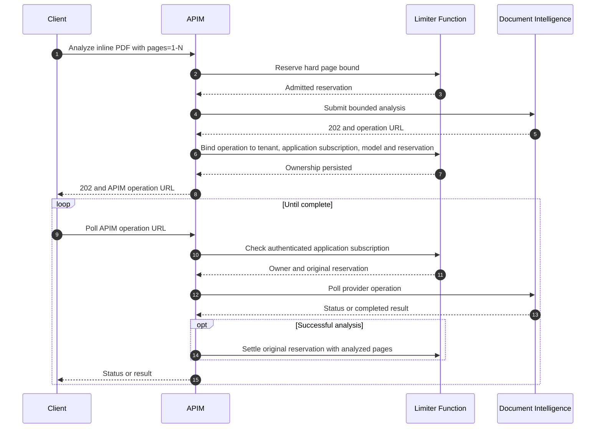
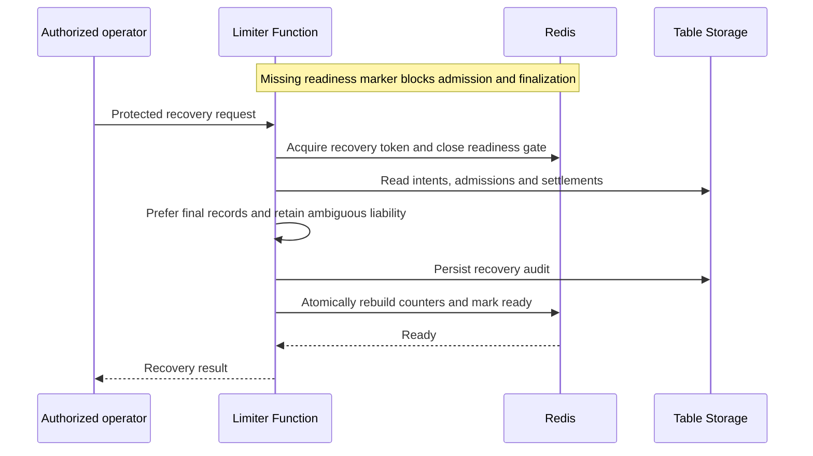

# System architecture

This guide owns the component boundaries, service-specific flows and storage design.
The [reservation guide](docs/reservation-system.md) owns admission/settlement
sequences, lifecycle diagrams, cache-price math and failure semantics.
The [Azure topology guide](docs/azure-topology.md) owns networking and identity.

## System overview

[Full-size SVG](docs/diagrams/logical-architecture.svg) |
[Editable draw.io source](docs/diagrams/logical-architecture.drawio) |
[Diagram editing and physical views](docs/diagrams/README.md).

Blue arrows show request/accounting paths, purple dashed arrows the portal path,
and gray dotted arrows telemetry. The Engine is shared code in both Function
hosts, not a third deployed service; stream-to-Engine settlement is in-process.
Only enabled services/protocols are published. Browser API calls use the portal's
same-origin Node proxy, then APIM `/portal`, never an unauthenticated Function.
The proxy preserves the user's delegated token and adds a server-only product
subscription key resolved from Key Vault using the web managed identity. Resource-level identity
and network details belong to the [physical views](docs/azure-topology.md).

The [model registry](docs/model-registry.md) maps protocol/alias pairs to
approved fixed deployments and pinned prices for APIM and both Functions. It
changes logical routing, not physical topology; the portal discovers a
redacted read-only inventory. Accounting and policy selection use the alias.

The Terraform-managed model account is Microsoft Foundry (`AIServices`, S0),
not an OpenAI-kind account or an ML hub. Account-level inference does not require
a Foundry project. Chat and Responses keep the native OpenAI-compatible endpoints
and their existing caller roles; Messages uses its separately approved Foundry
endpoint and role. A dedicated account identity enables Foundry resource features
without sharing or broadening APIM/Function workload permissions. Existing
OpenAI accounts can be [upgraded in place](docs/deployment.md#upgrade-an-existing-openai-account).

## Responsibility boundaries

| Component | Owns | Does not own |
| --- | --- | --- |
| APIM | Identity, supported request bounds, native throttling, protocol/alias lookup and approved deployment routing, managed-identity callouts | Price arithmetic or the durable budget ledger |
| Control-plane Function | Rule selection, reserve/settle/recovery, configuration, audit, authorized reports and Admin-only dashboard queries | Model generation or portal static hosting |
| Streaming Function | Registered-deployment SSE transport, trusted usage observation and shared Engine settlement | Client-reported usage or arbitrary proxy destinations |
| Redis | Atomic all-or-none check/debit and idempotent finalization | Durable configuration or invoice history |
| Table Storage | Configuration, pinned intents, admissions, settlements, ownership and recovery evidence | A cross-service ACID transaction with Redis |
| React portal / Node server | Admin editing, native dashboard charts, model inventory, app-subscription views, own Graph photo and same-origin authenticated control-plane proxy | Inference execution, backend authorization or live Redis balances |
| Key Vault | Server-only portal APIM key, resolved by the web managed identity | Browser credentials, model authentication or budget identity |
| Azure Monitor | Operational traces, metrics and charts | Admission decisions or canonical billing |

Native APIM counters remain gateway-scoped. Shared custom limits require gateways
to use the same configured store; active-active cross-region ledger replication
is not implemented. Dynamically rotating APIM keys is not a replacement for atomic
cost accounting. The [client-driven throttling article](https://learn.microsoft.com/azure/api-management/api-management-sample-flexible-throttling#client-driven-throttling)
demonstrates scoping, not financial consistency.

### Application identity, not user identity

Inference requires **both** a tenant-validated Entra access token and a native
product subscription key. `context.Subscription.Id` is the canonical application
identity. The primary and secondary key, key rotation and different authenticated
users all use that same budget; another subscription gets a separate budget.
The authenticated Entra principal remains audit metadata, never a counter key.
Assignments bind policies and explicitly authorized Reader principals to an app.
The portal's separate product subscription is control-plane access, not an
inference application or a shared end-user budget.

See [rule/counter semantics](docs/configuration-reference.md#policy-selection-and-counter-scope)
and [supported gateway contracts](apim/README.md).

The telemetry endpoint reads the native dashboard's 22 query definitions rather
than maintaining a second catalog. It runs outside admission/settlement, rejects
client-supplied query destinations, and never grants workspace-wide data to
application-scoped Readers. See [in-app chart access](docs/observability.md#charts-inside-the-application).

## Document Intelligence and Language

Document analysis is asynchronous. Submission reserves the enforced page bound;
polling checks ownership and settles the **original** reservation, without
reserving another analysis.

Bind failures fail closed without leaking the backend operation URL. The supported
operation accepts bounded inline PDFs, not arbitrary remote URLs or general uploads.
Language instead uses synchronous sentiment analysis and per-document text-record
rounding; backend transaction statistics settle the submitted bound.

Exact payload limits and unit rules belong to the [APIM contract](apim/README.md).
The implementation is in [document submission](apim/policies/document-submit.xml.tftpl),
[document polling](apim/policies/document-poll.xml.tftpl),
[Language settlement](apim/policies/language-settlement.xml.tftpl), and
[`Engine` ownership methods](src/apim_rate_limit_foundry/engine.py).

## Why Redis, and why not Redis alone?

| Option | Useful property | Limitation for this design |
| --- | --- | --- |
| Redis scripts | Atomic check/reserve across matching counters with few network trips | Cache loss, hot keys, topology and cloud lifecycle constraints |
| Table Storage | Durable, inexpensive records and partition transactions | Contention and extra trips for hot multi-rule decisions |
| Cosmos DB | Durable low-latency partition transactions | RU/partition design and cost; not automatically better for contended counters |
| Azure SQL | Mature durable transactions | Additional schema/operational cost and contention tradeoffs |
| Function memory | Deterministic local test doubles | Not shared across workers |
| APIM counters | Efficient native burst controls | Gateway-scoped and no differentiated price catalog |

The sample deliberately combines Redis for the hot decision with Table Storage
for durability. The third-party Python `redis` client is necessary because there
is no suitable Microsoft-maintained Python Redis data-plane client.

Redis and Table writes are not a distributed ACID transaction. Ambiguous writes
retain liability instead of reopening allowance. One Redis hash/slot and one
Table partition make the reference implementation comprehensible, but limit
horizontal scaling. Historical records are not automatically expired or archived.
Table access is on the admission path; Redis-only latency numbers are not
end-to-end latency claims.

### Cache loss and recovery

Proven denials rebuild with no debit. Unconfirmed intents can consume allowance
conservatively even if backend execution cannot be proved. Recovery does not ask
providers to discover unreported usage and is not a budget-reset operation.
Use the [operations runbook](docs/operations.md#recovery), not direct Redis edits.

## Configuration and reporting

Configuration changes and their audit records are committed together in the
Table partition. New reservations read configuration; in-flight requests keep
their original snapshots. Reports derive UTC admission-time cohorts from durable
records, replacing estimates with available settlements rather than maintaining
a second materialized accounting ledger.

Readers are scoped by the server to their authenticated tenant/principal; browser
filters and role hints are not authorization. Detailed trust boundaries are in
[Azure topology and identity](docs/azure-topology.md#identity-and-token-boundaries).

Large histories require designed retention, pagination, partitioning and possibly
incremental projections before production use. Also establish load/latency,
availability, recovery and pricing-governance objectives.

## Further reading

- [Reservation system](docs/reservation-system.md): per-request mechanics and detailed sequence/lifecycle diagrams.
- [Code guide](docs/code-guide.md): entry points, dependency injection, persistence and extension points.
- [Observability](docs/observability.md): telemetry paths, dashboard inventory and correlation.
- [Deployment](docs/deployment.md) and [infrastructure reference](infra/README.md): execution and inputs.
