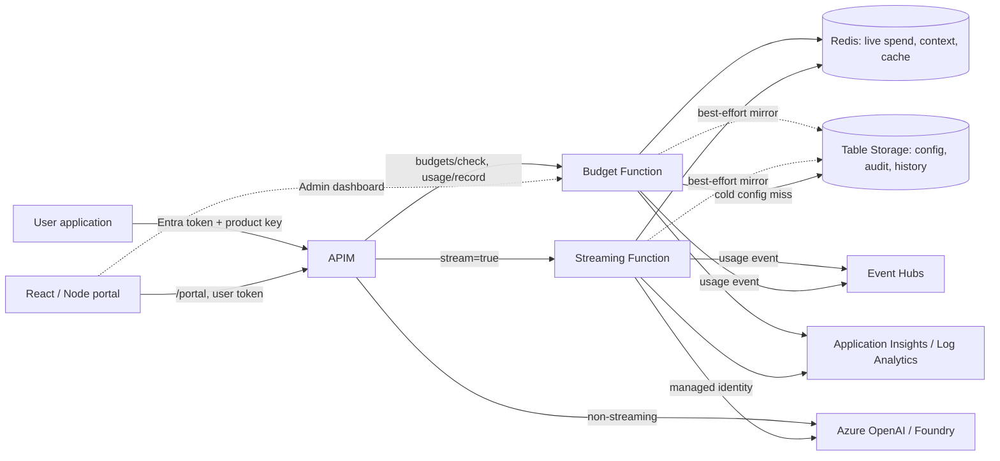
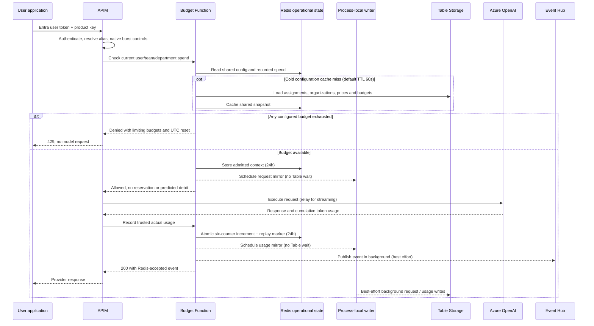

# Architecture

The sample enforces **monthly, calendar-UTC dollar budgets** for an authenticated
user and their configured team and department. It supports Azure OpenAI Chat
Completions and Responses, with incremental streaming and non-streaming requests.

## Responsibilities

| Component | Owns | Code |
| --- | --- | --- |
| APIM | Entra/product-key validation, native RPM/TPM protection, model alias/backend routing, budget-check and usage-record callouts | [`apim/`](apim), [`infra/modules/apim`](infra/modules/apim) |
| Budget Function | Cached membership/configuration, all-level budget decisions, price snapshots, Redis accounting, background history writes, scoped reports and dashboard query API | [`function_app.py`](function_app.py), [`api.py`](src/apim_rate_limit_foundry/api.py), [`engine/`](src/apim_rate_limit_foundry/engine) |
| Streaming Function | Bounded incremental OpenAI SSE relay, in-process terminal Redis accounting and background Event Hub publication | [`stream/function_app.py`](stream/function_app.py), [`streaming/`](src/apim_rate_limit_foundry/streaming) |
| Table Storage | Durable configuration/audit and best-effort eventual request/usage history for reports and chargeback; not admission authority | [`stores/table.py`](src/apim_rate_limit_foundry/stores/table.py) |
| Redis | Shared configuration cache, admitted context, replay protection and live approximate monthly spend | [`stores/redis.py`](src/apim_rate_limit_foundry/stores/redis.py), [`stores/scripts.py`](src/apim_rate_limit_foundry/stores/scripts.py) |
| React/Node portal | Authenticated administration, operational spend, persisted chargeback and shared Azure dashboard | [`web/`](web) |
| Event Hubs | Best-effort downstream usage transport, published by the Functions; not budget enforcement | [`export/`](src/apim_rate_limit_foundry/export), [`infra/modules/event_hubs`](infra/modules/event_hubs) |
| Application Insights/Log Analytics | Operational traces and the Azure dashboard, not canonical billing | [`telemetry/`](src/apim_rate_limit_foundry/telemetry), [`reports/dashboard.py`](src/apim_rate_limit_foundry/reports/dashboard.py) |

## System context

Solid arrows are on the request path; dashed arrows are best-effort or
off-path. The editable [logical and physical diagrams](docs/diagrams/README.md)
add the network, identity and portal detail. The [code guide](docs/code-guide.md)
walks each flow through the code.

The portal's same-origin Node proxy preserves the user's delegated API token and
adds a server-only APIM product key resolved through managed identity and Key
Vault. Readers do not gain workspace-wide Azure Monitor access.

## Request and accounting flow

The call chain behind each step is in the [code guide walkthroughs](docs/code-guide.md#request-walkthroughs).

The relay forwards chunks incrementally, performs Redis accounting in process at
terminal usage and schedules the Event Hub publication in the background. It does
not wait for Table persistence, buffer the complete response, or parse prompts
into estimated charges. The nonstreaming APIM usage call still waits briefly for
Redis acceptance, but not for Table writes or Event Hub publication. Both Functions
publish each finalized event themselves with their managed identity; APIM has no
Event Hub access.

Warm admission never reads Table. A cold configuration miss may read it; Admin
configuration CRUD is synchronous durable-first with shared-cache invalidation.
No per-request full ledger reads or global distributed ledger lock exist.

## Identity and hierarchy

Tenant plus validated Entra object ID identifies the user. An APIM subscription
is application attribution, not an alternative budget identity. Explicit managed
configuration maps the user to one team and department; teams belong to the same
tenant and their assigned department. Membership must be unambiguous and enabled.

All matching budgets apply, including model-specific and wildcard budgets.
Unconfigured levels impose no implicit financial cap. Each request contributes
to the relevant user/team/department totals but remains **one financial charge**:
never add three hierarchy totals together as if they were separate consumption.
Business-unit and cost-center dimensions are snapshotted for historical chargeback.

## Approximate budgets and accepted data loss

There are no monetary reservations, holds, refunds or settlement deltas. A check
only tests already-recorded spend; concurrent work can overshoot. An `$80` monthly
budget means `80,000,000` micro-USD. Cost uses decimal price arithmetic and integer
micro-USD, not binary floating point.

Redis holds admitted request context and usage replay protection for 24 hours.
Each actual usage update atomically increments all six applicable monthly keys:
user, team and department, each for the model alias and wildcard pool, together
with its usage-idempotency marker. Monthly counters last about 62 days. Replay
protection is bounded by the retained context/marker, not an exactly-once guarantee.

Redis is the live admission authority. Redis unavailability fails closed with
`503`, without Table fallback. An exhausted budget, including a zero limit,
denies with `429`. Redis data loss can reset spend and lose admitted context.
There is **no automatic ledger rebuild**; persisted history is not replayed into
live budgets. The system prioritizes inference speed and accepts approximate
budgets rather than ledger-authoritative admission.

Request/usage Table writes use a bounded process-local `asyncio` queue/task with
256 pending writes. APIM does not await them. Saturation drops and write failures
are logged; graceful close attempts a best-effort two-second drain. Restart,
failure or saturation can lose writes. There is no durable queue, outbox, retry
or exactly-once persistence guarantee. Redis/Table are not a distributed ACID
transaction. Persisted usage/history/chargeback can lag live spend or differ
permanently after loss; neither is a financially complete source.
Missing or malformed terminal usage is **unknown**, never a zero-cost success.
Unknown usage limits financial completeness; see [token accounting](docs/token-accounting.md).

Event Hub failure must not change an inference response. An event means Redis
accepted accounting, not that Table persisted it. Compare retained history,
telemetry and exports to investigate gaps, but none guarantees recovery of lost
writes or events. No application retry queue or outbox is introduced.

## Dashboard and deployment

The Terraform-managed Azure dashboard contains finalized spend, hierarchy
utilization/denials, tokens, chargeback and Event Hub health views. The Admin-only
portal dashboard reads that same persisted layout and KQL rather than duplicating
queries. Scoped chargeback reports use the eventually persisted Table history,
not the live Redis balance.

Azure Commercial and Government are explicit deployment configurations, not
interchangeable DNS suffixes. The resource group/network are pre-created.
Terraform does not manage policy-owned private DNS zone groups. A reviewed
cutover is required before applying resource deletions from the old sample.

See [topology](docs/azure-topology.md), [migration](docs/migration.md),
[observability](docs/observability.md) and [implementation](docs/code-guide.md).
