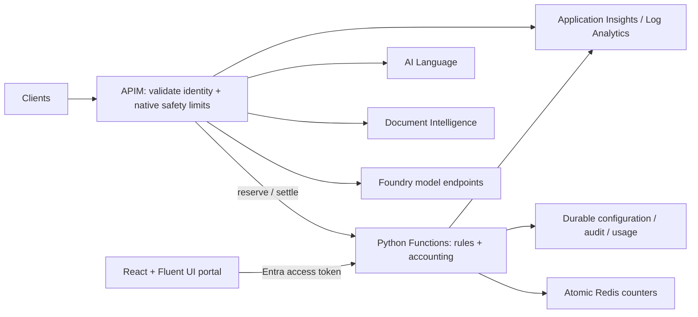

# Architecture and accounting



## APIM versus custom logic

APIM remains the gateway, not an accounting program. Native JWT/subscription validation,
`rate-limit-by-key`, optional native LLM limits, backend routing, managed identity, and response
headers remain in APIM. XML callouts delegate budget arithmetic, price selection, rule matching,
reservation, and settlement to the Function.

Do not implement custom cost enforcement by dynamically rotating APIM counter keys. The
[client-driven throttling article](https://learn.microsoft.com/azure/api-management/api-management-sample-flexible-throttling#client-driven-throttling)
demonstrates flexible *scoping*, not globally atomic financial accounting. The sample uses a
trusted server-derived principal rather than a caller-controlled `Rate-Key`.

Native APIM rate counters are gateway-scoped. Regions/workspace gateways do not collectively
enforce one monetary budget. The custom store is the authority for all configured gateways
using that store. This sample does not implement active-active cross-region ledger replication.

## Reservation lifecycle

1. Validate/authenticate the client and derive tenant-bound principal/service/model dimensions.
2. Reject unsupported operations and bound inputs/output before reservation.
3. Atomically evaluate all matching limits and reserve the conservative maximum.
4. Persist the accounting evidence required for recovery before returning an allow decision.
5. Dispatch the backend request only after admission succeeds.
6. Settle once using trusted actual usage; release only when non-dispatch/non-billable status is
   unambiguous. Retries reuse a reservation identity for accounting, not for backend execution.
7. Leave unresolved or ambiguous calls conservatively charged. Investigate/reconcile them rather
   than silently reopening budget.

The backend's exact schema, validation rules, storage behavior, and test coverage define the
executable contract. Unknown prices and unavailable decision/state services must fail closed;
an operational failure is not a budget denial and should not be misreported as `429`.

## Tokens and pricing

Store budget values as **integer micro-USD**; price cards use decimal USD strings.
Avoid binary floating-point money and round reservation charges conservatively.
Price versions used for reservations must be pinned for settlement.

For OpenAI-compatible responses, cached input is a subset of input:

```text
uncached_input = input_tokens - cached_input_tokens
cost = uncached_input * input_price
     + cached_input_tokens * cached_input_price
     + output_tokens * output_price
```

Input/output prices are normally expressed per million tokens, with conversion applied by the
Function. Reject impossible cached counts. Missing usage is not zero usage.
Provider differences require adapters; do not assume one provider's caching fields or quota
semantics apply to another.

The client cannot promise a cache hit before dispatch. Reserve undiscounted input and the bounded
maximum output, then apply reported cached discounts on settlement. This can temporarily deny a
cheap request whose worst-case cost does not fit the remaining budget. That is the deliberate
tradeoff for a conservative admission design.

APIM response caches and provider prompt caching are distinct. A gateway response-cache hit
avoids model execution; provider prompt caching reduces the reported backend charge. Any future
semantic caching must separately account for embedding/cache costs and tenant data isolation.

## Streaming

APIM forwards the response stream without buffering it through the rate-limiter Function.
It cannot obtain exact input/output/cache usage from arbitrary SSE traffic using a normal
outbound XML expression. Reserve a bounded worst case, show it as estimated, and settle only from
a trusted usage source. Never count SSE chunks as tokens (the old sample's heuristic is not valid).

Without a trusted usage record, the conservative charge remains. There is no promise that model
telemetry is always complete or prompt enough for invoice-quality reconciliation. Missing and
disconnected streams must remain visible operationally.

## Document Intelligence and Language

Document Intelligence analysis is asynchronous. Submission and polling have different accounting
semantics; polling must not repeatedly debit an analysis budget. Returned operation URLs must
point through APIM, and results must be bound to the submitting identity. An arbitrary URL/PDF
cannot be assigned a trustworthy page count merely from a client header. Restrict supported
inputs or reserve an enforced upper bound when exact page units are not known.

Language text records are derived from supported operation semantics, including per-document
rounding and batch validation. A batch's total character count divided by 1000 can undercount
relative to rounding each document separately. Unsupported operations must be rejected rather
than charged zero.

## Why Redis, and why not Redis alone?

| Option | Strength | Limitation for this sample |
| --- | --- | --- |
| Redis atomic scripts | Low-latency check-and-reserve across counters and idempotency records | Failover/cache loss, hot keys, topology restrictions, sovereign-cloud lifecycle |
| Azure Table Storage | Low-cost durable configuration/events; Entra identity; both clouds | ETags/transactions partition-scoped; retry contention and multiple trips for hot limits |
| Cosmos DB | Durable low-latency data and partition transactions | RU/partition design, contention, cost; not intrinsically faster atomic multi-principal budgets |
| Azure SQL | Durable transactions and mature consistency | More operational/schema cost and contention than needed for a reference hot counter |
| Function memory | Simple test double | Not shared across workers; unsafe as production rate-limit state |
| APIM counters | Native and efficient burst protection | Approximate/gateway-scoped, no differentiated cached-token price catalog |

Choose Redis for the **hot path**, durable storage for configuration/accounting, and fail closed
on unproven recovery. Lua atomicity is not durable exactly-once execution. A successful Redis
write and failed durable write is an ambiguity to retain/recover, not an excuse to allow without
evidence. Redis and Table Storage do not form a distributed ACID transaction.

The reference implementation deliberately uses one Redis hash/slot and one Table partition to
make cross-rule atomicity and recovery comprehensible. This limits horizontal scaling; historical
reservation records are not automatically archived or expired. Table queries/persistence are
also on the admission path. Benchmark the whole system and design retention/partitioning before
production rather than extrapolating Redis-only latency numbers.

Commercial's Managed Redis and Government's legacy Cache for Redis differ in resource shape,
endpoints, authentication, and support lifetime. A data-plane interface reduces coupling but does
not itself solve service retirement. Revalidate Government alternatives before production.

## Security and cloud boundaries

- Azure Functions Easy Auth validates access tokens before trusted principal headers are used.
  Checking a JWT payload without signature/issuer/audience validation is insufficient.
- Workload `RateLimit.Gateway` and user `RateLimit.Admin`/`RateLimit.Reader` roles are distinct.
- Consumer queries are scoped on the server, not just hidden in React.
- Backend service calls use user-assigned managed identity and least-privilege RBAC.
- Do not log prompts, document contents, access tokens, subscription keys, or raw request bodies.
- Parameterize authority, audiences, endpoint URLs, provider environment, API versions, and model
  deployment configuration. Never automatically redirect Government traffic to Commercial.
- Private endpoints alone do not ensure reachability: APIM/Functions/App Service outbound
  integration and policy-managed DNS must resolve the private services.

## Observability and operations

Correlate APIM request IDs, reservation IDs, rule IDs, price versions, service/model, estimated
versus actual consumption, denial reason, latency, and failure category. Native diagnostics and
Application Insights complement the durable usage view; sampled telemetry is not the budget
ledger. Avoid high-cardinality principal IDs as custom metric dimensions; use structured events
and scoped table queries.

Before production, measure end-to-end admission latency, Redis contention, storage persistence
latency, recovery behavior, and the overreservation rate. Document the expected load, availability,
recovery objectives, and spend exposure for the actual deployment rather than claiming universal
sub-millisecond latency or mathematically exact Azure invoice parity.
