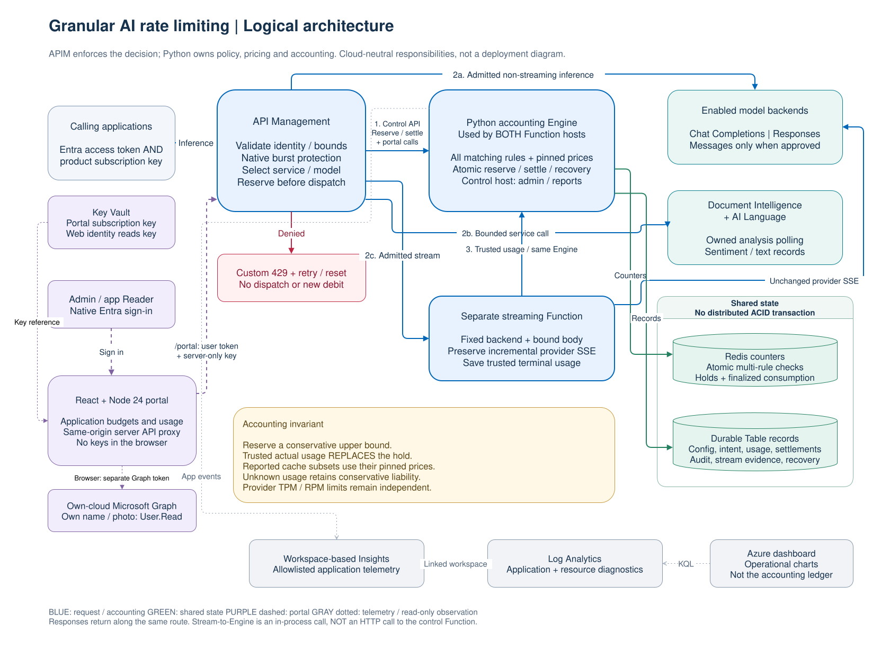
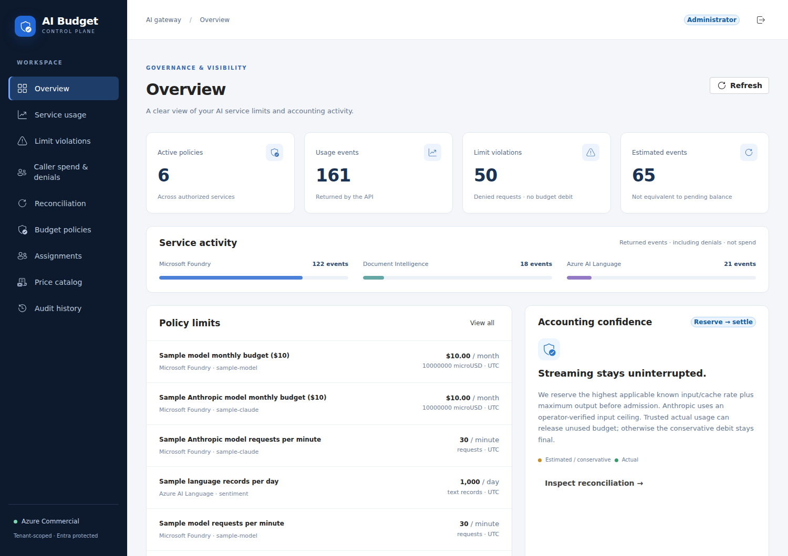

# APIM granular AI rate limiting

A reference sample for **Azure API Management + Microsoft Foundry + Python Azure
Functions**, with a **React + Microsoft Fluent UI** administration portal.

The deployed portal requires native **Microsoft Entra ID** sign-in, using its
Terraform-managed registration and secretless web-identity federation. MSAL
separately obtains user-scoped API tokens. A same-origin server proxy adds its
server-only APIM subscription key; see [identity boundaries](docs/azure-topology.md#identity-and-token-boundaries).

Terraform manages a native Foundry **`AIServices`** account. Existing OpenAI
accounts can be [upgraded without replacing their model deployments or endpoints](docs/deployment.md#upgrade-an-existing-openai-account).

APIM handles authentication, native burst protection and routing. Python owns
per-application/service/model budget decisions, versioned pricing and usage accounting.
Redis supplies atomic hot counters; Azure Table Storage retains configuration,
accounting evidence and audit history.

**Every APIM request needs both Entra authorization and a product subscription
key.** Budgets follow the validated APIM **subscription ID**, not a person or the
secret key value. Primary/secondary keys and rotations share an application's
allowance; two subscriptions have separate allowances, even for the same user.
The [application cutover guide](docs/deployment.md#application-subscription-cutover)
explains existing-data migration and reader access.

[Full-size logical view](docs/diagrams/logical-architecture.svg) |
[Editable draw.io source](docs/diagrams/logical-architecture.drawio) |
[Physical deployment views](docs/diagrams/README.md).
The [architecture guide](ARCHITECTURE.md) explains the component boundaries.

## What this adds to APIM

Native token limits do not express a price catalog with separate input, output,
cache-read and cache-write rates. This sample reserves a conservative allowance
before execution, then settles trusted usage at configured prices. A separate
streaming Function observes provider SSE usage without buffering the whole response.

**Cache-aware settlement does not imply optimistic admission.** Unknown cache hits
cannot be spent in advance; missing usage retains conservative liability. Provider
TPM/RPM limits still apply independently.

| API | Gateway route | Accounting |
| --- | --- | --- |
| OpenAI Chat Completions | `POST /foundry/chat/completions` | Input/output and cached-input subset |
| OpenAI Responses | `POST /foundry/responses` | Input/output and cached-input subset |
| Anthropic Messages | `POST /anthropic/v1/messages` | Uncached input, cache reads, 5-minute/1-hour writes, output |
| Document Intelligence | `POST /document-intelligence/analyze?pages=1-N` | Bounded pages; owned asynchronous polling |
| AI Language | `POST /language/sentiment` | Per-document text records |

These are native wire protocols, not conversions to Chat Completions. Only bounded
inline text/client-executed tools and the listed service operations are supported;
see the [gateway contract](apim/README.md).

## See it in action

This historical capture predates the square-edged portal and subscription-based
reports. Current screens use application subscriptions, not user budgets.

Live Commercial demo capture, with account identity hidden. Counts are returned
events, not spend or live balances; configured Claude policies do not prove an
enabled Claude backend. The [illustrated walkthrough](docs/rate-limiting-walkthrough.md)
shows pricing, policy editing, an inference request and caller investigation.

For Cody's original questions, start with the
[dashboard review and example charts](docs/observability.md#review-against-codys-requirements):
cost by service/model, differentiated cache tokens, who is denied, and why.
These are operational observations at configured sample prices, not Azure invoices.

## Documentation: choose a starting point

Each guide owns a different concern. Detailed contracts and procedures are linked
rather than repeated in component READMEs.

| I want to... | Read |
| --- | --- |
| Understand components, data flows and why Redis is used | [Architecture](ARCHITECTURE.md) |
| View or edit logical, deployed public and private-reference diagrams | [Draw.io architecture diagrams](docs/diagrams/README.md) |
| Understand holds, refunds, caching, concurrency and failure semantics | [Reservation system](docs/reservation-system.md) |
| Configure a policy and investigate a real request, with screenshots | [Operator walkthrough](docs/rate-limiting-walkthrough.md) |
| Understand Azure resources, networking, identities and token audiences | [Azure topology and identity](docs/azure-topology.md) |
| Find entry points, dependency injection, storage records and extension points | [Code guide](docs/code-guide.md) |
| Set runtime values or call the control-plane APIs | [Configuration reference](docs/configuration-reference.md) |
| Add approved model aliases, prices and pooled policies | [Model registry](docs/model-registry.md) |
| Check accepted inference payloads and gateway headers | [APIM contract](apim/README.md) |
| Run locally, debug, or execute checks | [Local development](docs/local-development.md) |
| Deploy to an explicitly selected cloud | [Deployment runbook](docs/deployment.md) |
| Set Terraform inputs, enable a protocol, or package azd services | [Infrastructure reference](infra/README.md) |
| Understand the React portal, runtime config, privacy or GUI testing | [Portal guide](web/README.md) |
| Read Azure charts, correlate logs or diagnose telemetry gaps | [Observability guide](docs/observability.md) |
| Recover counters or complete operational acceptance | [Operations](docs/operations.md) |

## Develop

Use Python 3.12+, [uv](https://docs.astral.sh/uv/), Node.js 24 LTS,
and Terraform 1.9+. Start with [local setup](docs/local-development.md); it covers
the API, portal demo, separate streaming host, Redis/Azurite, VS Code tasks and
warning-free validation commands.

The root `function_app.py` and `stream/function_app.py` are different deployment
entry points. Do not combine their HTTP-hosting modes.

## Deploy and cloud boundaries

Deployment uses **azd + Terraform**, a pre-created resource group, and explicit
cloud, model, quota, identity, pricing and network inputs. Follow the
[deployment runbook](docs/deployment.md), not a bare `azd up` copied into an
unconfigured environment. Private mode requires an appropriately connected runner.

Commercial and Government are explicit configurations, not interchangeable
endpoint suffixes. Responses and Messages are opt-in capabilities. Government
Responses needs independent verification; Government Anthropic enablement is
rejected because sovereign provider availability is not established.

Commercial uses Azure Managed Redis. The Government compatibility path uses
Azure Cache for Redis with its documented **September 30, 2028** retirement gate;
approve a supported migration before a production lifetime commitment.

This is a sample, not a financial billing system, provider-availability guarantee,
or GCCH/FedRAMP certification. The `SecurityControl=Ignore` tag is an approved-demo
exception, not a recommended production setting. Local tests do not certify live
cloud access, policy compilation, private DNS or interactive client compatibility.

## Contributor guidance and implementation history

[AGENTS.md](AGENTS.md), [.github/copilot-instructions.md](.github/copilot-instructions.md)
and [language/tooling instructions](.github/instructions/) define contributor
automation rules. They intentionally serve different tooling entry points.

[Implementation plans](.github/plans/) are historical execution records. Their
counts, checklists and original design choices describe their respective work
items; they are not current setup instructions or a substitute for the guides above.

## Sources

- [APIM advanced request throttling](https://learn.microsoft.com/azure/api-management/api-management-sample-flexible-throttling)
- [APIM LLM token limits](https://learn.microsoft.com/azure/api-management/llm-token-limit-policy)
- [Original custom rate limiter sample](https://github.com/ThePreston/Custom-Rate-Limiter-API)
- [Azure Government comparison](https://learn.microsoft.com/azure/azure-government/compare-azure-government-global-azure)
- [Foundry cloud/region support](https://learn.microsoft.com/azure/foundry/reference/region-support)
- [OpenAI Responses on Azure](https://learn.microsoft.com/azure/foundry/openai/how-to/responses)
- [Claude in Foundry](https://platform.claude.com/docs/en/build-with-claude/claude-in-microsoft-foundry)
- [Anthropic caching semantics](https://platform.claude.com/docs/en/build-with-claude/prompt-caching)

## Disclaimer

THE SOFTWARE IS PROVIDED "AS IS", WITHOUT WARRANTY OF ANY KIND, EXPRESS OR IMPLIED,
INCLUDING BUT NOT LIMITED TO THE WARRANTIES OF MERCHANTABILITY, FITNESS FOR A
PARTICULAR PURPOSE AND NONINFRINGEMENT. See [LICENSE](LICENSE).
