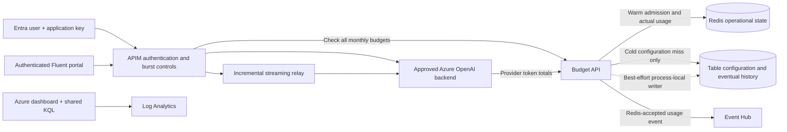

# APIM monthly AI dollar budgets

An **Azure API Management + Azure OpenAI + Python Azure Functions** sample with
a Microsoft Fluent UI React administration portal. It accounts for actual tokens
after each request and enforces monthly USD budgets for **users, teams and
departments**. Cached input is priced separately from uncached input and output.

**These are approximate operational spending limits.** The gateway checks Redis-recorded spend before
execution, without holding funds. Already-running requests can exceed a budget;
the next request is denied while that spend remains in Redis. Redis data loss can
reset spend. Inference latency takes priority over accounting durability.
Native APIM RPM/TPM protection and provider capacity quotas remain independent of dollars.

Only OpenAI **Chat Completions** and **Responses** are in scope. APIM validates
both Entra authorization and a product subscription key, then routes approved
model aliases through native APIM backend entities. Budgets follow the validated
Entra user, not the subscription key. The subscription identifies the calling
application for attribution. Organizational membership is explicitly configured.

Completed provider usage updates Redis at a pinned price version. Request/usage
Table writes run in a bounded in-process background queue and can be lost.
Live spend and persisted history/chargeback can therefore differ permanently.
The Function publishes the Redis-accepted event to Event Hubs in the background
with the Microsoft `azure-eventhub` SDK and its managed identity; neither
acceptance nor export proves Table persistence.
The Azure dashboard and the portal share the deployed dashboard's KQL definitions.

## Architecture



This is a simplified request flow. The editable
[logical and physical diagrams](docs/diagrams/README.md) add the web app, Key
Vault, Application Insights, the optional streaming host, identities and the
private networking (VNet, subnets, private endpoints) around these components.

Redis caches shared configuration for 60 seconds by default, request context and
usage replay markers for 24 hours, and monthly user/team/department wildcard/model
counters for about 62 days. Warm admission never reads Table. Redis unavailability
fails closed with `503`, without Table fallback; exhausted budgets, including zero
limits, return `429`. No automatic ledger rebuild restores lost Redis state.
Admin configuration writes remain synchronous, durable-first and invalidate the
shared cache. See [operations](docs/operations.md) for accepted data-loss limits.

## Why a custom accounting engine

APIM's native `llm-token-limit` policy counts tokens per minute or per period.
It cannot express **dollars per model** or **discounted cached input**: a million
tokens costs a different amount on each model, and cached tokens cost less than
uncached ones. The sample therefore keeps native APIM protection for bursts
(requests and tokens per minute) and adds a small Python accounting engine for
monthly USD budgets. Everything else uses native Azure features:

* APIM `validate-jwt`, subscription keys, managed identity to the model account,
  and native backends for approved model aliases.
* Event Hubs for usage events (published by the Function), Azure Managed Redis for live spend, and Table
  Storage for configuration and eventual history.
* Application Insights, Log Analytics and the shared Azure dashboard.

## How the cost math works

Each completed response reports final provider token counts. The engine prices
them with the model's **versioned price card**, in USD per million tokens:

* **Uncached input** (input minus cached tokens) at the input rate.
* **Cached input** at its discounted rate.
* **Cache-write** tokens at their own rate where a price card defines one; a
  counter with no price is treated as unknown usage, never as free.
* **Output** at the output rate. Reasoning tokens are already part of output
  tokens and are never counted a second time.

Each model alias pins a price version, so editing prices does not change calls
already in flight. The total becomes integer micro-USD and is added to the
user's, team's and department's monthly counters. A budget is a monthly dollar
limit; the next request is denied with `429` once any of them is exhausted. See
[token accounting](docs/token-accounting.md) for streaming totals, unknown usage
and rounding.

## Documentation

| Concern | Guide |
| --- | --- |
| Responsibilities, accounting and failure behavior | [Architecture](ARCHITECTURE.md) |
| Monthly budgets, organization hierarchy and APIs | [Configuration](docs/configuration-reference.md) |
| Streaming totals and unknown usage | [Token accounting](docs/token-accounting.md) |
| Cost centers and monthly exports | [Chargeback](docs/chargeback.md) |
| Dashboard, telemetry and Event Hub delivery limits | [Observability](docs/observability.md) |
| Runtime identities and networking | [Azure topology](docs/azure-topology.md) |
| Safe cutover from the previous ledger | [Migration](docs/migration.md) |
| Local development, tests and debugging | [Development](docs/local-development.md) |
| Cloud configuration and deployment | [Deployment](docs/deployment.md), [infrastructure](infra/README.md) |
| Entry points and module boundaries | [Code guide](docs/code-guide.md) |
| Approved model aliases | [Model registry](docs/model-registry.md) |
| Gateway and portal details | [APIM](apim/README.md), [portal](web/README.md) |

## Deploy and verify

Prerequisites: the [Azure Developer CLI](https://learn.microsoft.com/azure/developer/azure-developer-cli/)
(`azd`), `uv`, Terraform 1.9+, Node.js 24 LTS, an existing resource group with
the network and private DNS pre-created, and a storage account for Terraform state.

1. Create an environment and set every value in
   [`infra/environment.example.json`](infra/environment.example.json) with
   `azd env set <NAME> <value>`, including the remote state coordinates
   (`RS_RESOURCE_GROUP`, `RS_STORAGE_ACCOUNT`, `RS_CONTAINER_NAME`).
   To deploy real models, set `MANAGED_MODELS` from
   [`infra/managed-models.example.json`](infra/managed-models.example.json).

   ```bash
   azd env new <environment-name>
   azd env set AZURE_LOCATION <region>
   ```

2. Provision and deploy. The pre-provision hook (`infra/scripts/preflight.sh`)
   fails fast on missing settings.

   ```bash
   azd up
   ```

3. Seed organizations, assignments, prices and budgets through the portal API
   (`API_BASE_URL`). The tool previews by default; see
   [local development](docs/local-development.md) for its settings.

   ```bash
   uv run python scripts/seed.py
   uv run python scripts/seed.py --apply
   ```

4. Call the gateway. Open [`examples/gateway.http`](examples/gateway.http) in
   VS Code (REST Client) or another HTTP client and set `gateway` to
   `azd env get-value GATEWAY_URL`, a delegated user token for `API_SCOPE`, and
   an inference product subscription key. A private deployment needs private
   routing to the gateway.
5. See the results. Open `azd env get-value AZURE_DASHBOARD_URL` for the Azure
   dashboard, or sign in to the portal at `WEB_URL` and open **Azure dashboard**.

Deployment details are in [deployment](docs/deployment.md), local setup in
[local development](docs/local-development.md) and acceptance checks in
[operations](docs/operations.md).

## Clean up

```bash
azd down --purge
```

This destroys the Terraform-managed resources and purges soft-deleted ones so
their names can be reused. The pre-created resource group, network and
Terraform state storage are not managed here and remain.

## Develop

Use Python 3.12+, `uv`, Node.js 24 LTS and Terraform 1.9+.

```bash
uv sync --extra dev
uv run ruff check .
uv run mypy src/
uv run pytest -W error
```

The repository includes VS Code tasks and launch configurations. Do not deploy
local authentication bypasses. Deployment uses **azd + Terraform**, an existing
resource group and explicitly selected Azure Commercial or Government endpoints.
Government service availability, private connectivity and GCCH authorization
require independent approval; this sample is not a compliance certification or
an Azure invoice.

Historical plans under `.github/plans/` are execution records, not current
operating instructions. The dollar-budget cutover removes the former monetary
hold/settlement system rather than maintaining two enforcement mechanisms.
