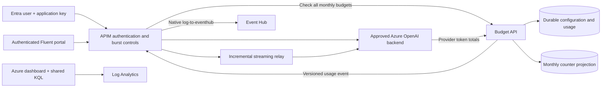

# APIM monthly AI dollar budgets

An **Azure API Management + Azure OpenAI + Python Azure Functions** sample with
a Microsoft Fluent UI React administration portal. It accounts for actual tokens
after each request and enforces monthly USD budgets for **users, teams and
departments**. Cached input is priced separately from uncached input and output.

**These are soft spending limits.** The gateway checks recorded spend before
execution, without holding funds. Already-running requests can exceed a budget;
the next request is denied. Native APIM RPM/TPM protection and provider capacity
quotas remain independent of dollars.

Only OpenAI **Chat Completions** and **Responses** are in scope. APIM validates
both Entra authorization and a product subscription key, then routes approved
model aliases through native APIM backend entities. Budgets follow the validated
Entra user, not the subscription key. The subscription identifies the calling
application for attribution. Organizational membership is explicitly configured.

Completed provider usage becomes one durable record at a pinned price version.
APIM publishes its privacy-safe projection with native **`log-to-eventhub`** and
managed identity. Export is best effort, not a financial delivery guarantee. The
Azure dashboard and the portal share the deployed dashboard's KQL definitions.

## Architecture



## Documentation

| Concern | Guide |
| --- | --- |
| Responsibilities, accounting and failure behavior | [Architecture](ARCHITECTURE.md) |
| Monthly budgets, organization hierarchy and APIs | [Configuration](docs/configuration-reference.md) |
| Streaming totals and unknown usage | [Token accounting](docs/token-accounting.md) |
| Cost centers and monthly exports | [Chargeback](docs/chargeback.md) |
| Dashboard, telemetry and Event Hub delivery limits | [Observability](docs/observability.md) |
| Runtime identities and networking | [Azure topology](docs/azure-topology.md) |
| Safe cutover from the previous ledger | [Migration](docs/migration.md) |
| Local development, tests and debugging | [Development](docs/local-development.md) |
| Cloud configuration and deployment | [Deployment](docs/deployment.md), [infrastructure](infra/README.md) |
| Entry points and module boundaries | [Code guide](docs/code-guide.md) |
| Approved model aliases | [Model registry](docs/model-registry.md) |
| Gateway and portal details | [APIM](apim/README.md), [portal](web/README.md) |

## Develop

Use Python 3.12+, `uv`, Node.js 24 LTS and Terraform 1.9+.

```bash
uv sync --extra dev
uv run ruff check .
uv run mypy src/
uv run pytest -W error
```

The repository includes VS Code tasks and launch configurations. Do not deploy
local authentication bypasses. Deployment uses **azd + Terraform**, an existing
resource group and explicitly selected Azure Commercial or Government endpoints.
Government service availability, private connectivity and GCCH authorization
require independent approval; this sample is not a compliance certification or
an Azure invoice.

Historical plans under `.github/plans/` are execution records, not current
operating instructions. The dollar-budget cutover removes the former monetary
hold/settlement system rather than maintaining two enforcement mechanisms.
