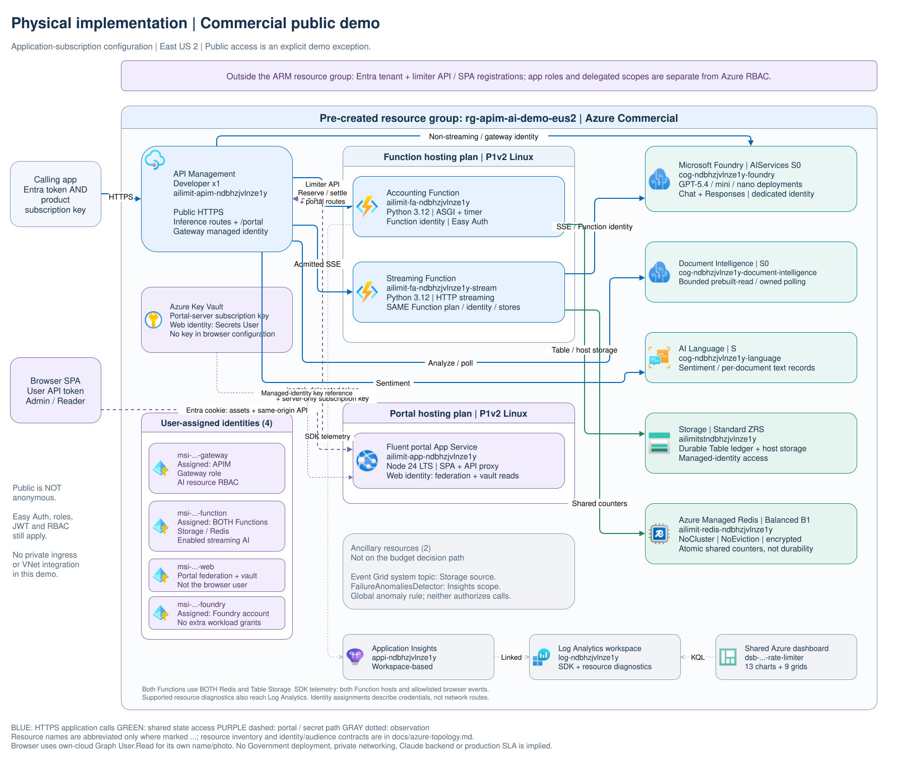
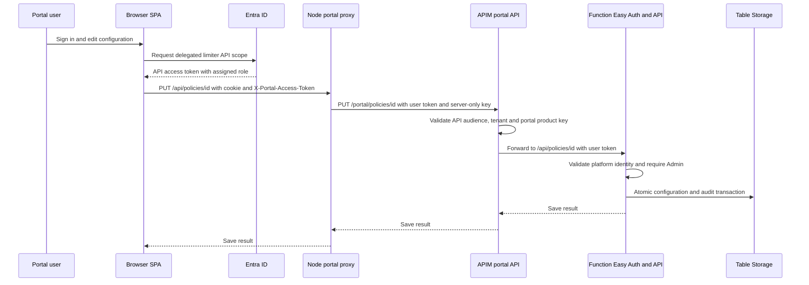
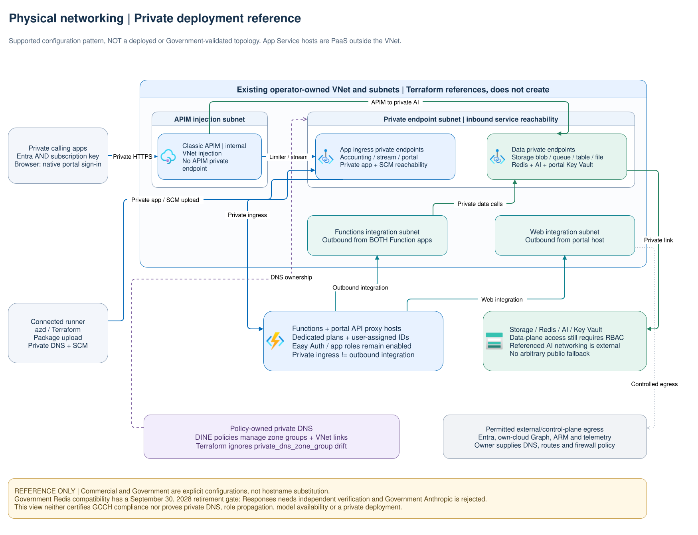

# Azure resources, networking, and identity

This guide explains the Azure deployment and its trust boundaries. It is not a
provisioning procedure; use [deployment](deployment.md) for that, and
[infrastructure inputs](../infra/README.md) for exact configuration.

## What is created, and what must already exist?

[`infra/main.tf`](../infra/main.tf) composes the modules below. The application
resource group, remote-state account/container and private-mode network/subnets
are operator-owned prerequisites, not resources silently created by the sample.

| Resource/module | Purpose and ownership |
| --- | --- |
| [Identity](../infra/modules/identity/main.tf) | Limiter API and SPA registrations, service principals, app roles, consent and three workload identities |
| [Hosting](../infra/modules/hosting/main.tf) | Linux Dedicated plans, ASGI Function, optional streaming Function, Node-hosted portal and platform authentication |
| [APIM](../infra/modules/apim/main.tf) | Gateway, explicit operations, fragments, policies, diagnostics and backend authentication |
| [Storage](../infra/modules/storage/main.tf) | Durable Table ledger and identity-authenticated Function host storage |
| [Redis](../infra/modules/redis/main.tf) | Cloud-selected shared counters and data-access assignments |
| [AI](../infra/modules/ai/main.tf) | Native Foundry with managed Chat/Responses deployments, Document Intelligence and Language; reference approved optional Messages backends |
| [Portal Key Vault](../infra/modules/portal_key_vault/main.tf) | Server-only portal subscription key, resolved by the web managed identity |
| [Monitoring](../infra/modules/monitoring/main.tf) | Linked Application Insights/workspace and shared Azure dashboard |
| [Private endpoints](../infra/modules/private_endpoints/main.tf) | Service ingress endpoints; no DNS zone/group ownership |
| [Diagnostics](../infra/modules/diagnostics/main.tf) | Supported resource logs and metrics routed to the workspace |

Two Function apps are intentional. The streaming app shares the Function plan,
identity and stores, but Microsoft Python HTTP streaming cannot be mixed into
the legacy ASGI app. Only the stream host enables `PYTHON_ENABLE_INIT_INDEXING`.

The portal's Node server serves static assets and public-safe runtime configuration
behind native App Service Entra sign-in. Its single-tenant registration supports a
Web callback for the platform session and a SPA callback for MSAL's delegated API
tokens. The attached web workload identity federates the platform's confidential
client authentication without a secret; it is **not** the browser's identity and
has no limiter API role. Logout clears both platform and MSAL sessions.

## Observed Commercial demo resource map

Read-only inventory of `rg-apim-ai-demo-eus2`, **November 6, 2026**, with the
Foundry and application-subscription upgrades. All 21
top-level resources were in East US 2 except the global anomaly rule. This is a
specific **public demo**, not the recommended private production shape or an
Azure Government validation. Names below describe roles instead of embedding
subscription, identity or credential values.

| Observed resources | Count | Relevant deployed configuration |
| --- | ---: | --- |
| APIM | 1 | Developer, capacity 1; Resource Health Available |
| Linux hosting plans | 2 | P1v2, one Function plan and one portal plan |
| Function apps | 2 | Python 3.12; accounting and separate streaming host, both Running |
| Portal App Service | 1 | Verified `NODE|24-lts`, HTTPS-only and native Entra protection |
| AI accounts | 3 | Foundry AIServices S0, Document Intelligence S0, Language S; baseline accounts in this group |
| Storage | 1 | Standard ZRS |
| Azure Managed Redis | 1 | Balanced B1; default database NoCluster / NoEviction / encrypted protocol |
| User-assigned identities | 4 | Gateway, Function, web and Foundry account boundaries |
| Key Vault | 1 | Portal key reference verified Resolved using the dedicated web identity |
| Log Analytics / Application Insights / dashboard | 3 | Linked workspace, SDK destination and shared query dashboard |
| Failure anomaly rule | 1 | Enabled `FailureAnomaliesDetector`, scoped to Application Insights |
| Event Grid system topic | 1 | Storage-account source; ancillary resource, not part of reserve/settle |

[Full-size Commercial view](diagrams/physical-commercial.svg) |
[Editable physical draw.io source, page 1](diagrams/physical-architecture.drawio) |
[Editing/export instructions](diagrams/README.md).
Containers show actual resource-group and hosting relationships, not VNet
placement. Both Function apps use both stores; representative green connectors
avoid drawing four overlapping state paths. Identity assignments and secondary
telemetry paths are annotated rather than mistaken for inference routes.

The inventory includes ancillary resources without inventing a dependency on
them: the Event Grid topic is not a budget-update queue, and the anomaly rule
does not authorize requests. Azure control-plane inventory omits Entra directory
objects and child resources such as APIs, model deployments, database settings
and diagnostic settings. Those remain described by their module contracts above.
Model routes and externally referenced accounts must be checked separately;
the presence of a Claude price/policy record does not establish a Claude backend.
The current Foundry account has actual `gpt-5.4`, `gpt-5.4-mini` and `gpt-5.4-nano`
deployments, each exposed through Chat and Responses. The original sample-named
deployment is preserved but excluded from the active model registry.

## Identity and token boundaries

The website's sign-in session and API token destinations are separate:

| Request path | Token audience/identity | Authorization |
| --- | --- | --- |
| Browser to portal website/config/assets | Portal registration's tenant-specific Entra sign-in | App Service redirects unauthenticated browsers; dedicated web identity authenticates its token exchange |
| AI client to APIM inference route | Configured `GATEWAY_CLIENT_AUDIENCE` **and** inference product subscription key | APIM validates both; stable subscription ID selects the app's budgets, JWT identifies the actor |
| Browser to same-origin `/api` proxy | Native website cookie plus delegated limiter token in `X-Portal-Access-Token` | Native sign-in protects the host; the proxy forwards no platform headers or caller keys |
| Portal proxy/script to APIM `/portal` | Generated limiter `API_AUDIENCE` **and** separate portal product key | APIM validates both, then forwards the user's API token unchanged to the Function |
| Web server to Key Vault | Dedicated web managed identity | Secrets User retrieves the server-only portal key through an App Service Key Vault reference |
| Browser to own Graph photo | Separate delegated `User.Read` token for same-cloud Graph | Own photo only; not a limiter token, native cookie or persisted profile record |
| APIM to reserve/settle/ownership/stream | Limiter API audience, token acquired as gateway managed identity | Easy Auth validation plus `RateLimit.Gateway` |
| APIM to non-streaming AI backend | That backend's explicit resource audience | Gateway managed identity's AI resource RBAC |
| Streaming Function to model | That backend's explicit resource audience | Function managed identity's AI resource RBAC |
| Function to Table/Redis | Service-specific SDK scope/audience | Function managed identity's data-plane permissions |

An ID token is not an API access token. Likewise, an inference token is not
automatically an admin token, and a permitted client application ID is not a role.
Easy Auth's allowed-client list, tenant/audience checks, Entra assignments and
application role checks all matter.

### Application roles versus Azure RBAC

These are different permission systems:

| Limiter app role | What the application permits |
| --- | --- |
| `RateLimit.Gateway` | Reserve, settle, conservative release, document ownership and streaming dispatch |
| `RateLimit.Admin` | Configuration writes, recovery and all authorized reporting |
| `RateLimit.Reader` | Read-only app views only for explicit tenant/subscription assignments containing that principal |

Admin does not automatically grant Gateway operations. Gateway alone does not
grant portal reporting. Entra role membership is checked on the server, not just
used to hide buttons. Reader price catalogs are visible; policies/assignments and
event reports receive the filtering in [`api.py`](../src/apim_rate_limit_foundry/api.py).
The deployer is initially assigned Admin; other users/groups require deliberate
assignments in the [identity module](../infra/modules/identity/main.tf).

Azure RBAC grants workload access to resources:

- The gateway identity receives configured AI roles: OpenAI User for the baseline
  Chat account, Cognitive Services User for created service accounts, and explicit
  verified roles for referenced protocol backends.
- The Function identity receives AI roles only for enabled streaming backends.
  Control-plane accounting does not need to impersonate an end user to the model.
- The shared Function identity receives Storage Blob Data Owner, Queue Data
  Contributor, Table Data Contributor and Storage Account Contributor in the
  current host/storage implementation.
- Redis data access uses the engine's own access-policy assignment. Azure Owner
  alone is not a Redis or Table data credential.
- Azure dashboard/workspace permissions are independent of limiter Reader/Admin.

See the actual assignments in [AI](../infra/modules/ai/main.tf),
[Storage](../infra/modules/storage/main.tf), and [Redis](../infra/modules/redis/main.tf).
Review the reference deployment's grant breadth before production; this is a
description of its permissions, not a least-privilege certification.

### Where caller identity comes from

The AI [identity fragment](../apim/fragments/identity.xml.tftpl) requires native
product subscription validation and a tenant-valid Entra JWT on every call.
It uses `context.Subscription.Id` as the application budget identity. Validated
object ID, with an authorized-party fallback, remains actor/audit metadata.
Neither key values nor caller-supplied identity headers select counters.
Terraform provisions inference and portal products separately and provides a
non-secret application registry. Keys alone and bearer tokens alone fail closed;
the original email's reject-both-credentials behavior is intentionally replaced.

The website's native token targets its portal registration. A limiter access token
must **not** replace Authorization on a request to that website, whose Easy Auth
audience is different. The SPA sends its limiter token in a dedicated header to
the same-origin proxy, which supplies the upstream Authorization header.
Graph tokens separately target `graph.microsoft.com` or `graph.microsoft.us`.
Photo errors, missing photos and denied consent fall back to initials, not a
commercial Graph endpoint or a stored image.

On the Function, [`authenticate()`](../src/apim_rate_limit_foundry/auth.py) reads
the Easy Auth principal only in the Azure-hosted, platform-authenticated path.
APIM strips spoofable principal headers on portal forwarding; App Service supplies
the validated identity. Local headers are a separate loopback-only mode forbidden
in Azure. Function trigger `ANONYMOUS` means no Function key, **not** no Easy Auth.
Even health is platform-authenticated in the deployment and does not prove Redis
readiness.

## Private networking versus public demo mode

[Full-size private reference](diagrams/physical-private.svg) |
[Editable physical draw.io source, page 2](diagrams/physical-architecture.drawio).
This page illustrates the Terraform configuration pattern; it is **not** a
deployed or Government-validated environment. App Service/Functions hosts are
PaaS outside the VNet, connected through distinct ingress and outbound mechanisms.

An ingress private endpoint does not give an application outbound VNet access.
Function and web integration subnets, APIM injection, DNS and routing must all
agree. Classic APIM uses **internal VNet injection**, not an APIM private endpoint;
its management/control-plane dependencies still require permitted routing.

Storage receives blob/queue/table/file endpoints. Function host storage is
identity-based; creating a file endpoint does not imply Azure Files credentials
are used for code deployment. SCM/Oryx deployment has its own reachability needs.

Private DNS zone groups and VNet links belong to Azure Deploy If Not Exists
policies. Terraform endpoints ignore `private_dns_zone_group` changes and do not
create competing DNS management. Referenced AI accounts retain externally owned
networking; verify their private connectivity before enabling routes.

Explicit public demo mode omits the private endpoints/VNet integration and enables
public data-plane access. It does **not** disable authentication, RBAC or request
bounds. Do not select it automatically when private deployment fails.

## Cloud-specific boundaries

`AZURE_CLOUD` in azd selects `AzureCloud` or `AzureUSGovernment`; runtime values
are `commercial` or `government`. ARM/provider, state backend, Entra authority,
service endpoints and token audiences must all refer to the same intended cloud.
There is no automatic Commercial fallback.

An endpoint hostname does not determine its Entra audience. APIM expects resource
audiences; SDK token acquisition uses `/.default` scopes. Use returned account
endpoints and verified service-specific audiences, not suffix substitution.
Government Redis's scope is an explicit verified input, not an invented
`redis.azure.us` value.

Protocol/model/SKU availability and Redis lifetime are deployment gates in
[deployment](deployment.md#government-lifecycle-gate) and
[protocol verification](../infra/README.md#protocol-enablement-and-hard-input-cap-verification).
An isolated Commercial demo does not certify Government, private-network or client
compatibility.
