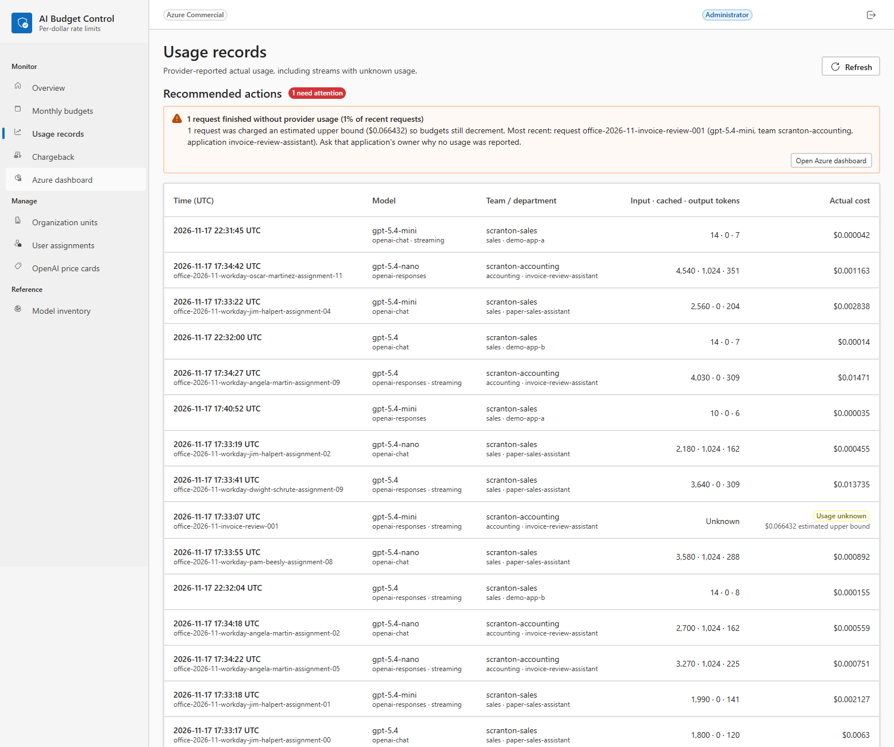
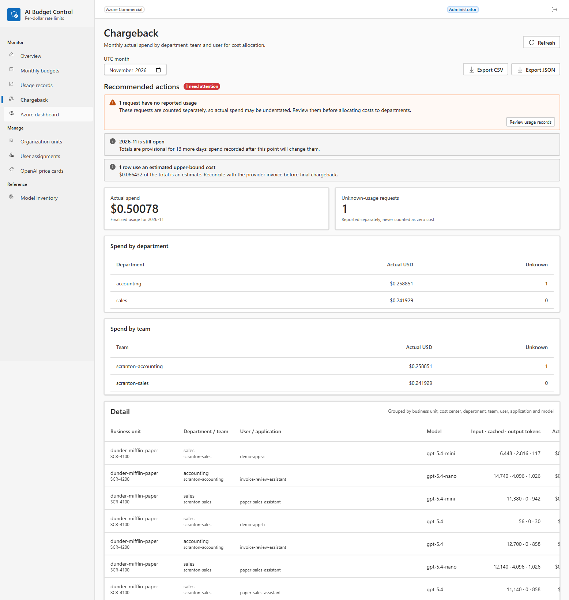

## Reporting contract

Administrators configure departments, their business-unit and cost-center codes,
teams within departments, and users assigned to those teams. The accounting
context snapshots those dimensions and the price version when the request is
checked. Later membership or price edits do not rewrite history.

`GET /api/chargeback?month=YYYY-MM&format=json` returns scoped monthly groups.
Use `format=csv` for downstream finance import. Groups preserve business unit,
cost center, department, team, user reference, application subscription and model.

Sum **one cost per actual request**, not user plus team plus department counters.
Unknown requests are separately counted in `unknown_requests`. Their cost is not
assumed zero: they carry an estimated upper bound (`cost_basis` is
`estimated_upper_bound`) priced from the model's pinned token limits, so they can
overstate spend. The CSV ends with `cache_write_tokens` and `cost_basis` columns.
`GET /api/usage` reads one month at a time (`month=YYYY-MM`, default current
month). Reports read eventually persisted Table history, not live Redis
balances. The process-local background writer can lose request/usage writes on
restart, failure or saturation; history can lag or permanently differ from live
spend. Redis loss can also reset spend without changing retained Table history.
There is no automatic rebuild or financial-completeness guarantee. Investigate
unknown records and missing history against independent provider evidence before
using an export for finance; the export alone cannot establish completeness.
See [operations](operations.md#redis-availability-and-accepted-loss) for the
shared Table/export queue and its loss behavior.

Event Hub events carry the same dimensions, token counts, price version,
micro-USD cost and stable event ID. Downstream consumers should deduplicate by
event ID and tolerate schema evolution. An event means Redis accepted accounting,
not that Table persisted it. Compare retained history and downstream events to
investigate gaps, but either side can be missing data permanently.
Event Hub publication is best effort; its absence is not evidence that
the user consumed nothing.

This is configured internal showback/chargeback, not an Azure invoice. Shared
platform hosting costs, taxes, discounts and currency conversion are outside
the sample. No external finance adapter or accounting platform is deployed.

See [configuration](configuration-reference.md) for organization and price
records, [token accounting](token-accounting.md) for cost calculations and
[observability](observability.md) for the separate operational dashboard.

## Portal reports

These captures show the running portal with fictional demonstration history and
gateway test activity. Signed-in profiles and identifying fields are hidden.

### Usage records

Open **Usage records** to inspect each persisted request's protocol, streaming
flag, input/cached/output tokens and charge. The example includes an unknown-usage
request: its row shows an estimated upper-bound charge rather than invented
token counts or a zero cost.

### Chargeback exports

Open **Chargeback**, select a UTC month and review department and team allocation
before exporting CSV or JSON. The warnings identify an open reporting month and
estimated charges. Totals can include those estimates, even where the interface
labels a summary "Actual spend"; they are not exclusively provider-reported
actuals or an Azure invoice.

