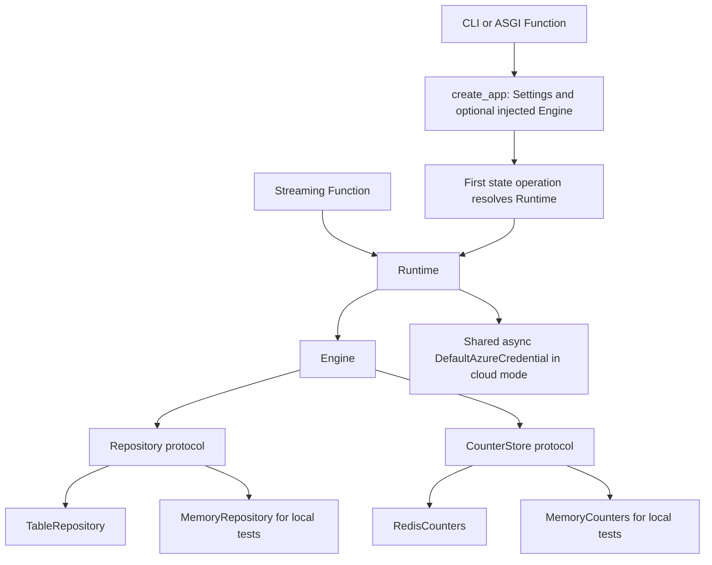

# Code guide: entry points, dependencies, and extension points

Use this guide to navigate the implementation rather than infer behavior from
directory names. Public request contracts are in the
[configuration reference](configuration-reference.md) and [APIM contract](../apim/README.md);
accounting mechanics are in the [reservation guide](reservation-system.md).

## Three runnable services

| Entry point | Runs | Deployment/package |
| --- | --- | --- |
| [`main.py`](../src/apim_rate_limit_foundry/main.py) | Loopback FastAPI CLI, useful for local development | `uv run apim-rate-limit-foundry`; not another Azure service |
| Root [`function_app.py`](../function_app.py) | ASGI Function and reconciliation timer | azd `api`; [package-function.sh](../infra/scripts/package-function.sh) |
| [`stream/function_app.py`](../stream/function_app.py) | Dedicated HTTP-streaming Function | azd `stream`; [package-stream.sh](../infra/scripts/package-stream.sh) |
| [`web/server/index.mjs`](../web/server/index.mjs) | Static portal and public runtime-config endpoint | azd `web`; [package-web.sh](../infra/scripts/package-web.sh) |

[`azure.yaml`](../azure.yaml) binds service names to Terraform outputs and hooks.
The stream package builds a project wheel and exports frozen dependencies; the
root `.funcignore` excludes that separate host. The portal package contains
`dist/`, `server/`, and `package.json`, not source tests or runtime `node_modules`.

Do not enable Python HTTP-stream indexing on the ASGI host or merge the two hosts.
The stream handler's base `Response` return annotation is intentional: an otherwise
plausible response union failed actual Azure worker indexing.
The local FastAPI CLI does not run the Functions reconciliation timer; use the
root Functions host when validating scheduled replay/finalization.

## Dependency construction and lifetime



[`create_app(settings, engine)`](../src/apim_rate_limit_foundry/api.py) lets tests
inject an Engine without Azure calls. Otherwise it constructs
[`Runtime`](../src/apim_rate_limit_foundry/runtime.py) on first state access.
FastAPI lifespan closes its repository, counters and credential.

Runtime selects in-memory local stores, paired persistent local Redis/Azurite, or
cloud Table/Redis with async Azure credentials. Local connection strings and auth
bypasses are rejected by [`Settings`](../src/apim_rate_limit_foundry/config.py)
in Azure. The stream host also retains a process-local Runtime but requires a
real credential for model dispatch; it is not a credential-free inference mock.

Settings are the centralized environment contract. The auth and store boundaries
are explicit dependencies, not global database imports hidden inside handlers.

### Example: test an API boundary without Azure

Run this with `uv run python -` from the repository root. It injects the real
Engine with in-memory stores and exercises the HTTP role boundary, not a mock
identity accepted by a deployed service:

```python
import asyncio

import httpx

from apim_rate_limit_foundry.api import create_app
from apim_rate_limit_foundry.config import Settings
from apim_rate_limit_foundry.engine import Engine
from apim_rate_limit_foundry.stores.memory import MemoryCounters, MemoryRepository


async def main() -> None:
    settings = Settings(
        _env_file=None, azure_tenant_id="tenant-example",
        local_auth_enabled=True, local_store_enabled=True, telemetry_enabled=False,
    )
    engine = Engine(MemoryRepository(), MemoryCounters(), settings)
    app = create_app(settings, engine)
    headers = {
        "X-Local-Tenant-Id": "tenant-example",
        "X-Local-Principal-Id": "reader-example",
        "X-Local-Roles": "RateLimit.Reader",
    }
    async with httpx.AsyncClient(
        transport=httpx.ASGITransport(app=app), base_url="http://test",
    ) as client:
        response = await client.get("/api/policies", headers=headers)
        assert response.status_code == 200 and response.json() == []
        denied = await client.delete("/api/policies/not-present", headers=headers)
        assert denied.status_code == 403
    print("Reader can list authorized policies but cannot delete them.")


asyncio.run(main())
```

Local headers are forbidden in Azure. For reserve/settle test arrangements and
seeded stores, follow [the existing fixtures](../tests/conftest.py) and
[API role/scoping tests](../tests/test_api.py), rather than adding an auth bypass.

## Where a change belongs

Registry configuration and price pins are deployment data, not a reason to add
per-model branches. See [model registry](model-registry.md) for the runtime
allowlist, discovery and the alias/provider boundary.

| Concern | Primary source |
| --- | --- |
| HTTP routes, roles and exception mapping | [`api.py`](../src/apim_rate_limit_foundry/api.py), [`auth.py`](../src/apim_rate_limit_foundry/auth.py) |
| Matching, UTC windows and decimal unit/cost arithmetic | [`accounting.py`](../src/apim_rate_limit_foundry/accounting.py) |
| Reserve/settle orchestration, reports, ownership and recovery | [`engine.py`](../src/apim_rate_limit_foundry/engine.py) |
| Typed contracts and validation | [`models/`](../src/apim_rate_limit_foundry/models/) |
| Provider-specific usage interpretation | [`normalization/`](../src/apim_rate_limit_foundry/normalization/) |
| SSE state machine, dispatch and saved-evidence replay | [`streaming/`](../src/apim_rate_limit_foundry/streaming/) |
| Counter/repository interfaces and adapters | [`stores/contracts.py`](../src/apim_rate_limit_foundry/stores/contracts.py), [`stores/`](../src/apim_rate_limit_foundry/stores/) |
| Canonical summary and caller projections | [`reports/`](../src/apim_rate_limit_foundry/reports/) |
| Request correlation, SDK setup and safe event schemas | [`request_telemetry.py`](../src/apim_rate_limit_foundry/request_telemetry.py), [`monitoring.py`](../src/apim_rate_limit_foundry/monitoring.py), [`telemetry.py`](../src/apim_rate_limit_foundry/telemetry.py) |
| Native payload validation and routing | [`apim/policies/`](../apim/policies/) and [`apim/fragments/`](../apim/fragments/) |
| React authentication/API boundary | [`main.tsx`](../web/src/main.tsx), [`auth.ts`](../web/src/auth.ts), [`api.ts`](../web/src/api.ts) |
| Portal navigation, editor and caller view | [`Portal.tsx`](../web/src/Portal.tsx), [`RecordEditor.tsx`](../web/src/RecordEditor.tsx), [`CallerReport.tsx`](../web/src/components/CallerReport.tsx) |

The stream relay is transparent transport, not an agent framework conversation:
it must preserve provider bytes and usage semantics rather than transform them
through a higher-level generation API.

## Durable record collections

[`TableRepository`](../src/apim_rate_limit_foundry/stores/table.py) uses one
`PartitionKey="ledger"` and a digest of collection/record ID for its row key.
The serialized payload contains the application's record, not arbitrary request
or completion content.

| Collection | Why it exists |
| --- | --- |
| `policies`, `prices`, `assignments` | Validated control-plane configuration |
| `audit` | Configuration snapshots/actions and recovery audit |
| `intents` | Original request bounds, price snapshot, fingerprint and policy-window debits |
| `usage` | Durable allow/deny and original reservation evidence |
| `settlements` | One canonical final accounting result per reservation |
| `reconciliation` | Settlement/pending history; not necessarily a current outstanding-work list |
| `operations` | Document operation ownership and reservation binding |
| `stream_dispatches` | Single-dispatch claim for a streaming reservation |
| `stream_usage` | Validated bounded provider metadata saved before settlement for retry |

`create()` is create-or-return-existing, supporting idempotent records. Configuration
mutation and its audit use a same-partition Table transaction. Redis finalization
and Table persistence are separate operations, not a distributed transaction.

The API's `/usage` overlays final values and strips the pinned price from its
response. Do not use that view to recover the original reserved amount. Summaries
scan durable admissions and final settlements on read; there is no separate rollup
database, background aggregation queue or automatic retention process.

## Idempotency and recovery are not provider retries

The reservation ID binds tenant, application subscription and the gateway-generated
request ID. The authenticated principal remains audit metadata.
[`fingerprints.py`](../src/apim_rate_limit_foundry/fingerprints.py) distinguishes
identical accounting retries from conflicting reuse. Redis
[`RESERVE`/`FINALIZE`](../src/apim_rate_limit_foundry/stores/scripts.py) prevent
duplicate debit/refund.

A fresh client HTTP retry normally gets a fresh APIM ID. Accounting idempotency
does not guarantee one provider execution across those separate requests.
Streaming additionally has a durable dispatch claim and SHA256 body binding.
Recovery reconstructs counters; it never replays AI inference.

## Extending the sample safely

For a new service or protocol, update the directly dependent layers together:

1. Define bounded request/usage contracts and supported billing dimensions.
2. Add gateway admission, routing and trusted usage extraction; fail closed on
   unknown semantics rather than assigning zero usage.
3. Implement normalization and pricing without assuming another protocol's cache
   subsets. Keep admitted hard bounds enforceable.
4. Add explicit backend capability, audience, model, RBAC/network and price-version
   configuration. Update Terraform and packaging only where required.
5. Update portal types/display and telemetry allowlists if new fields are exposed.
6. Add focused accounting/protocol, gateway, host and UI tests, plus configured
   live acceptance where the service exists.

Do not silently enable a new provider, accept legal terms, add credentials to
policies, change Government endpoints to Commercial, or introduce expiry refunds.
Full validation commands are owned by [local development](local-development.md);
live promotion scenarios are owned by [operations](operations.md).
