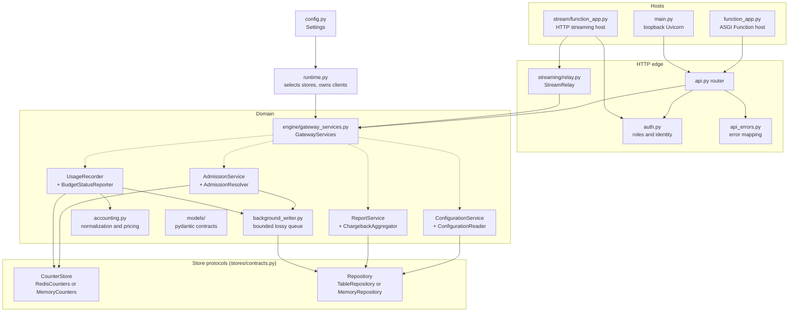
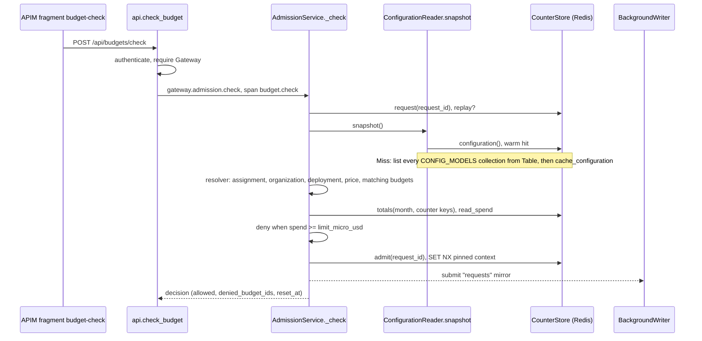
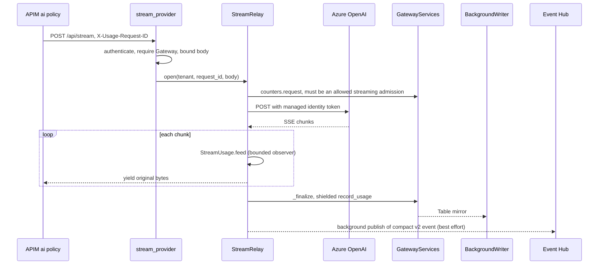

# Code guide

The public inference surface is Azure OpenAI Chat Completions and Responses behind
APIM. Python is responsible for organization membership, monthly dollar budgets,
versioned pricing, actual usage and authorized reports. Read the
[architecture](../ARCHITECTURE.md) first for behavior and guarantees; this guide
maps those behaviors to code. Paths are relative to
[`src/apim_rate_limit_foundry/`](../src/apim_rate_limit_foundry) unless noted.

## Repository map

| Path | Contents |
| --- | --- |
| [`src/apim_rate_limit_foundry/`](../src/apim_rate_limit_foundry) | Python budget API, gateway services, stores, streaming relay and telemetry |
| [`function_app.py`](../function_app.py), [`stream/`](../stream) | The two Azure Functions hosts (see [entry points](#entry-points)) |
| [`apim/`](../apim) | APIM policy and fragment templates; see the [gateway contracts](../apim/README.md) |
| [`web/`](../web) | React portal and its Node server; see the [portal guide](../web/README.md) |
| [`infra/`](../infra) | Terraform modules, `azd` packaging scripts and `*.tftest.hcl` tests; see the [infra guide](../infra/README.md) |
| [`scripts/`](../scripts) | Seeding, CI configuration and legacy-config archive tools |
| [`tests/`](../tests) | Python tests mirroring the modules (see [tests](#tests)) |
| [`examples/`](../examples) | Sample configuration records and `gateway.http` requests |

## Layers

Dependencies point downward. Only `runtime.py` chooses concrete stores, and only
`engine/` implements policy; hosts and routes stay thin.

## Entry points

| Entry point | Role |
| --- | --- |
| [`function_app.py`](../function_app.py) | Wraps [`create_app`](../src/apim_rate_limit_foundry/api.py) in `AsgiFunctionApp`. Function keys are anonymous because Easy Auth validates Entra tokens and `auth.py` enforces roles |
| [`stream/function_app.py`](../stream/function_app.py) | Native Functions HTTP-streaming host exposing `POST /api/stream` (`stream_provider`); builds one cached `Runtime` and a `StreamRelay` per request |
| [`main.py`](../src/apim_rate_limit_foundry/main.py) | `uv run apim-rate-limit-foundry`: local Uvicorn API on `127.0.0.1`, not the streaming host |
| [`web/server/index.mjs`](../web/server/index.mjs) | Portal static host and optional same-origin API proxy |

The streaming host is separate because it needs the HTTP streaming extensions.
The relay preserves the native OpenAI protocol.

## Components

| Component | Responsibility |
| --- | --- |
| [`api.py`](../src/apim_rate_limit_foundry/api.py), [`api_services.py`](../src/apim_rate_limit_foundry/api_services.py), [`api_errors.py`](../src/apim_rate_limit_foundry/api_errors.py), [`auth.py`](../src/apim_rate_limit_foundry/auth.py) | FastAPI router (prefix `/api`) with `Depends` providers, lazily built shared clients (`ApiServices`), HTTP error mapping (`register_error_handlers`: `Conflict`→409, validation→400, dependency failure→503), and independent Gateway/Admin/Reader authorization (`Identity.require`) |
| [`models/`](../src/apim_rate_limit_foundry/models) | Typed organization, assignment, budget, price and usage contracts; `models/responses/` holds the HTTP response models that FastAPI validates and publishes in OpenAPI (mirrored by the portal's [`contracts.ts`](../web/src/contracts.ts)) |
| [`engine/`](../src/apim_rate_limit_foundry/engine), [`accounting.py`](../src/apim_rate_limit_foundry/accounting.py) | Redis-recorded-spend decisions without reservations and replay-protected actual-cost accounting; see the engine layout below. `accounting.py` holds `utc_month`, `digest`, `normalize_openai_usage`, `cost_micro_usd`, `estimate_upper_bound_cost` and `price_usage` |
| [`stores/`](../src/apim_rate_limit_foundry/stores) | Durable configuration/history (`Repository`) and Redis operational configuration/context/replay/spend (`CounterStore`), each with a memory implementation for local mode |
| [`background_writer.py`](../src/apim_rate_limit_foundry/background_writer.py) | `BackgroundWriter`: bounded (256) process-local best-effort request/usage Table writer |
| [`streaming/`](../src/apim_rate_limit_foundry/streaming) | Incremental OpenAI SSE relay (`relay.py`), bounded SSE framing (`sse_parser.py`, `SseParser`) and usage semantics (`usage.py`, `StreamUsage`), the `UpstreamResponse` result of `StreamRelay.open` (`upstream_response.py`), per-request tracing (`request_telemetry.py`), in-process terminal Redis accounting and background Event Hub publication |
| [`export/`](../src/apim_rate_limit_foundry/export) | `UsageEventPublisher` contract and `EventHubUsagePublisher`, which sends each finalized usage event with the `azure-eventhub` `EventHubProducerClient` and the Function's managed identity; best effort, no retries |
| [`reports/dashboard.py`](../src/apim_rate_limit_foundry/reports/dashboard.py) | Admin-only `DashboardService` that replays the persisted Azure dashboard's KQL against Log Analytics. Scoped spend/chargeback reports live in `engine/report_service.py` |
| [`runtime.py`](../src/apim_rate_limit_foundry/runtime.py), [`config.py`](../src/apim_rate_limit_foundry/config.py) | Dependency injection, lifecycle and centralized settings (`Runtime`, `Settings`); see the [configuration reference](configuration-reference.md) |
| [`monitoring.py`](../src/apim_rate_limit_foundry/monitoring.py), [`observed_credential.py`](../src/apim_rate_limit_foundry/observed_credential.py) | One-time Azure Monitor distro setup and a credential wrapper that times token requests without exposing material |
| [`telemetry/`](../src/apim_rate_limit_foundry/telemetry), [`rate_limit_metrics.py`](../src/apim_rate_limit_foundry/rate_limit_metrics.py), [`request_telemetry.py`](../src/apim_rate_limit_foundry/request_telemetry.py) | Allowlisted structured events, low-cardinality custom metrics and per-request spans without prompts or credentials. [`telemetry/allowlist.py`](../src/apim_rate_limit_foundry/telemetry/allowlist.py) lists every permitted event and field: new ones must be added there or they are silently rewritten or dropped. Other modules split by concern: `sanitizer`, `context`, `events`, `operation`, `dependency`, `log_config`. See [observability](observability.md) |

## Engine layout

[`engine/gateway_services.py`](../src/apim_rate_limit_foundry/engine/gateway_services.py)
holds the wired services (`admission`, `usage`, `configuration`, `reports`) and
the stores they share. `GatewayServices.create` builds them and `close` releases
them; there is no delegating facade, so `api.py` and `streaming/relay.py` call
the service they need, for example `gateway.admission.check`.

| Module | Responsibility |
| --- | --- |
| [`configuration_reader.py`](../src/apim_rate_limit_foundry/engine/configuration_reader.py) | Validated configuration listing and the coalesced shared cache snapshot |
| [`configuration_validator.py`](../src/apim_rate_limit_foundry/engine/configuration_validator.py) | Assignment, organization and budget hierarchy rules |
| [`configuration_service.py`](../src/apim_rate_limit_foundry/engine/configuration_service.py) | Configuration save/delete with tenant checks, audit and cache invalidation |
| [`admission_resolver.py`](../src/apim_rate_limit_foundry/engine/admission_resolver.py) | Assignment, organization, price, budget and model-bound lookups pinned at admission |
| [`admission_service.py`](../src/apim_rate_limit_foundry/engine/admission_service.py), [`admission_telemetry.py`](../src/apim_rate_limit_foundry/engine/admission_telemetry.py) | Budget check and request-ID replay; `AdmissionTelemetry` emits the admission events and metrics |
| [`budget_status_reporter.py`](../src/apim_rate_limit_foundry/engine/budget_status_reporter.py) | Budget caps pinned at admission and live `budget_status` telemetry after each accepted charge |
| [`usage_recorder.py`](../src/apim_rate_limit_foundry/engine/usage_recorder.py), [`usage_telemetry.py`](../src/apim_rate_limit_foundry/engine/usage_telemetry.py) | Pricing against the pinned `AdmissionContext`, replay-safe Redis recording, the Table mirror and the background Event Hub publish; `UsageTelemetry` emits the usage events and metrics |
| [`report_service.py`](../src/apim_rate_limit_foundry/engine/report_service.py), [`chargeback_aggregator.py`](../src/apim_rate_limit_foundry/engine/chargeback_aggregator.py) | Usage history, budget status and chargeback grouping |
| [`assignments.py`](../src/apim_rate_limit_foundry/engine/assignments.py), [`spend.py`](../src/apim_rate_limit_foundry/engine/spend.py), [`budget_events.py`](../src/apim_rate_limit_foundry/engine/budget_events.py) | Shared helpers: enabled-assignment selection, live spend reads and remaining balance, and the single `budget_status` emitter |
| [`catalog.py`](../src/apim_rate_limit_foundry/engine/catalog.py), [`events.py`](../src/apim_rate_limit_foundry/engine/events.py), [`keys.py`](../src/apim_rate_limit_foundry/engine/keys.py) | Collection/schema constants (`CONFIG_MODELS`, `USAGE_COLLECTION`), the durable event envelope and stable identifiers (`budget_counter_key`, `opaque`) |

## Request walkthroughs

### Budget check (admission)

Route: `POST /api/budgets/check`, Gateway role only
([`check_budget`](../src/apim_rate_limit_foundry/api.py)). APIM calls it from the
[`budget-check`](../apim/fragments/budget-check.xml.tftpl) fragment.

1. A retry with a saved context short-circuits to `_replay_decision`, which
   validates the request fingerprint (`_fingerprint`) and returns the original
   decision.
2. `AdmissionResolver` picks the single enabled assignment, the organization
   snapshot, the registered model deployment, the price and every matching
   user/team/department budget.
3. Admission compares completed spend only. The pinned `AdmissionContext`
   (assignment, organization, price, model bounds, budgets, month, decision),
   stored as the `data` of the Redis request record, is what later
   accounting uses, so reassignment or price edits cannot change a request's
   attribution.
4. `counters.admit` is first-writer-wins, including for denied decisions; a
   concurrent loser replays the winner.

### Usage recording

Route: `POST /api/usage/record`
([`record_usage`](../src/apim_rate_limit_foundry/api.py)), called by the
[`usage-record`](../apim/fragments/usage-record.xml.tftpl) fragment for
nonstreaming responses (it only calls the Function and sets
`X-RateLimit-Accounting`) and in-process by the stream relay.
[`UsageRecorder._record`](../src/apim_rate_limit_foundry/engine/usage_recorder.py):

1. Look up a prior usage record (`counters.usage`) and replay it if the
   submitted-status and provider-usage fingerprints match; otherwise `Conflict`.
2. Load the admitted context (`counters.request`); a missing or denied context
   is a `Conflict`.
3. `_price` calls [`price_usage`](../src/apim_rate_limit_foundry/accounting.py),
   which normalizes provider counters (`normalize_openai_usage`) and prices them
   with the pinned `Price`. `usage_unknown` is charged the pinned upper bound
   (`estimate_upper_bound_cost`), never zero. See [token accounting](token-accounting.md).
4. `counters.record` runs the Lua script
   [`RECORD_USAGE`](../src/apim_rate_limit_foundry/stores/scripts.py): it
   increments the six `_counter_keys` (user, team, department × model and `*`)
   and writes the replay marker in one atomic step.
5. Only the winner schedules the Table mirror (`_mirror`), emits telemetry and
   reports `budget_status`, then schedules the best-effort Event Hub publish
   (never for replays) for streaming and non-streaming requests alike.

### Streaming

`StreamRelay.open` revalidates the admitted tenant, streaming flag and alias, and
resolves the provider deployment from `Settings.registered_model`, never from the
caller. `SseParser` frames events with bounded retention and `StreamUsage` applies
Chat/Responses semantics on top, observing without changing bytes. For Responses
only, an oversized `response.completed`/`response.incomplete` data line is kept up
to 1 MiB; other oversized lines are discarded. `_finalize` charges observed usage, or the
upper bound when none was seen, and skips provider throttles
(`_is_throttle_rejection`). See [token accounting](token-accounting.md).

### Configuration CRUD and reports

- `PUT`/`DELETE /api/{collection}/{id}` (Admin) go to
  [`ConfigurationService`](../src/apim_rate_limit_foundry/engine/configuration_service.py):
  model validation, tenant and hierarchy checks (`ConfigurationValidator`), an
  atomic `Repository.mutate` with its audit record, then
  `counters.invalidate_configuration`.
- `GET /api/{collection}` (Admin; `budgets`, `organizations`, `assignments`,
  `prices`) filters `gateway.configuration.list` by tenant; `ConfigurationReader`
  hides tombstones and archived legacy schemas.
- `GET /api/usage`, `/chargeback` and `/budgets/status` use `ReportService`;
  history reads one Table partition per tenant and month (`usage_partition`),
  while budget status reads live Redis spend.
- `GET /api/dashboard` (Admin) uses `DashboardService.fetch`. `GET /api/models`
  is served from `Settings.model_registry`; `GET /api/health` reports process
  status without probing dependencies.

## Data layout

| Store | Key or partition | Content and lifetime |
| --- | --- | --- |
| Redis (`RedisCounters`, hash tag `{limiter}`) | `{limiter}:configuration:v3` | Shared configuration snapshot; `CONFIGURATION_CACHE_SECONDS` TTL, invalidated on admin writes |
| | `{limiter}:request:v3:<request_id>` | Admitted context (`SET NX`); `REQUEST_CACHE_SECONDS` (24h) |
| | `{limiter}:usage:v3:<request_id>` | Replay marker plus finalized event; same TTL |
| | `{limiter}:spend:v3:<YYYY-MM>` | Hash of `budget_counter_key` digests to integer micro-USD; 62-day sliding TTL |
| Table (`TableRepository`) | `ledger` partition | Configuration collections (`organizations`, `assignments`, `budgets`, `prices`) and `audit`, committed together by `mutate` |
| | `ledger`, collection `requests` | Best-effort mirror of admitted contexts |
| | `usage:<tenant>:<YYYY-MM>`, collection `usage_v2` | Best-effort mirror of finalized usage; source for reports and chargeback |

Table rows use `RowKey = digest(collection, id)` and a JSON `payload`.

## Gateway policies

Terraform renders the templates in [`apim/`](../apim) from
[`infra/modules/apim/main.tf`](../infra/modules/apim/main.tf). The shared
[`ai.xml.tftpl`](../apim/policies/ai.xml.tftpl) pipeline runs, in order:
`limiter-identity` fragment → content-type/size/JSON validation →
`limiter-model-lookup` → per-protocol admission
([`foundry-admission`](../apim/policies/foundry-admission.xml.tftpl) or
[`responses-admission`](../apim/policies/responses-admission.xml.tftpl)) →
optional [`llm-limit`](../apim/policies/llm-limit.xml.tftpl) →
`limiter-budget-check` → `limiter-strip-caller-headers` → backend (the streaming
Function for `stream=true`, otherwise the model backend) → `limiter-usage-record`
on outbound and on error. The JSON body is parsed once into `request-json` and the
registry entry (with its Terraform-supplied `backend_id`) once into `model-entry`.
[`portal.xml.tftpl`](../apim/policies/portal.xml.tftpl) fronts the portal API and
[`apim/tests/`](../apim/tests) assert these contracts.

## Portal code map

| Path | Role |
| --- | --- |
| [`web/src/main.tsx`](../web/src/main.tsx), [`CloudSession.tsx`](../web/src/CloudSession.tsx), [`auth.ts`](../web/src/auth.ts) | MSAL sign-in, token acquisition and role hints |
| [`Portal.tsx`](../web/src/Portal.tsx), [`pages.ts`](../web/src/pages.ts) | Shell, navigation and page selection |
| [`api.ts`](../web/src/api.ts), [`contracts.ts`](../web/src/contracts.ts) | Typed client for the `/api` routes and mirrored response models |
| [`web/src/components/`](../web/src/components), [`web/src/insights/`](../web/src/insights) | Screens (overview, budgets, usage, chargeback, dashboard) and the derived recommendations |
| [`web/server/`](../web/server) | Runtime config, fixed-upstream API proxy, logging and server telemetry |
| [`web/tests/`](../web/tests) | Vitest suites |

Screens, server contracts and portal telemetry are documented in the
[portal guide](../web/README.md).

## Tests

Python tests in [`tests/`](../tests) mirror modules: for example `test_gateway_*.py`
and `test_configuration_service.py` cover `engine/`, `test_stream_relay.py` and `test_stream_usage.py` cover
`streaming/`, `test_redis*.py` cover `RedisCounters`, and `test_api*.py` use
`httpx.AsyncClient` against `create_app` with in-memory stores
([`tests/fakes.py`](../tests/fakes.py)). Policy, seed and preflight checks are in
`apim/tests/` and `scripts/tests/`; Terraform tests are `infra/tests/*.tftest.hcl`.
Run `uv run pytest -W error`; see [local development](local-development.md).

## Extending

- New HTTP route: follow the [new-api-endpoint skill](../.github/skills/new-api-endpoint/SKILL.md).
- New telemetry event or field: add it to `telemetry/allowlist.py` first.
- New configuration collection: extend `CONFIG_MODELS` in `engine/catalog.py`
  and its schema marker, then the portal's `contracts.ts`.
- New provider protocol or model: update the model registry; see the
  [model registry](model-registry.md).

## Invariants

Do not add independent price arithmetic to APIM, KQL or the browser. The immutable
usage context pins its price version. Redis acceptance drives live approximate
budgets; eventual Table history drives reports. Warm admission never reads Table;
cold configuration misses may. Admin CRUD is durable-first and invalidates shared
configuration. Actual usage increments all six hierarchy wildcard/model counters
atomically with its replay marker. There is no global ledger lock or rebuild.
Unknown usage is never free: the engine prices it at the upper bound pinned in the
admission context (`accounting.price_usage`). Usage history is keyed by tenant and
month so reports read one Table partition. Event Hub messages mean Redis accepted
usage, not that Table persisted it. The
background writer's bounded queue can drop/lose writes, so neither history nor
events promise financial completeness. See [operations](operations.md) for TTLs
and failure behavior.

See [architecture](../ARCHITECTURE.md), [API contracts](configuration-reference.md),
and [local validation](local-development.md).
