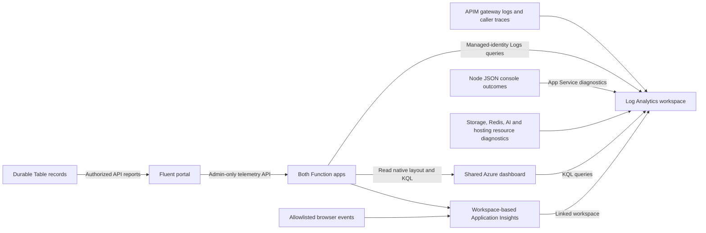
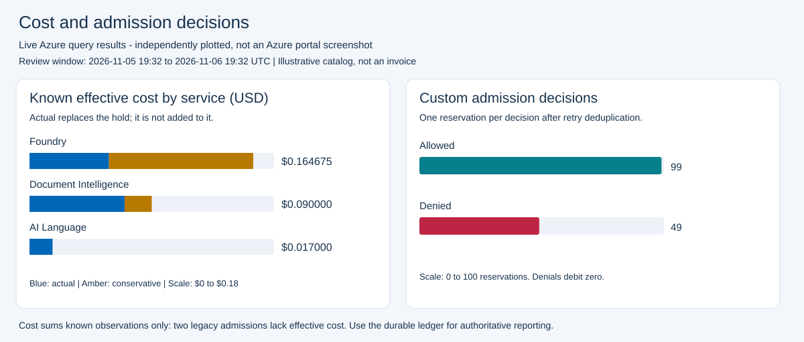
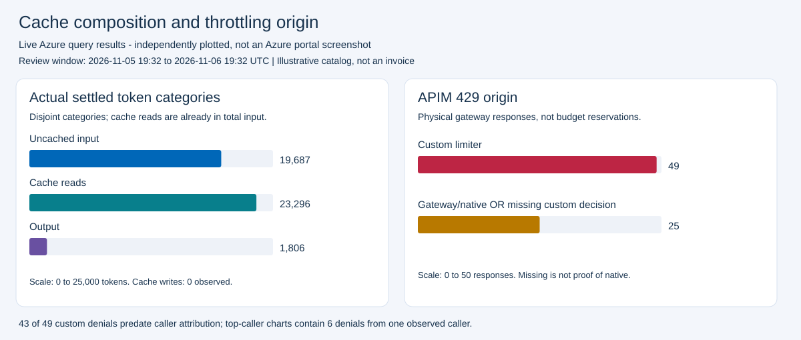

# Observability: charts, logs, and caller correlation

This is the canonical dashboard and application-trace reference.
For incident actions and acceptance checks use [operations](operations.md);
for financial meaning use the [reservation guide](reservation-system.md#9-what-dashboard-numbers-mean).

## Destinations and trust



Monitoring is asynchronous and never participates in admission. Workspace-based
Insights already writes to its linked workspace: do not add a diagnostic export
back to that same destination. It duplicates observations and is unsupported.

The application excludes prompts, document bytes, generated content, tokens,
subscription keys, raw identities and Redis keys from its custom trace properties.
Resource/native agents have separate schemas and may include network metadata.
Workspace access, retention, sampling and IP-handling policy remain operator
responsibilities. Pseudonymous caller references are not anonymous data.

**Sources:** [SDK setup](../src/apim_rate_limit_foundry/monitoring.py),
[safe trace schema](../src/apim_rate_limit_foundry/telemetry.py),
[resource diagnostics](../infra/modules/diagnostics/main.tf), and
[browser/server privacy contract](../web/README.md#privacy-safe-observability).

## Dashboard access and scope

The monitoring module deploys an `azurerm_portal_dashboard`, not a workbook and
not the React configuration portal. Use the azd `AZURE_DASHBOARD_URL` output.
`AZURE_DASHBOARD_ID` is the ARM resource ID; portal hosts are `portal.azure.com`
or `portal.azure.us` for their respective clouds.

Viewers need Azure access to both dashboard and workspace queries, for example
appropriate Log Analytics Reader permissions. Limiter `RateLimit.Reader` does
not grant Azure Monitor RBAC. End-user Azure role assignments remain unchanged.

### Charts inside the application

Administrators can open **Azure dashboard** in the React portal to see the same
**13 charts and nine detail grids**. The API reads the deployed ARM dashboard's
titles, axes, chart types and KQL definitions, then uses Microsoft's Azure Monitor
Logs SDK to query its fixed workspace. There is no separately maintained query
catalog, Azure portal iframe or browser-side workspace credential.

The Function identity receives resource-scoped **Reader** on the dashboard and
**Log Analytics Reader** on its workspace. The portal uses its existing Entra
token and server-side product key; no extra browser/Azure delegated permissions
are required. `GET /api/dashboard?period=1h|24h|7d` is **Admin-only** because the
native views cover the entire workspace. Assigned Readers retain their existing
application-scoped ledger reports but cannot access these global charts.

The default period is 24 hours. Refresh explicitly requests new results; there
is no automatic query loop. Each tile has an accessible data table and separate
empty/error state. Results are limited to 1,000 rows per tile (most recent for
time-series charts); a truncation notice recommends narrowing the window.
Partial query failures are labelled instead of plotted as zero. Ingestion delay,
sampling and financial caveats below apply equally to both dashboard surfaces.
Local fixture charts are illustrative and are never substituted for live failures.

The default time picker is last 24 hours. All 22 log tiles use the workspace
resource ID, unbound `TimeRange`, and `IsQueryContainTimeRange=false`; standalone
source queries do not pin `ago()`. Both sides of joins obey the selected window.
Function filters include `rate-limiter` **and** `rate-limiter-stream`.
The workspace is deployment-dedicated; sharing it across unrelated APIM instances
requires additional resource filtering.

## Dashboard inventory

The [monitoring module](../infra/modules/monitoring/main.tf) wires **13 charts and
9 grids** to [22 reusable queries](../infra/modules/monitoring/queries/).

| Query | View | What it answers |
| --- | --- | --- |
| `admissions.kql` | Line | Allowed/denied reservations by minute and service/protocol |
| `decision-outcomes.kql` | Pie | Deduplicated allow/deny mix |
| `throttling-trend.kql` | Stacked columns | Custom denials over time by service |
| `cost-trend.kql` | Line | Effective admission-cohort USD by accounting state |
| `policy-denials.kql` | Columns | Top binding policy/metric combinations, excluding nonbinding blocked rules |
| `token-composition.kql` | Stacked columns | Actual non-estimated disjoint uncached/read/write/output tokens |
| `latency-trend.kql` | Line | Reserve/settle HTTP p50/p95 milliseconds |
| `caller-denials.kql` | Stacked columns | Top caller/service/model custom denials |
| `caller-costs.kql` | Stacked columns | Top caller/service/model effective USD |
| `gateway-caller-429.kql` | Stacked columns | Physical gateway 429s by caller and origin |
| `streaming-outcomes.kql` | Stacked columns | Streaming actual, estimated and pending accounting |
| `streaming-economics.kql` | Line | Reserved/effective/released liability comparison |
| `streaming-cache.kql` | Stacked columns | Actual streaming token/cache categories |
| `denials.kql` | Grid | Recent custom denials and retry/reset/policy information |
| `gateway-429.kql` | Grid | Gateway/custom/backend origin with separate backend status |
| `policy-pressure.kql` | Grid | Per-policy conservative demand, applied/remaining and outcome |
| `cost-liability.kql` | Grid | Admission cohort with settlement replacing reservation |
| `cache-service-units.kql` | Grid | Settlement cohort cache ratios, tokens, pages, records and requests |
| `latency.kql` | Grid | Physical HTTP attempts, failures and percentiles |
| `dependency-failures.kql` | Grid | Failed Redis/Table spans and safe error categories |
| `callers.kql` | Grid | Caller/service/model costs, denials, cache and pending usage |
| `streaming-status.kql` | Grid | Per-stream settlement status and pending reasons |

Axes use separate USD, millisecond and token units. Cost trends are per admission
minute, not cumulative billing. Empty failure tables can be healthy.

## Review against Cody's requirements

The original request was not simply "show TPM." It was to govern **cost by model**,
respect cache economics, identify **who** hits limits on **which services**, and
put Document Intelligence/Language behind the same gateway identity surface.
Use these tiles together, rather than treating an allow/deny pie as the answer:

| Requirement | Start with | Interpret alongside |
| --- | --- | --- |
| Cost by model/caller | **Top caller effective USD by service / model** | Caller attribution grid and the portal's authorized caller report; generic cost trend alone is not model attribution |
| Explain a budget rejection | **Top callers hitting custom limits by service / model** and **Blocking policies** | Recent denials, policy demand/remaining and the configured price/limit; a small eventual cache charge can still fail conservative admission |
| Discount reported cached tokens | **Actual settled input / cache / output tokens** and **Actual streaming input / cache / output tokens** | Versioned price catalog and actual settlement; token counts alone do not measure dollars saved |
| Distinguish holds from final spend | **Effective USD over time** and **Streaming USD** | Cost liability and streaming status; reserved/effective/released are comparisons, not three additive charges |
| Identify gateway versus custom throttles | **Gateway 429s by caller and origin** | Gateway origin grid and `gateway_caller` correlation; no custom event does not prove a native throttle |
| Document Intelligence and Language | **Admissions over time by service / protocol** and **Custom throttling over time** | Cache/service-units grid reports pages and text records, not invented tokens; caller/service/model attribution provides their costs |
| GCCH suitability | Cloud-selected resources, identity and network configuration | No chart certifies GCCH compliance, sovereign model availability or interactive client compatibility |

Latency/dependency tiles are supporting operational health, not budget-fairness
metrics. Cost, tokens, pages, records, HTTP attempts and unique reservations must
not share a numerical axis. Top-caller/policy tiles are ranked subsets, not totals.

### Live Commercial review: November 6, 2026

Read-only review inspected the persisted ARM dashboard and executed **all 22
persisted queries** against its actual workspace. The 13 chart axes/types, nine
grids, shared time-picker settings, both Function roles and source-query equality
passed. APIM Resource Health reported Available. No dashboard deployment,
configuration writes or new paid inference calls were needed.

The fixed review window was **November 5, 19:32 UTC through November 6, 19:32 UTC**.
The plots below are independently rendered from those live query results, **not
screenshots of the Azure portal**. In the isolated browser, Azure itself required
an interactive sign-in; signed-in Azure tile rendering was not verified. The
[Fluent app screenshots](rate-limiting-walkthrough.md#screenshot-provenance) were
captured from its authenticated live deployment.





| Check | Observed result and meaning |
| --- | --- |
| Custom decision totals | 148 unique observations: 99 allowed, 49 denied; admissions trend and outcome pie agree |
| Cost consistency | Trend and liability grid both sum to **$0.271675 known effective liability**, at sample prices; not a complete balance or an invoice |
| Missing legacy cost | Only 97 of 99 admissions have known **effective** cost after settlement joins. Original hold cost is absent on 31 legacy admissions; settlement supplies cost for 29, leaving two unknown pending liabilities, not zero-priced requests |
| Actual token composition | 19,687 uncached input + 23,296 cache reads + 1,806 output = 44,789 tokens; matches actual LLM settlement totals without adding cache twice |
| Trusted streams | 18 actual provider-usage settlements and 14,336 cache-read tokens observed; reserved $0.439146 − effective $0.029006 = released $0.410140, not cache-only savings |
| Shared AI services | Actual settlement query includes 7 analyzed pages and 17 Language text records; Foundry, document and Language costs remain separate |
| Physical gateway throttles | Both 429 views agree: 49 custom + 25 gateway/native **or missing decision** responses |
| Caller coverage | Six custom denials have caller references; 43 older denials are omitted from top-caller charts. Only one distinct caller and one LLM deployment alias were observed, not a multi-caller or multi-model acceptance test |
| Failure grid | Zero dependency-failure rows; an empty failure table is not a broken chart |

**Review conclusion:** chart types, units and joins are relevant to the ask, and
the matched chart/table totals reconcile. Telemetry coverage is incomplete for
older records, so these numbers must not be presented as complete caller spend.
The app's durable reports can contain more records than these telemetry cohorts.
For acceptance, use fresh fully instrumented traffic, inspect known-cost counts
and attribution coverage, and compare the same window with durable records.
The last missing original-hold observation was at 04:50 UTC; the last unreferenced
denial was at 15:02 UTC, before referenced decisions began at 16:02 UTC. Do not
compare historical original-reservation/refund columns as complete totals when
their hold metadata is absent; the matched streaming comparison above does
reconcile.
Anthropic cache-write pricing, Government deployment, same-key onboarding and
interactive pi/Copilot BYOK behavior are **not proved** by this snapshot.

Keep the full caller reference in the query result for authorized resolution;
expand a tile if its 64-character labels are cramped. Do not publish identity
labels into a broadly shared dashboard merely to shorten its axes.

## Custom trace schema

Function `AppTraces.Message` and `Properties.event_name` identify the allowlisted
event; `event_version=1` versions the schema.

| Event | Important properties |
| --- | --- |
| `rate_decision` | Caller/service/model/protocol, streaming, allow/reason, policies, reset/retry, reserved cost and admitted cost (zero on denial) |
| `reservation_policy_debit` | Requested amount, applied amount, limit/remaining and allowed/denied/blocked outcome |
| `settlement_recorded` | Actual/conservative status, estimated flag, normalized usage, pinned price, reserved/final/refunded cost |
| `settlement_policy_debit` | Final amount, reserved amount and released allowance for each policy |
| `stream_dispatch_started`, `stream_usage_observed` | Trusted stream lifecycle and reservation identity |
| `stream_settlement_completed`, `stream_settlement_pending` | Stream outcome, final cost or safe pending reason |
| `dependency_completed`, `operation_failed` | Dependency/operation, duration, success and error type without exception text |

`gateway_caller` is an APIM trace emitted **before** its native burst throttle.
It carries correlation ID, API/operation and a caller reference, not raw identity.
`limiter_decision` is the APIM observation of a custom result; it is not a second
custom reservation.

Browser telemetry uses sanitized `AppEvents`, not automatic dependency URL
capture. Node's `portal_request` JSON goes through console/resource logging, not
the browser SDK. Keep native HTTP agent telemetry separate from custom events.
Their exact allowlists and behavior are owned by the
[portal privacy contract](../web/README.md#privacy-safe-observability).

## Trace one request

For an admitted response, obtain `X-RateLimit-Reservation`; for a custom denial,
obtain `reservation_id` from the decision JSON. `X-Correlation-ID` joins the
original gateway HTTP request:

```kusto
let RequestCorrelation = "<X-Correlation-ID>";
AppTraces
| where TimeGenerated > ago(1h)
| where AppRoleName in ("rate-limiter", "rate-limiter-stream")
| where tostring(Properties.correlation_id) == RequestCorrelation
| project TimeGenerated, Message,
    Reservation = tostring(Properties.reservation_id), Properties
| order by TimeGenerated asc
```

Use that same ID against `ApiManagementGatewayLogs.CorrelationId`. It is not
necessarily W3C `OperationId`. A document poll or timer replay may have another
HTTP correlation ID; follow the reservation across those calls:

```kusto
let Reservation = "<reservation_id>";
AppTraces
| where TimeGenerated > ago(24h)
| where AppRoleName in ("rate-limiter", "rate-limiter-stream")
| where tostring(Properties.reservation_id) == Reservation
| project TimeGenerated, Message, Properties
| order by TimeGenerated asc
```

The sample investigation queries intentionally bound time; the embedded dashboard
queries instead inherit the portal time picker.

### Resolve a caller without logging names

`caller_ref` is full lowercase SHA256 of UTF-8 `tenant_id + "\n" + subscription_id`,
preserving input case, with no prefix or trailing newline. APIM and
[`caller_reference.py`](../src/apim_rate_limit_foundry/caller_reference.py) agree.

Resolve it in the portal's application-subscription view. Admins see all
applications; Readers see only explicitly assigned tenant/application pairs.
Application labels come from configured subscriptions/assignments, not Graph
user names. The charts use non-secret **SubscriptionId**, never primary/secondary
key values, and show the top 20 subscription/series pairs.

The policy-pressure table includes subscription, model, metric, limit, demand
and remaining allowance at each decision. Both key slots and key rotations
produce the same identity; changing Entra users does not reset an app's budget.
Accounting charts deliberately exclude pre-cutover user-based events lacking a
subscription ID rather than pretending those events belong to an application.
Historical records remain in the durable ledger. Request/dependency latency
still includes all physical attempts.

Gateway 429 attribution joins application traces and custom decisions by correlation,
falling back to the native `ApiManagementGatewayLogs.ApimSubscriptionId`.
A missing custom decision is **not proof** of native throttling; the label is
gateway/native **or missing decision**. Older events may remain unattributed.

## Accounting and query caveats

- Deduplicate admissions by reservation, policy evaluations by reservation/policy,
  and settlements by reservation before summing. Retries can repeat observations
  without spending again; `applied_amount` is not an incremental replay charge.
- Effective cost uses the final settlement when visible, otherwise the original
  hold. Never add both, sum overlapping policy costs, or interpret released
  liability as entirely cache savings or an invoice credit.
- Missing historical cost is unknown, not zero. Compare `KnownCostReservations`
  with `Reservations` in the liability grid. A settlement can restore known
  effective cost without restoring missing original-hold telemetry.
- Token categories are disjoint. Estimated/conservative counts are kept separate;
  cached input is not added again to total input.
- Ingestion delay, sampling, query caching and time-window boundaries can hide
  one side of a join. An out-of-window settlement may appear pending. Check a
  wider window and fresh query before concluding settlement failed.
- Remaining values are last-decision per-policy observations, not live Redis
  queries. Mixed-unit header values are not a monetary balance.
- Physical request/dependency latency counts retries. Blank bins do not prove
  zero traffic, and a denial can appear under multiple binding policies.
- Durable reports are the accounting source. Their scans still have the sample's
  retention/partition-scaling limits; telemetry is not invoice reconciliation.

## Validate and investigate missing data

Confirm both Function role names, APIM diagnostic verbosity/sampling, platform
destinations and workspace permissions. Native resource categories differ:
Managed Redis audit logs belong to its database, while parent metrics belong to
the instance. Identity/RBAC/private-endpoint changes rely on platform Activity
Logs; subscription-level export belongs to the landing-zone owner.

Run standalone source queries against the intended cloud/workspace and check
the deployment's actual returned schema, not just whether rows exist.

For a read-only live check, set `AZURE_DASHBOARD_ID` from azd and
`WORKSPACE_CUSTOMER_ID` to the workspace's GUID (not its ARM resource ID):

```bash
az resource show --ids "$AZURE_DASHBOARD_ID" \
  --query properties.lenses --output json

az monitor log-analytics query --workspace "$WORKSPACE_CUSTOMER_ID" \
  --analytics-query "$(cat infra/modules/monitoring/queries/cost-liability.kql)" \
  --timespan P1D --output table
```

Run in the intentionally selected Azure cloud/session. Match the time range to
the portal before comparing totals; this CLI example uses a rolling day.

The offline wiring check needs no Azure access:

```bash
terraform -chdir=infra test -filter=tests/dashboard.tftest.hcl
```

Live query execution, persisted ARM metadata, and signed-in portal rendering are
different checks. Passing one does not prove the others. See Microsoft's
[dashboard structure](https://learn.microsoft.com/azure/azure-portal/azure-portal-dashboards-structure),
[query scope](https://learn.microsoft.com/azure/azure-monitor/logs/scope), and
[visualization guidance](https://learn.microsoft.com/azure/azure-monitor/visualize/tutorial-logs-dashboards).
