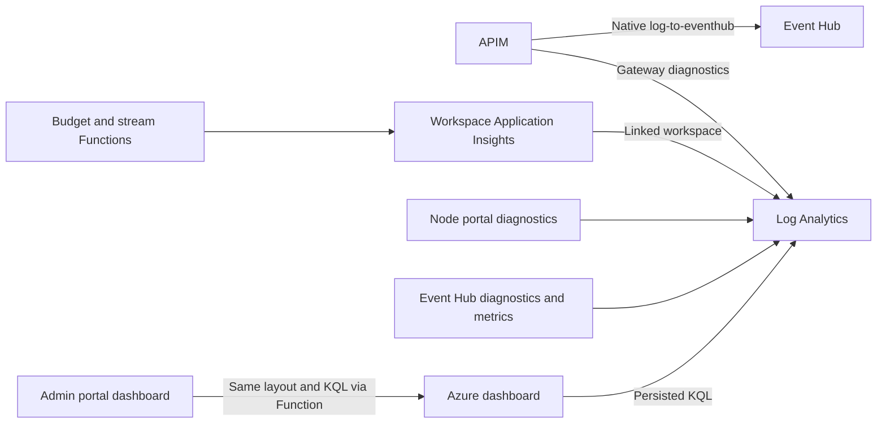

# Observability and Azure dashboards

The **durable usage ledger** owns accounting. Log Analytics and Event Hubs are
operational/downstream projections and may be incomplete.

## Destinations



Workspace-based Application Insights writes directly to its linked workspace.
Do not add a diagnostic export back to the same workspace.
No prompts, generated content, bearer tokens, subscription keys, user display
names or raw Entra user identifiers belong in custom usage telemetry.
Pseudonymous identifiers still require appropriate access and retention controls.

## Native Event Hub publication

APIM's configured user-assigned managed identity has **Azure Event Hubs Data
Sender** on the destination hub. `log-to-eventhub` emits compact versioned JSON
from the finalized usage projection; Python does not publish to Event Hubs.
The streaming relay invokes a protected internal APIM logging operation after
terminal usage recording, without buffering the SSE body.

The policy is unaffected by Application Insights sampling and truncates messages
larger than **200 KB**. Keep schema-bounded events well below that threshold.
Delivery is best effort with no application retry queue or exactly-once claim.
Unknown usage has null counts/cost and a distinct status.

See [policy reference](https://learn.microsoft.com/azure/api-management/log-to-eventhub-policy)
and [managed identity logger setup](https://learn.microsoft.com/azure/api-management/api-management-howto-log-event-hubs).

## Azure dashboard

Terraform owns the deployed Azure portal dashboard and KQL under
`infra/modules/monitoring/`. Update those source definitions, not an independent
portal query catalog. The in-app Admin dashboard reads the persisted dashboard
layout and executes its fixed-workspace KQL through the Function managed identity.
Readers retain scoped ledger reports, not workspace-wide queries.

The redesigned views cover:

- Actual USD by model, user, team and department.
- Monthly budget utilization and the level responsible for a denial.
- Disjoint uncached input, cached input and output token composition.
- Business-unit/cost-center chargeback and application attribution.
- Unknown accounting outcomes, request latency and dependency failures.
- Event Hub ingress, throttling/errors and APIM callback/logging health.

Budget gauges require complete month-to-date data; a short chart time picker
must not relabel last-hour spend as the complete monthly balance. Use the
authoritative `/budgets/status` API for live financial decisions.
Deduplicate usage by stable event ID. Never add nested hierarchy counters or
join operational retries into multiple financial charges.

Native `llm-emit-token-metric` can supplement operational visibility, but custom
dimension/series limits make it inappropriate for arbitrary per-user billing.
Use low-cardinality metrics and detailed log grids instead. Telemetry ingestion
delay, sampling, retention and missing terminal usage affect dashboard coverage.

## Trace a request

```kusto
let Correlation = "<X-Correlation-ID>";
AppTraces
| where TimeGenerated > ago(1h)
| where tostring(Properties.correlation_id) == Correlation
| project TimeGenerated, Message, Properties
| order by TimeGenerated asc
```

Use the request/event ID to correlate the durable record with downstream events.
Event Hub ingress indicates acceptance by the hub, not capture or downstream
finance processing. No Stream Analytics, Fabric pipeline or finance system is
deployed by this sample.
