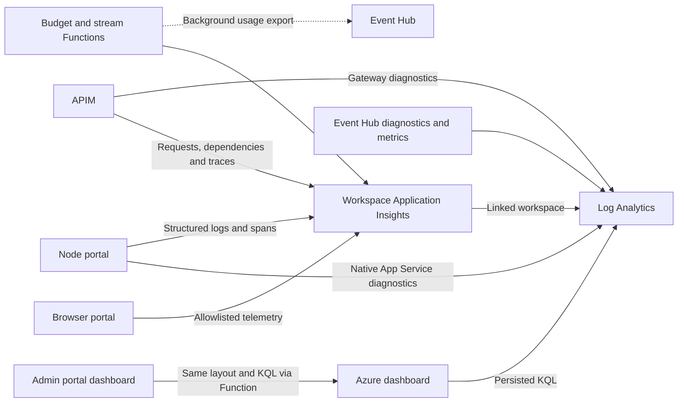

## Overview

**Redis-accepted usage drives approximate live budgets.** Table history is
persisted asynchronously and may be incomplete permanently; it drives retained
usage/chargeback reports, not admission. Log Analytics and Event Hubs can also
lose data. None establishes financial completeness.

## Destinations



Workspace-based Application Insights writes directly to its linked workspace.
Do not add a diagnostic export back to the same workspace.
No prompts, generated content, bearer tokens, subscription keys, user display
names or raw Entra user identifiers belong in custom usage telemetry.
Pseudonymous identifiers still require appropriate access and retention controls.

APIM uses its gateway user-assigned identity and the Application Insights
connection string's cloud-aware regional ingestion endpoint. Its **Monitoring
Metrics Publisher** assignment is scoped to the specific Application Insights
component. API diagnostics retain W3C correlation, zero logged body bytes, and
the correlation-ID header allowlist.

The inference policy snapshots the validated incoming `traceparent` before
inherited policies or backend forwarding can mutate the request headers.
Internal budget/usage `send-request mode="new"` calls reuse this immutable
parent, not the model dependency's parent left in mutable request headers.
Instrumented clients must send a valid W3C parent for one operation-wide trace.
Plain clients still receive the gateway's financial request UUID, which
joins check/usage records via `request_id`/`correlation_id`. APIM does not
expose its internally generated W3C parent to policy expressions when the client
omits it; inventing a second trace ID would not repair that platform boundary.

## Event Hub publication

The Function's managed identity has **Azure Event Hubs Data Sender** scoped to the
destination hub; APIM has no Event Hub role. The Function publishes compact
versioned JSON with the `azure-eventhub` SDK from Redis-accepted usage. A
successful nonstream usage call still waits briefly for Redis acceptance, not
Table writes or publication. The streaming relay forwards chunks incrementally and
does Redis accounting in process at terminal usage. In both cases the Function
schedules a background publish after Redis accepts the first record; replays are
never published. Neither path promises Table persistence before the event.

Table mirrors and Event Hub sends share one serial, process-local writer.
There is no application-level retry worker, durable outbox or replay repair;
the Azure SDK retains its default transport retries. See
[operations](operations.md#redis-availability-and-accepted-loss) for queue
capacity, shutdown and failure handling.

Keep schema-bounded events well below Event Hub's message size limit.
Unknown usage has null provider token counts, a distinct status and an estimated
charge marked `cost_basis=estimated_upper_bound`.

Both streaming and non-streaming accounting emit `usage_event_publish_accepted`
or `usage_event_publish_failed` from the Function with the original request/event
identifiers. Accepted means Event Hubs accepted the send after Redis acceptance,
not that Table persisted the record or a downstream consumer processed the event.
Confirm broker ingress with Event Hub's `IncomingMessages` metric. Consumer
checkpoints, transformations and finance ingestion are outside this sample; absence of those application spans is not evidence that publication
failed. Do not deploy a duplicate accounting consumer just to produce telemetry.

## Azure dashboard

Terraform owns the deployed Azure portal dashboard and KQL under
`infra/modules/monitoring/`. Update those source definitions, not an independent
portal query catalog. The in-app Admin dashboard reads the persisted dashboard
layout and executes its fixed-workspace KQL through the Function managed identity.
Readers retain scoped persisted-history reports, not workspace-wide queries.

Open **Azure dashboard** in the Admin portal. Ten operational charts appear before
the supporting detail grids; every chart also has an expandable data table.
Terraform persists `AnalyticsChart`, `SpecificChart` and axis/split dimensions.
Defining only `AnalyticsGrid` produces a table, even when the portal supports charts.

| Chart                                             | Source and interpretation                                                                                                                                                                                                                                                                                                        |
| ------------------------------------------------- | -------------------------------------------------------------------------------------------------------------------------------------------------------------------------------------------------------------------------------------------------------------------------------------------------------------------------------- |
| APIM inference traffic and HTTP outcomes          | Gateway diagnostics, deduplicated by correlation ID. Separates observed monthly-budget denials, backend/provider 429s, other/unclassified 429s, auth failures and HTTP outcomes over five-minute bins. HTTP 2xx is not proof of completed accounting, especially for SSE.                                                        |
| Function budget admissions and blocks by model    | Unique `budget_decision` events. Counts requests, not tokens; a request blocked before inference has no provider-reported token consumption.                                                                                                                                                                                     |
| Actual token composition by model / over time     | Unique actual `usage_recorded` events, stacked as input excluding cache reads (`input - cached`), cached input, and output. The first series includes cache-write input; unlike the custom token metric, this three-series dashboard does not split it out. Unknown usage is excluded, never invented as zero.                   |
| Input tokens served from provider prompt cache    | Cached input / total input tokens by model. This is a token-weighted percentage, not request hit rate or APIM response/semantic caching.                                                                                                                                                                                         |
| Function admission-to-accounting lifecycle        | Correlates admitted requests with actual/unknown terminal records. Grouped, not stacked: admitted includes finalized and unknown stages. Separates recent waiting from no terminal observed after five minutes. Sampling, ingestion delay and window boundaries can produce apparent gaps; this is not financial reconciliation. |
| Function budget-check and usage-recording latency | P95 request duration for the two internal Function routes, in five-minute bins; detail tables include request and server-error counts.                                                                                                                                                                                           |
| Function Table and Redis operations               | Success/failure counts by storage operation; detail tables include P95 duration. These operations are not inference requests or financial charges. Redis is the live operational state; Table writes are asynchronous history. Warm admission never reads Table.                                                                 |
| Month-to-date actual USD by model                 | UTC month-to-date Redis-accepted actual usage observed in telemetry, not proof of Table persistence or complete finance totals. Unknown-usage estimates are charged but excluded from this actual-only chart; it does not apply the shorter activity time picker.                                                                |
| Monthly budget utilization                        | Latest observed monthly status, not a live Redis read. Percentages can exceed 100% because these are soft caps. Never add nested user/team/department spend together.                                                                                                                                                            |

Supporting grids retain blocking budget IDs/hierarchy, chargeback, application
attribution, request latency/errors, Event Hub health, and unknown provider usage.
Blocking-budget matches can exceed the number of blocked requests when multiple
budgets reject the same request; use the admission chart for unique blocked requests.

Budget gauges require complete month-to-date data; a short chart time picker
must not relabel last-hour spend as the complete monthly balance. Use the
`/budgets/status` API for live approximate Redis balances, not a financially
complete report. Redis loss can reset spend; there is no automatic ledger rebuild.
Deduplicate usage by stable event ID. Never add nested hierarchy counters or
join operational retries into multiple financial charges.

Native `llm-emit-token-metric` can supplement operational visibility, but custom
dimension/series limits make it inappropriate for arbitrary per-user billing.
Use low-cardinality metrics and detailed log grids instead. Telemetry ingestion
delay, sampling, retention and missing terminal usage affect dashboard coverage.

## Trace a request

The Function worker exports structured logs and manual spans through
application-owned OpenTelemetry providers and Microsoft's Azure Monitor
exporters. The Azure Monitor distro configures metrics. Trace/log providers are
not installed globally: this prevents FastAPI's native telemetry, including the
streaming extension's internal app, from creating duplicate requests or
collecting raw paths and exception details.
Initialization sets `OTEL_TRACES_EXPORTER=none` and `OTEL_LOGS_EXPORTER=none`
for the distro's global pipelines. Application-owned exporters still use the
configured connection string; these settings do not disable the manual spans
and structured logs.

Both Function hosts disable adaptive host sampling. The configured worker trace
sampling ratio is independent of structured log export; logs are not dropped
merely because their span was not sampled. Export remains asynchronous and
best effort.

### Application Map identities

Deployed Function workers use `WEBSITE_SITE_NAME` as their cloud role, matching
the host instead of creating separate `rate-limiter` nodes. Local workers fall
back to `OTEL_SERVICE_NAME`. Both hosts suppress `Host.Results` invocation
requests; the worker's sanitized server spans are the authoritative request
records. Host invocation Request records are intentionally absent, while other
host diagnostic categories remain enabled.

Redis, Table and streaming model dependencies identify the configured resource
hostname, not generic service labels. Event Hub publication is a producer
dependency with the namespace and hub destination. Dashboard reads and queries
identify the cloud-specific ARM and Log Analytics API hosts. Dependency
attributes exclude paths, query strings, commands, entity contents and messages.

Application Map represents observed application traffic, not the infrastructure
inventory. Idle resources, telemetry ingestion endpoints and downstream consumers
without instrumentation need not appear. External dependencies do not acquire
server spans merely because the caller propagates a trace header. After rollout,
use a time window containing only new traffic; historical role/target aliases
remain visible until they leave the selected window.

### Function event catalog

| Events                                                                       | Important context                                                                                                                                                                                                                                                                                                                                                                                                                                                                        |
| ---------------------------------------------------------------------------- | ---------------------------------------------------------------------------------------------------------------------------------------------------------------------------------------------------------------------------------------------------------------------------------------------------------------------------------------------------------------------------------------------------------------------------------------------------------------------------------------- |
| `request_started`, `request_completed`, `request_failed`                     | Every request reaching the budget API's ASGI app and every invocation of the registered stream handler. Includes authorization/validation failures and unmatched budget API routes. Completion includes method, allowlisted route template, status, duration and outcome. Failures contain exception type, never exception text or stack.                                                                                                                                                |
| `operation_started`, `operation_completed`, `operation_failed`               | Budget checks and usage recording, with inference request ID, elapsed time and safe failure type. A successful operation can still return a denied budget decision.                                                                                                                                                                                                                                                                                                                      |
| `budget_decision`                                                            | Model/protocol, streaming flag, original request ID, allow/deny reason, denied budget IDs, pinned month/price and replay flag. Fresh decisions also include matching budget IDs/counts. Replays return the original decision without reevaluating budgets.                                                                                                                                                                                                                               |
| `budget_evaluated`                                                           | One snapshot per applicable budget on a fresh decision: scope, wildcard/model, limit, spent, remaining, allow/deny and reset time. Opaque user and assigned hierarchy references permit investigation without raw Entra identities.                                                                                                                                                                                                                                                      |
| `usage_recorded`                                                             | Newly Redis-accepted actual/unknown usage, immutable usage-v2 identifiers and pinned attribution. Actual logs add uncached input, total tokens and cache-hit flag. Acceptance is not confirmation of a Table write.                                                                                                                                                                                                                                                                      |
| `budget_status`                                                              | Live Redis balance of every cap pinned at admission, emitted after each newly accepted charge, and when `/budgets/status` is read. Caps and hierarchy come from shared cached configuration; warm reads avoid Table, cold misses may load it. Includes limit, spent, remaining, opaque user reference and assigned hierarchy. The utilization chart uses the latest event without requiring portal polling. A post-charge status-read failure is logged and does not reverse accounting. |
| `stream_usage_unknown`, `stream_rejected_by_provider`, `usage_record_failed` | A provider stream ended without complete terminal usage (charged at the pinned upper bound), ended with a provider throttle before any output (not charged), or final Redis accounting failed.                                                                                                                                                                                                                                                                                           |
| `runtime_closed`                                                             | Clients closed after an attempted bounded background drain; not proof that all jobs persisted. The streaming host closes when its event loop cancels remaining tasks. Missing shutdown telemetry or `background_writes_abandoned` warrants investigation of lost history/export jobs.                                                                                                                                                                                                    |
| `usage_out_of_bounds`                                                        | Provider-reported tokens exceeded the pinned model bounds. The real counts are still priced and the record is flagged `out_of_bounds`.                                                                                                                                                                                                                                                                                                                                                   |
| `configuration_record_invalid`                                               | A current-schema configuration record failed validation; the request fails closed instead of silently dropping the record.                                                                                                                                                                                                                                                                                                                                                               |
| `dashboard_query_failed`, `dashboard_timeout`                                | A per-batch query timeout emits `dashboard_query_failed status=timeout` and affected tiles contain errors. An overall deadline (query timeout plus 15 seconds), or a propagated timeout, yields HTTP `504` and `dashboard_timeout`.                                                                                                                                                                                                                                                      |
| `usage_record_replayed`                                                      | Existing Redis accounting returned on retry or concurrent usage acceptance within the replay window. Does not emit another `usage_recorded` event or duplicate token/cost metrics.                                                                                                                                                                                                                                                                                                       |
| `dependency_completed`, `limiter_dependency_unavailable`                     | Table/Redis operation latency/outcome and dependency failures. Redis unavailability fails closed; background Table write failure does not reverse accepted usage. Dependency spans link to their enclosing request/operation.                                                                                                                                                                                                                                                            |
| `usage_event_publish_failed`, `metric_record_failed`                         | Best-effort downstream publication or operational metric recording failed; these events do not establish Table persistence.                                                                                                                                                                                                                                                                                                                                                              |

Unknown usage reasons distinguish `reported_unknown`, `provider_usage_missing`
and `provider_usage_invalid`; it has no fabricated token measurements, but its
estimated cost contributes to live spend and cost metrics.
Actual provider usage uses reason `provider_usage`. Cache reads are included in
provider input: uncached input is
`input_tokens - cached_input_tokens - cache_write_tokens`, total
tokens are `input_tokens + output_tokens`, and reasoning is not added again.
A blocked request has no provider-reported "blocked tokens"; count denials, not
invented token consumption. Budget balances are snapshots, and nested hierarchy
spend must not be added together.

### Function custom metrics

| Instrument                      | Unit and dimensions                                                                                                                                                                                                                                                     |
| ------------------------------- | ----------------------------------------------------------------------------------------------------------------------------------------------------------------------------------------------------------------------------------------------------------------------- |
| `limiter.http.requests`         | Requests by method, route template, status and outcome.                                                                                                                                                                                                                 |
| `limiter.http.duration`         | Millisecond histogram with the same HTTP dimensions; stream duration includes body iteration and final accounting.                                                                                                                                                      |
| `limiter.budget.decisions`      | Decision attempts by configured model, protocol, streaming, allowed and replayed. Filter out replayed attempts for unique admissions/blocks.                                                                                                                            |
| `limiter.usage.records`         | Accounting attempts by configured model, protocol, streaming, actual/unknown and replayed.                                                                                                                                                                              |
| `limiter.usage.tokens`          | Only newly Redis-accepted actual tokens, split into disjoint `uncached_input`, `cached_input`, `cache_write_input` and `output`.                                                                                                                                        |
| `limiter.usage.out_of_bounds`   | Newly accepted records whose provider-reported tokens exceeded the pinned model bounds.                                                                                                                                                                                 |
| `limiter.budget.denials`        | Exhausted caps on fresh decisions by `subject_type` (user/team/department) and budget model or `*`. One request can deny several caps.                                                                                                                                  |
| `limiter.budget.utilization`    | Histogram of spent/limit percent per cap at `stage` `admission` or `usage`; can exceed 100 for soft caps. Use `budget_status` logs for per-budget detail.                                                                                                               |
| `limiter.stream.outcomes`       | Stream endings by protocol and `outcome`: `completed`, `usage_unknown`, `provider_throttled`, `provider_error`, `invalid_response`, `open_failed`, `accounting_failed`.                                                                                                 |
| `limiter.provider.duration`     | Milliseconds until provider response headers by protocol and `http_status` (or `error_type` on failure); surfaces provider 429s and latency.                                                                                                                            |
| `limiter.usage.event_publishes` | Function usage-event sends to Event Hubs (streaming and non-streaming), `accepted` or `failed`; counts send acceptance, not consumer processing.                                                                                                                        |
| `limiter.background.writes`     | Best-effort Table mirror/export jobs by `collection` and `outcome` (`completed`, `failed`, `dropped`); drops/failures indicate gaps. For `usage_event`, completion only means the publisher returned, not broker acceptance; inspect the publish outcome events/metric. |
| `limiter.dependency.duration`   | Milliseconds per Redis, Table and managed-identity operation by `dependency`, `operation` and `status`.                                                                                                                                                                 |
| `limiter.usage.cost`            | Only newly Redis-accepted cost, in **micro-USD**, not USD, split by `cost_basis` (`provider_usage` or `estimated_upper_bound`); not proof of Table persistence.                                                                                                         |

The distro's performance counters (process CPU/memory and request rate) are on
by default (`OTEL_PERFORMANCE_COUNTERS_ENABLED`); Live Metrics is opt-in
(`OTEL_LIVE_METRICS_ENABLED`). Neither carries request payloads or identities.
The application attaches the exporter's performance-counter and Live Metrics
processors to its private providers so they observe the same sanitized spans
and logs without enabling global framework capture. Dependency upgrades must
preserve these processor integrations and the export-level regression tests.

Usage token/cost dimensions are model, protocol, streaming and status, plus token
type on the token counter and cost basis on the cost counter. No request,
correlation, user, tenant, subscription or
budget identifiers are metric dimensions. Metrics appear in `AppMetrics`; use
detailed logs for high-cardinality investigation. Process crashes or exporter
failures can lose operational measurements, even with sampling disabled.
Unsampled request and per-budget logging increases ingestion volume and cost.

### End-to-end correlation

APIM generates the inference request ID; callers cannot choose financial
idempotency keys. With an instrumented client, APIM's W3C diagnostics, internal
budget/usage checks and forwarded backends share one trace ID. Functions extract the incoming
`traceparent`, create server and operation/dependency spans, and attach explicit
`trace_id`, `span_id` and `correlation_id` fields to structured logs.
Ordinary Function requests can also use the Functions invocation trace context
when no valid incoming header exists. Invalid correlation headers are replaced
with a safe generated ID.

The stream Function keeps its server span active through body iteration,
disconnect cleanup and final accounting. Manual HTTP child spans propagate
`traceparent` and the original `X-Correlation-ID` to the model provider. The
provider span measures connection/header latency; the server span covers the
complete stream. Event Hub messages retain the existing immutable usage-v2
schema and request/event identifiers; no trace fields are added to that contract.
Provider-side telemetry is visible only if the provider exposes it; propagation
alone does not make an external service's internal spans available.

APIM does not expose its native `send-request` dependency span IDs to policy
expressions. Budget/usage requests therefore use the saved client parent and
appear as siblings of the gateway request, rather than children of its native
callout dependencies. This preserves the complete operation without falsely
parenting accounting under the model call. Do not invent APIM spans or rewrite
exported parent IDs to imply a relationship the gateway did not expose.

### Instrumented inference client

The optional [tracing client](../scripts/trace_inference.py) makes one real
request, exports a client dependency to the same Application Insights component,
and retains its span until the complete response is read. It validates terminal
stream usage and records the returned gateway UUID on the client span. It never
exports prompts, model output, credentials or response bodies.

Create an untracked, owner-readable `.azure/inference.env` containing these
environment variables; do not put credentials in command arguments:

```dotenv
INFERENCE_GATEWAY=https://<your-apim-gateway-host>
INFERENCE_MODEL=<configured-model-alias>
INFERENCE_ACCESS_TOKEN=<delegated-user-access-token>
INFERENCE_SUBSCRIPTION_KEY=<inference-product-key>
INFERENCE_APPLICATIONINSIGHTS_CONNECTION_STRING=<same-app-insights-connection-string>
```

The delegated token's audience must match the gateway's configured client
audience. The portal API can use a different app registration, so its access
token is not necessarily valid for inference.

```bash
chmod 600 .azure/inference.env
uv run --env-file .azure/inference.env python -m scripts.trace_inference
uv run --env-file .azure/inference.env python -m scripts.trace_inference --stream
uv run --env-file .azure/inference.env python -m scripts.trace_inference --protocol openai-responses
uv run --env-file .azure/inference.env python -m scripts.trace_inference --protocol openai-responses --stream
```

Each command incurs a real model request with a 32-token output cap and no
application retries. It prints only the trace/span IDs, gateway UUID, protocol,
streaming flag and completion status. VS Code provides `inference:trace`,
`inference:trace-stream` tasks and an inference debugger configuration.
The loader's synthetic records are not client requests and cannot supply
end-to-end network traces.

### Native service request identifiers

`dependency_response` logs and the enclosing dependency span retain bounded
`service_request_id` and, for Table requests, `client_request_id`.
The Table SDK response hook captures these IDs on successful and failed
responses, including paged reads. Match them to `StorageTableLogs.CorrelationId`
and `ClientRequestId` in workspace Logs; these resource logs are not App Insights
Search items. Redis is covered by the correlated client operation spans, not
per-command server spans.

Streaming provider responses record the selected service request ID before
the provider dependency ends. Nonstreaming APIM dependencies allowlist only
provider response request-ID headers (`apim-request-id`, `x-request-id`,
`x-ms-request-id`, `request-id`) in addition to `X-Correlation-ID`.
Use those response properties to join model-service diagnostics or support
records. Provider diagnostics use provider-owned IDs, not the gateway UUID.
No arbitrary headers, bodies, Redis keys or Table entity contents are collected.

### Search and operation expansion

In App Insights Search, select the relevant time range and Request, Dependency
and Trace event types. Search for the quoted complete gateway UUID, or filter
on the operation ID printed by the client. Related transaction details are
operation-based; a custom request UUID alone does not merge separate operations.

Find all stages by original request/correlation ID:

```kusto
let Correlation = "<X-Correlation-ID>";
AppTraces
| where TimeGenerated > ago(1h)
| where tostring(Properties.correlation_id) == Correlation
    or tostring(Properties.request_id) == Correlation
| project TimeGenerated, AppRoleName, OperationId, ParentId, Message, Properties
| order by TimeGenerated asc
```

Expand into the distributed trace, including native APIM and Function requests
and Table/Redis/provider dependencies:

```kusto
let Correlation = "<X-Correlation-ID>";
let Operations = AppTraces
    | where TimeGenerated > ago(1h)
    | where tostring(Properties.correlation_id) == Correlation
        or tostring(Properties.request_id) == Correlation
    | where isnotempty(OperationId)
    | distinct OperationId;
union withsource=Signal AppRequests, AppDependencies, AppTraces
| where TimeGenerated > ago(1h)
| where OperationId in (Operations)
| project TimeGenerated, Signal, AppRoleName, OperationId, ParentId,
    Id, Name, Message, Properties
| order by TimeGenerated asc
```

`OperationId` is the W3C trace ID; `Id`/`ParentId` establish span relationships.
APIM gateway resource logs separately expose their native `CorrelationId`.
Native Function host requests and manual server spans can overlap: filter by
role/name when counting traffic rather than adding every `AppRequests` row.
Easy Auth/platform rejections occurring before Python runs cannot generate these
custom middleware events; investigate native hosting/authentication diagnostics.
Streaming responses can report HTTP 200 yet fail later: use the custom completion
outcome and usage status, not HTTP status alone.

### Platform and identity boundaries

Resource diagnostic settings send supported host, authentication, audit, storage,
Redis, model-service and Event Hub categories directly to the shared workspace.
They are not expected to appear as custom `AppTraces`. Function hosts expose
`FunctionAppLogs` and supported App Service authentication/audit categories;
the portal also exposes `AppServiceHTTPLogs` and console logs. A configured
category can legitimately have no rows until that kind of activity occurs.

APIM's native application telemetry covers gateway authorization/policy failures.
An Easy Auth rejection occurs before application code and must be investigated in
hosting/authentication diagnostics, not synthesized as an application invocation.
Tenant-wide Entra sign-in/audit export and external model-provider internals are
separate administrative boundaries; this sample does not configure tenant-wide
identity exports or invent provider spans it cannot observe. A correlation ID and
transport status do not establish downstream consumer or external-provider completion.

Manual client spans cover `dashboard.read` (ARM GET),
`dashboard.query_batch` (Log Analytics POST), `redis.connection`, and
`managed-identity.get_token`/`managed-identity.get_token_info`. They retain only
fixed service/operation names, timing, outcome and exception class, not scopes,
tokens, queries, Redis keys or exception messages. There is no global distributed
ledger lock or per-request ledger rebuild. A dashboard HTTP 200 can still
contain failed tiles; `dashboard_query_failed` distinguishes an unavailable
batch from incomplete individual tiles. Correlated
`usage_event_publish_accepted` records the Function's Event Hub send
acceptance with immutable request/event IDs, not downstream processing.

### Portal application telemetry

The Node server uses manual OpenTelemetry providers and Microsoft's Azure
Monitor exporters. It sends `portal_started`, `portal_request` and
`portal_server_error` to `AppTraces`, sanitized route-template server spans to
`AppRequests`, and hostname-targeted `portal_api` dependencies to `AppDependencies`.
The server role is `apim-rate-limit-foundry.ai-budget-portal`. The App Service
Node agent is explicitly disabled to avoid duplicate request capture and
uncontrolled automatic dependency/exception collection; the Application Insights
connection string and native resource diagnostics remain enabled. The packaged
server includes only locked production dependencies, not frontend build tooling.
The staged `.webappignore` preserves those dependencies in azd's actual ZIP;
installing them in a staging directory alone does not override azd's defaults.

The browser role `ai-budget-portal-browser` emits sanitized API/Graph dependency
records and bounded identity acquisition outcomes. A fresh W3C dependency
context accompanies API calls; the Node request and its APIM dependency use
child spans, preserving the trace through APIM and the Function. Direct portal
gateway CORS permits `traceparent`/`tracestate`; it does not permit arbitrary
headers. UUID correlation IDs remain useful alongside the canonical W3C
operation ID. Manual Graph records identify only `graph_profile`/`graph_photo`,
never a person's profile, photo URL or Graph response. Browser dependency targets
use the actual API origin or the configured cloud's Graph origin. The browser
SDK interprets a bare service label as a relative URL, which would incorrectly
export the portal hostname for Graph traffic; export-level tests guard this
mapping. Existing browser event
allowlists remain in force; blanket fetch/console/exception-stack capture,
statsbeat, SDK statistics, resource metrics and offline buffering stay disabled.

Use the request/event ID to correlate any retained Table record with downstream events.
Event Hub ingress indicates acceptance by the hub, not capture or downstream
finance processing. No Stream Analytics, Fabric pipeline or finance system is
deployed by this sample.

See [operations](operations.md) for acceptance checks and data-loss handling,
[token accounting](token-accounting.md) for normalization and estimates,
[chargeback](chargeback.md) for report interpretation and the
[portal guide](../web/README.md#privacy-safe-observability) for browser/server
privacy contracts.
