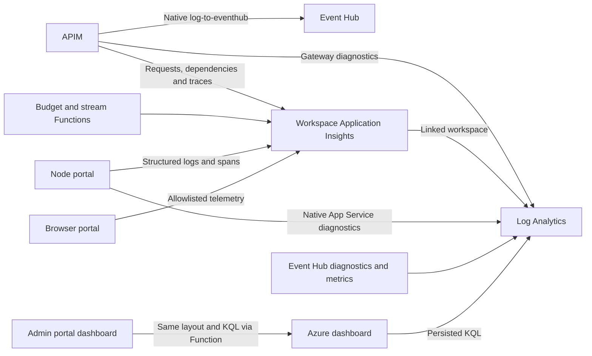

# Observability and Azure dashboards

**Redis-accepted usage drives approximate live budgets.** Table history is
persisted asynchronously and may be incomplete permanently; it drives retained
usage/chargeback reports, not admission. Log Analytics and Event Hubs can also
lose data. None establishes financial completeness.

## Destinations



Workspace-based Application Insights writes directly to its linked workspace.
Do not add a diagnostic export back to the same workspace.
No prompts, generated content, bearer tokens, subscription keys, user display
names or raw Entra user identifiers belong in custom usage telemetry.
Pseudonymous identifiers still require appropriate access and retention controls.

APIM uses its gateway user-assigned identity and the Application Insights
connection string's cloud-aware regional ingestion endpoint. Its **Monitoring
Metrics Publisher** assignment is scoped to the specific Application Insights
component. API diagnostics retain W3C correlation, zero logged body bytes, and
the correlation-ID header allowlist. The logger is created before replacing the
legacy instrumentation-key logger so APIs can switch destinations safely.

The internal budget/usage `send-request mode="new"` policies explicitly forward
an incoming `traceparent`; otherwise those subrequests start unrelated traces
even while native APIM dependency telemetry is enabled. Instrumented clients
(including the portal) should send a valid W3C parent for one operation-wide
trace. Plain clients still receive the gateway's financial request UUID, which
joins check/usage/callback records via `request_id`/`correlation_id`. APIM does not
expose its internally generated W3C parent to policy expressions when the client
omits it; inventing a second trace ID would not repair that platform boundary.

## Native Event Hub publication

APIM's configured user-assigned managed identity has **Azure Event Hubs Data
Sender** on the destination hub. `log-to-eventhub` emits compact versioned JSON
from Redis-accepted usage; Python does not publish to Event Hubs. A successful
nonstream usage call still waits briefly for Redis acceptance, not Table writes,
and returns the event on `200`. The streaming relay forwards chunks incrementally,
does Redis accounting in process at terminal usage, then schedules a background
callback to a protected internal APIM logging operation. Neither path promises
Table persistence before the event.

Request/usage Table writes run in a process-local async queue/task with 256
pending writes and a best-effort two-second graceful-close drain. Monitor logged
drops/failures and abandoned work: saturation, restart and failures can lose
writes. There is no durable queue, outbox, retry or exactly-once guarantee.

The policy is unaffected by Application Insights sampling and truncates messages
larger than **200 KB**. Keep schema-bounded events well below that threshold.
Delivery is best effort with no application retry queue or exactly-once claim.
Unknown usage has null counts/cost and a distinct status.

Both streaming callbacks and non-streaming accounting emit
`usage_event_enqueued` from APIM with the original request/event identifiers.
This means the native logging policy ran after Redis acceptance, not that Table
persisted the record or a downstream consumer processed the event. Confirm broker
ingress with Event Hub's `IncomingMessages`
metric. Consumer checkpoints, transformations and finance ingestion are outside
this sample; absence of those application spans is not evidence that publication
failed. Do not deploy a duplicate accounting consumer just to produce telemetry.

See [policy reference](https://learn.microsoft.com/azure/api-management/log-to-eventhub-policy)
and [managed identity logger setup](https://learn.microsoft.com/azure/api-management/api-management-howto-log-event-hubs).

## Azure dashboard

Terraform owns the deployed Azure portal dashboard and KQL under
`infra/modules/monitoring/`. Update those source definitions, not an independent
portal query catalog. The in-app Admin dashboard reads the persisted dashboard
layout and executes its fixed-workspace KQL through the Function managed identity.
Readers retain scoped persisted-history reports, not workspace-wide queries.

Open **Azure dashboard** in the Admin portal. Ten operational charts appear before
the supporting detail grids; every chart also has an expandable data table.
Terraform persists `AnalyticsChart`, `SpecificChart` and axis/split dimensions.
Defining only `AnalyticsGrid` produces a table, even when the portal supports charts.

| Chart | Source and interpretation |
|---|---|
| APIM inference traffic and HTTP outcomes | Gateway diagnostics, deduplicated by correlation ID. Separates observed monthly-budget denials, backend/provider 429s, other/unclassified 429s, auth failures and HTTP outcomes over five-minute bins. HTTP 2xx is not proof of completed accounting, especially for SSE. |
| Function budget admissions and blocks by model | Unique `budget_decision` events. Counts requests, not tokens; a request blocked before inference has no provider-reported token consumption. |
| Actual token composition by model / over time | Unique actual `usage_recorded` events, stacked as uncached input (`input - cached`), cached input, and output. Unknown usage is excluded, never invented as zero. |
| Input tokens served from provider prompt cache | Cached input / total input tokens by model. This is a token-weighted percentage, not request hit rate or APIM response/semantic caching. |
| Function admission-to-accounting lifecycle | Correlates admitted requests with actual/unknown terminal records. Grouped, not stacked: admitted includes finalized and unknown stages. Separates recent waiting from no terminal observed after five minutes. Sampling, ingestion delay and window boundaries can produce apparent gaps; this is not financial reconciliation. |
| Function budget-check and usage-recording latency | P95 request duration for the two internal Function routes, in five-minute bins; detail tables include request and server-error counts. |
| Function Table and Redis operations | Success/failure counts by storage operation; detail tables include P95 duration. These operations are not inference requests or financial charges. Redis is the live operational state; Table writes are asynchronous history. Warm admission never reads Table. |
| Month-to-date actual USD by model | UTC month-to-date Redis-accepted actual usage observed in telemetry, not proof of Table persistence or complete finance totals. Unknown amounts stay unpriced; this chart does not apply the shorter activity time picker. |
| Monthly budget utilization | Latest observed monthly status, not a live Redis read. Percentages can exceed 100% because these are soft caps. Never add nested user/team/department spend together. |

Supporting grids retain blocking budget IDs/hierarchy, chargeback, application
attribution, request latency/errors, Event Hub health, and unknown provider usage.
Blocking-budget matches can exceed the number of blocked requests when multiple
budgets reject the same request; use the admission chart for unique blocked requests.

Budget gauges require complete month-to-date data; a short chart time picker
must not relabel last-hour spend as the complete monthly balance. Use the
`/budgets/status` API for live approximate Redis balances, not a financially
complete report. Redis loss can reset spend; there is no automatic ledger rebuild.
Deduplicate usage by stable event ID. Never add nested hierarchy counters or
join operational retries into multiple financial charges.

Native `llm-emit-token-metric` can supplement operational visibility, but custom
dimension/series limits make it inappropriate for arbitrary per-user billing.
Use low-cardinality metrics and detailed log grids instead. Telemetry ingestion
delay, sampling, retention and missing terminal usage affect dashboard coverage.

## Trace a request

The Function worker exports structured logs, manual spans and custom metrics
through the Microsoft Azure Monitor OpenTelemetry distro. Both Function hosts
disable adaptive host sampling; the configured worker trace sampling ratio is
independent of structured log export. Logs are not dropped merely because their
span was not sampled. Export remains asynchronous and best effort.

### Function event catalog

| Events | Important context |
|---|---|
| `request_started`, `request_completed`, `request_failed` | Every request reaching the budget API's ASGI app and every invocation of the registered stream handler. Includes authorization/validation failures and unmatched budget API routes. Completion includes method, allowlisted route template, status, duration and outcome. Failures contain exception type, never exception text or stack. |
| `operation_started`, `operation_completed`, `operation_failed` | Budget checks and usage recording, with inference request ID, elapsed time and safe failure type. A successful operation can still return a denied budget decision. |
| `budget_decision` | Model/protocol, streaming flag, original request ID, allow/deny reason, denied budget IDs, pinned month/price and replay flag. Fresh decisions also include matching budget IDs/counts. Replays return the original decision without reevaluating budgets. |
| `budget_evaluated` | One snapshot per applicable budget on a fresh decision: scope, wildcard/model, limit, spent, remaining, allow/deny and reset time. Opaque user and assigned hierarchy references permit investigation without raw Entra identities. |
| `usage_recorded` | Newly Redis-accepted actual/unknown usage, immutable usage-v2 identifiers and pinned attribution. Actual logs add uncached input, total tokens and cache-hit flag. Acceptance is not confirmation of a Table write. |
| `usage_record_replayed` | Existing Redis accounting returned on retry or concurrent usage acceptance within the replay window. Does not emit another `usage_recorded` event or duplicate token/cost metrics. |
| `dependency_completed`, `limiter_dependency_unavailable` | Table/Redis operation latency/outcome and dependency failures. Redis unavailability fails closed; background Table write failure does not reverse accepted usage. Dependency spans link to their enclosing request/operation. |
| `usage_event_publish_failed`, `metric_record_failed` | Best-effort downstream publication or operational metric recording failed; these events do not establish Table persistence. |

Unknown usage reasons distinguish `reported_unknown`, `provider_usage_missing`
and `provider_usage_invalid`; it has no fabricated token/cost measurements.
Actual provider usage uses reason `provider_usage`. Cache reads are included in
provider input: uncached input is `input_tokens - cached_input_tokens`, total
tokens are `input_tokens + output_tokens`, and reasoning is not added again.
A blocked request has no provider-reported "blocked tokens"; count denials, not
invented token consumption. Budget balances are snapshots, and nested hierarchy
spend must not be added together.

### Function custom metrics

| Instrument | Unit and dimensions |
|---|---|
| `limiter.http.requests` | Requests by method, route template, status and outcome. |
| `limiter.http.duration` | Millisecond histogram with the same HTTP dimensions; stream duration includes body iteration and final accounting. |
| `limiter.budget.decisions` | Decision attempts by configured model, protocol, streaming, allowed and replayed. Filter out replayed attempts for unique admissions/blocks. |
| `limiter.usage.records` | Accounting attempts by configured model, protocol, streaming, actual/unknown and replayed. |
| `limiter.usage.tokens` | Only newly Redis-accepted actual tokens, split into disjoint `uncached_input`, `cached_input` and `output`. |
| `limiter.usage.cost` | Only newly Redis-accepted actual cost, in **micro-USD**, not USD; not proof of Table persistence. |

Usage token/cost dimensions are model, protocol, streaming and status, plus token
type on the token counter. No request, correlation, user, tenant, subscription or
budget identifiers are metric dimensions. Metrics appear in `AppMetrics`; use
detailed logs for high-cardinality investigation. Process crashes or exporter
failures can lose operational measurements, even with sampling disabled.
Unsampled request and per-budget logging increases ingestion volume and cost.

### End-to-end correlation

APIM generates the inference request ID; callers cannot choose financial
idempotency keys. APIM's existing W3C diagnostics correlate `send-request`
budget/usage checks and forwarded backends. Functions extract the incoming
`traceparent`, create server and operation/dependency spans, and attach explicit
`trace_id`, `span_id` and `correlation_id` fields to structured logs.
Ordinary Function requests can also use the Functions invocation trace context
when no valid incoming header exists. Invalid correlation headers are replaced
with a safe generated ID.

The stream Function keeps its server span active through body iteration,
disconnect cleanup and final accounting. Manual HTTP child spans propagate
`traceparent` and the original `X-Correlation-ID` to the model provider and
internal APIM usage-event callback. The provider span measures connection/header
latency; the server span covers the complete stream. Callbacks also trace the
original financial `request_id` and `event_id`, separate from APIM's callback
transport request ID. Event Hub messages retain the existing immutable usage-v2
schema and request/event identifiers; no trace fields are added to that contract.
Provider-side telemetry is visible only if the provider exposes it; propagation
alone does not make an external service's internal spans available.

Find all stages by original request/correlation ID:

```kusto
let Correlation = "<X-Correlation-ID>";
AppTraces
| where TimeGenerated > ago(1h)
| where tostring(Properties.correlation_id) == Correlation
    or tostring(Properties.request_id) == Correlation
| project TimeGenerated, AppRoleName, OperationId, ParentId, Message, Properties
| order by TimeGenerated asc
```

Expand into the distributed trace, including native APIM and Function requests
and Table/Redis/provider/callback dependencies:

```kusto
let Correlation = "<X-Correlation-ID>";
let Operations = AppTraces
    | where TimeGenerated > ago(1h)
    | where tostring(Properties.correlation_id) == Correlation
        or tostring(Properties.request_id) == Correlation
    | where isnotempty(OperationId)
    | distinct OperationId;
union withsource=Signal AppRequests, AppDependencies, AppTraces
| where TimeGenerated > ago(1h)
| where OperationId in (Operations)
| project TimeGenerated, Signal, AppRoleName, OperationId, ParentId,
    Id, Name, Message, Properties
| order by TimeGenerated asc
```

`OperationId` is the W3C trace ID; `Id`/`ParentId` establish span relationships.
APIM gateway resource logs separately expose their native `CorrelationId`.
Native Function host requests and manual server spans can overlap: filter by
role/name when counting traffic rather than adding every `AppRequests` row.
Easy Auth/platform rejections occurring before Python runs cannot generate these
custom middleware events; investigate native hosting/authentication diagnostics.
Streaming responses can report HTTP 200 yet fail later: use the custom completion
outcome and usage status, not HTTP status alone.

### Platform and identity boundaries

Resource diagnostic settings send supported host, authentication, audit, storage,
Redis, model-service and Event Hub categories directly to the shared workspace.
They are not expected to appear as custom `AppTraces`. Function hosts expose
`FunctionAppLogs` and supported App Service authentication/audit categories;
the portal also exposes `AppServiceHTTPLogs` and console logs. A configured
category can legitimately have no rows until that kind of activity occurs.

APIM's native application telemetry covers gateway authorization/policy failures.
An Easy Auth rejection occurs before application code and must be investigated in
hosting/authentication diagnostics, not synthesized as an application invocation.
Tenant-wide Entra sign-in/audit export and external model-provider internals are
separate administrative boundaries; this sample does not configure tenant-wide
identity exports or invent provider spans it cannot observe. A correlation ID and
transport status do not establish downstream consumer or external-provider completion.

Manual client spans cover `dashboard.read` (ARM GET),
`dashboard.query_batch` (Log Analytics POST), `redis.connection`, and
`managed-identity.get_token`/`managed-identity.get_token_info`. They retain only
fixed service/operation names, timing, outcome and exception class, not scopes,
tokens, queries, Redis keys or exception messages. There is no global distributed
ledger lock or per-request ledger rebuild. A dashboard HTTP 200 can still
contain failed tiles; `dashboard_query_failed` distinguishes an unavailable
batch from incomplete individual tiles. Correlated
`usage_event_publish_accepted` records the stream callback's transport
acceptance with immutable request/event IDs, not downstream processing.

### Portal application telemetry

The Node server uses manual OpenTelemetry providers and Microsoft's Azure
Monitor exporters. It sends `portal_started`, `portal_request` and
`portal_server_error` to `AppTraces`, sanitized route-template server spans to
`AppRequests`, and fixed-target `portal_api` dependencies to `AppDependencies`.
The server role is `apim-rate-limit-foundry.ai-budget-portal`. The App Service
Node agent is explicitly disabled to avoid duplicate request capture and
uncontrolled automatic dependency/exception collection; the Application Insights
connection string and native resource diagnostics remain enabled. The packaged
server includes only locked production dependencies, not frontend build tooling.
The staged `.webappignore` preserves those dependencies in azd's actual ZIP;
installing them in a staging directory alone does not override azd's defaults.

The browser role `ai-budget-portal-browser` emits sanitized API/Graph dependency
records and bounded identity acquisition outcomes. A fresh W3C dependency
context accompanies API calls; the Node request and its APIM dependency use
child spans, preserving the trace through APIM and the Function. Direct portal
gateway CORS permits `traceparent`/`tracestate`; it does not permit arbitrary
headers. UUID correlation IDs remain useful alongside the canonical W3C
operation ID. Manual Graph records identify only `graph_profile`/`graph_photo`,
never a person's profile, photo URL or Graph response. Existing browser event
allowlists remain in force; blanket fetch/console/exception-stack capture,
statsbeat, SDK statistics, resource metrics and offline buffering stay disabled.

Use the request/event ID to correlate any retained Table record with downstream events.
Event Hub ingress indicates acceptance by the hub, not capture or downstream
finance processing. No Stream Analytics, Fabric pipeline or finance system is
deployed by this sample.
