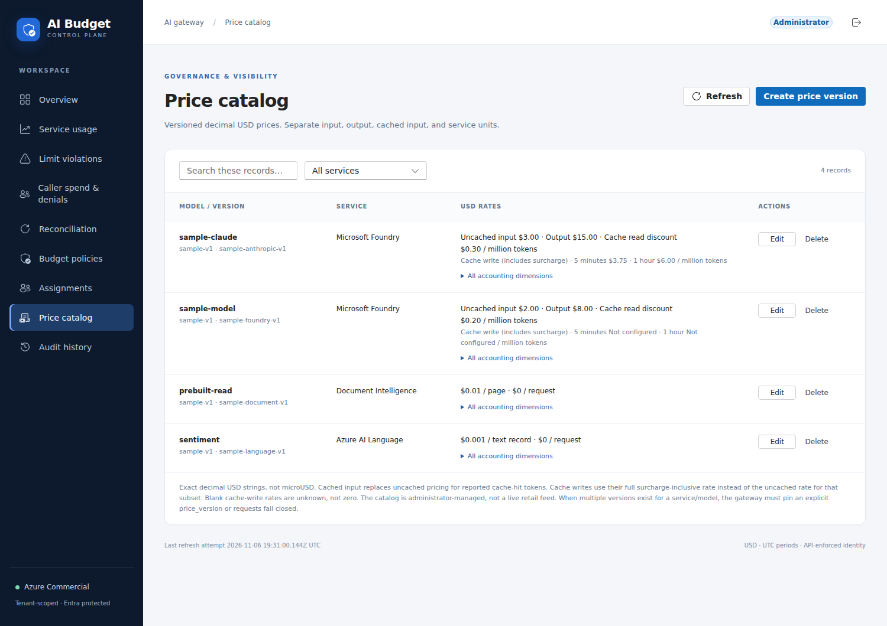
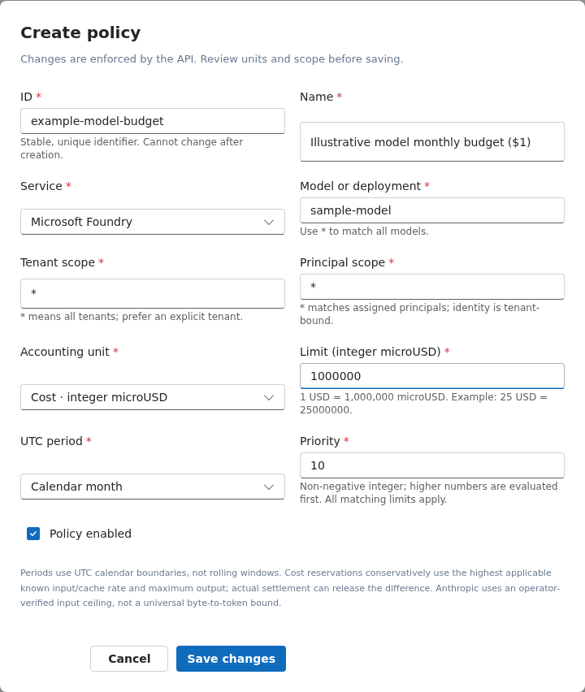
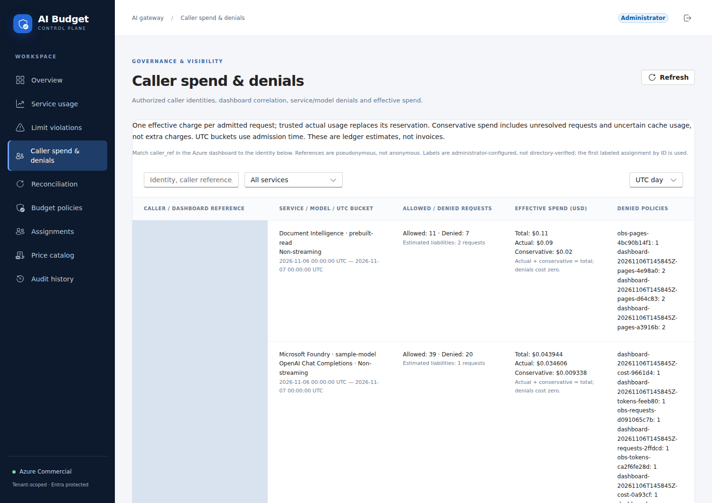

# Operator walkthrough: configure a limit and follow a request

This is a practical exercise for an already deployed, authorized environment.
It does not replace the [deployment runbook](deployment.md).
For the underlying hold/refund math and failure behavior, read the
[reservation-system guide](reservation-system.md); for charts and log schemas,
use [observability](observability.md).

Use a disposable caller/model scope with approved test prices and capacity.
Do not overwrite existing operator configuration or run recovery as a routine
part of policy editing.

## Screenshot provenance

These are **historical captures before the application-subscription and visual
redesign** of the deployed Commercial app on November 6, 2026, not
fixture-mode mockups. An isolated browser used an existing approved delegated
session through MSAL, not an interactive MFA sign-in or an authentication bypass.
Account identity and caller identity/reference cells are masked for publication.
The policy editor contains an **unsaved illustrative draft**; capture performed
no configuration writes or inference calls. Prices are invented demo rates.
Configured Anthropic records do not mean its backend is enabled.
Their old caller labels, rounded styling and example models are not the current
application-subscription UI or current managed-model price catalog.

Screenshots are static, cropped views; scroll/filter the real app for other rows.
Azure query plots and their separate validation boundaries are in
[observability](observability.md#review-against-codys-requirements).

## 1. Establish access and the target route

Sign into the Fluent portal with `RateLimit.Admin`. Identify the deployment alias
and enabled route from the `LLM_GATEWAY_ROUTES` azd output.
The read-only Model inventory also shows protocol, alias, provider deployment
and price readiness; see [model registry](model-registry.md) before adding one.
The inference token must target `GATEWAY_CLIENT_AUDIENCE`; portal/admin tokens
target the separate limiter API audience.

See [identity and token boundaries](azure-topology.md#identity-and-token-boundaries)
before reusing a token between these paths.

## 2. Configure a price card

In **Price catalog**, publish exactly one service/model/version match for the
route's pinned price version. Example files contain invented rates, not contractual
Azure prices.
For a registry entry, changing the pinned version itself requires Terraform
provisioning and deployment; changing only the price card does not change the pin.

Use decimal USD strings, with token rates per million tokens and service rates
per unit. Explicit zero means uncharged; unknown/null does not mean free.
Messages needs the complete read/write price dimensions described in the
[configuration contract](configuration-reference.md#llm-protocol-and-caching-contract).

If multiple catalog versions exist, the gateway's version pin chooses among them.
Editing a catalog does not reprice an in-flight reservation.



The read price is a **full unit price**, not a discount percentage. Cache-write
prices include their surcharge; unknown writes remain unconfigured, not free.

## 3. Add policies and optional assignments

In **Budget policies**, create illustrative rules such as:

| Policy ID | Metric | Limit | Period |
| --- | --- | ---: | --- |
| `example-model-rpm` | `requests` | 30 | `minute` |
| `example-model-tokens` | `tokens` | 20,000 | `minute` |
| `example-model-budget` | `cost` | 1,000,000 micro-USD ($1) | `month` |

Set the intended `service`, deployment `model`, `tenant_id`, and `subscription_id`.
All matching rules apply, not just the highest-priority one.
A wildcard subscription gives separate allowances per application, not a tenant pool.

Use **Assignments** for opt-in policy membership and explicit Reader access.
Select the application subscription and add authorized Entra object IDs to
`reader_principal_ids`. Its optional display label helps identify the application;
it never replaces the validated subscription ID or changes its counters.
See [selection and counter scope](configuration-reference.md#policy-selection-and-counter-scope)
before changing metric/period, disabling rules, or assigning a previously general rule.



The draft's `1000000` means **$1**, not one million dollars. Its wildcard scopes
are illustrative: prefer explicit tenant/caller scopes for a real test.
For a scriptable equivalent, use the
[policy PUT example](configuration-reference.md#example-save-and-read-a-budget-policy).

For fresh/cold Redis only, complete the protected [initialization/recovery](operations.md#recovery).

## 4. Send an allowed request

Use a genuine **access token**, not an ID token. Keep it out of terminal transcripts,
screenshots and checked-in files. This Chat example assumes the route is enabled
and the selected model accepts the supplied output-cap field.

```bash
curl --fail-with-body --include \
  "$APIM_GATEWAY_URL/foundry/chat/completions" \
  -H "Authorization: Bearer $AI_ACCESS_TOKEN" \
  -H "Ocp-Apim-Subscription-Key: $APIM_SUBSCRIPTION_KEY" \
  -H "Content-Type: application/json" \
  --data '{"model":"gpt-5.4-mini","messages":[{"role":"user","content":"Reply with OK."}],"max_completion_tokens":64}'
```

Capture `X-Correlation-ID` and `X-RateLimit-Reservation`. Check **Service usage**
for the canonical result, not a sum of per-policy costs. For a streaming request,
add `"stream":true`; terminal usage is observed by the dedicated Function.
Receipt of conservative admission headers does not imply settlement failed.

Use the [APIM contract](../apim/README.md) for Responses, Messages and service
payload restrictions rather than substituting a different endpoint into this body.

For an enabled Responses deployment, the equivalent bounded **streaming** request
uses a different body and output-cap field:

```bash
curl --fail-with-body --no-buffer --include \
  "$APIM_GATEWAY_URL/foundry/responses" \
  -H "Authorization: Bearer $GATEWAY_ACCESS_TOKEN" \
  -H "Ocp-Apim-Subscription-Key: $APIM_SUBSCRIPTION_KEY" \
  -H "Content-Type: application/json" \
  --data "{\"model\":\"$RESPONSES_DEPLOYMENT_NAME\",\"input\":\"Reply with OK.\",\"max_output_tokens\":64,\"store\":false,\"stream\":true}"
```

Use the configured deployment alias and a model-compatible cap; some reasoning
models need more output allowance. The checked-in
[REST Client examples](../examples/gateway.http) also cover Messages, Language
and bounded PDF submission/polling with the same application subscription key
**and** an Entra token. Use an inference product subscription, not the portal key.
Terraform's registered application subscriptions provide the stable IDs.

## 5. Exercise a denial safely

Temporarily lower a dedicated test policy below the request's conservative demand,
without affecting other callers. Record the original configuration first.
The next valid request should return a custom `429` decision containing blocking
policy IDs and retry/reset information. The AI backend should not be called.

Restore the original policy afterward and verify the saved value. A native APIM
throttle or provider 429 is a different result; neither proves custom budget
enforcement. Requests that are invalid before reserve have no custom usage record.

## 6. Read the dashboard and trace one request

Open the `AZURE_DASHBOARD_URL` azd output and choose a time range spanning both
admission and settlement. Follow the
[correlation queries](observability.md#trace-one-request) and the
[chart inventory](observability.md#dashboard-inventory).

For this exercise, verify:

1. The allowed request has a reservation and a final actual or explicitly estimated result.
2. The denied request contributes zero custom cost and names the binding rule.
3. Multiple matching policies have not multiplied the displayed consumption.
4. Reported cached tokens use the configured read price, not uncached pricing.
5. In the application-subscription report, the authorized app/service/model row
   matches the dashboard's stable subscription ID or pseudonymous reference.

Per-policy remaining observations are more useful than one mixed-unit remaining
header. Neither is a continuously queried live balance.
Use durable reports for accounting and logs for investigation; the
[observability caveats](observability.md#accounting-and-query-caveats) explain discrepancies.



The first column is deliberately masked here. In the authorized app, copy
`caller_ref` or the stable subscription ID from an Azure chart into the application
search to resolve its configured app label, not a person. Switch **UTC day/hour**, then compare the same admission
cohort. This view does not count native pre-reserve APIM denials; use the gateway
429 chart for those.

## 7. Extend acceptance beyond this exercise

Run the [operations acceptance checklist](operations.md#operator-acceptance-checklist)
for concurrency, retries, provider errors, missing stream usage, document polling,
reader isolation and recovery. Real cached-token verification requires provider-
reported hits; repeating a prompt does not guarantee a cache hit.

Restore all temporary configuration. Record the target cloud, route/model, price
version, results and any unavailable providers or untested interactive clients.
