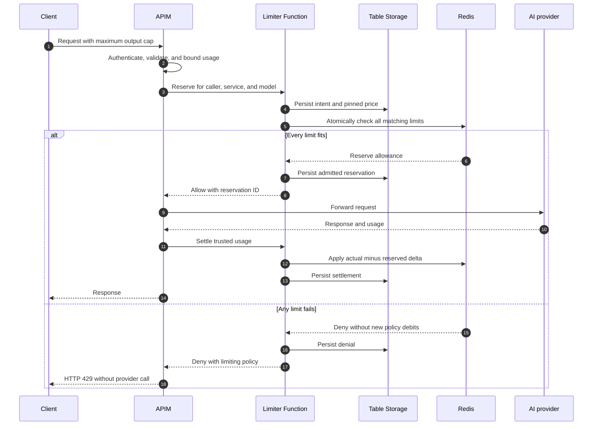
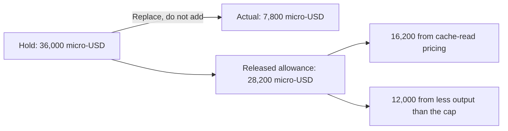
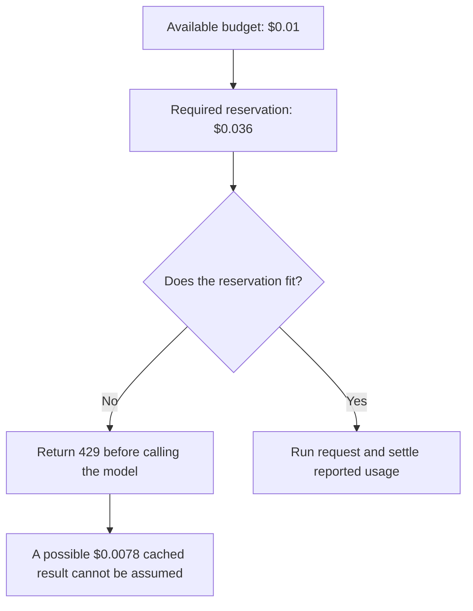
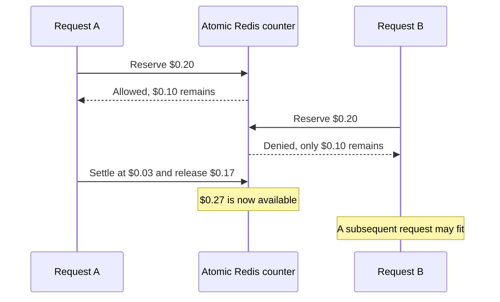
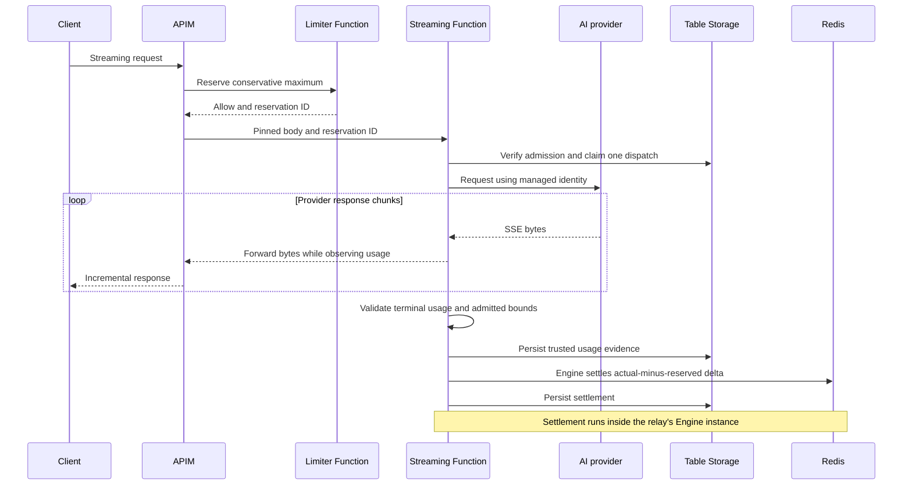
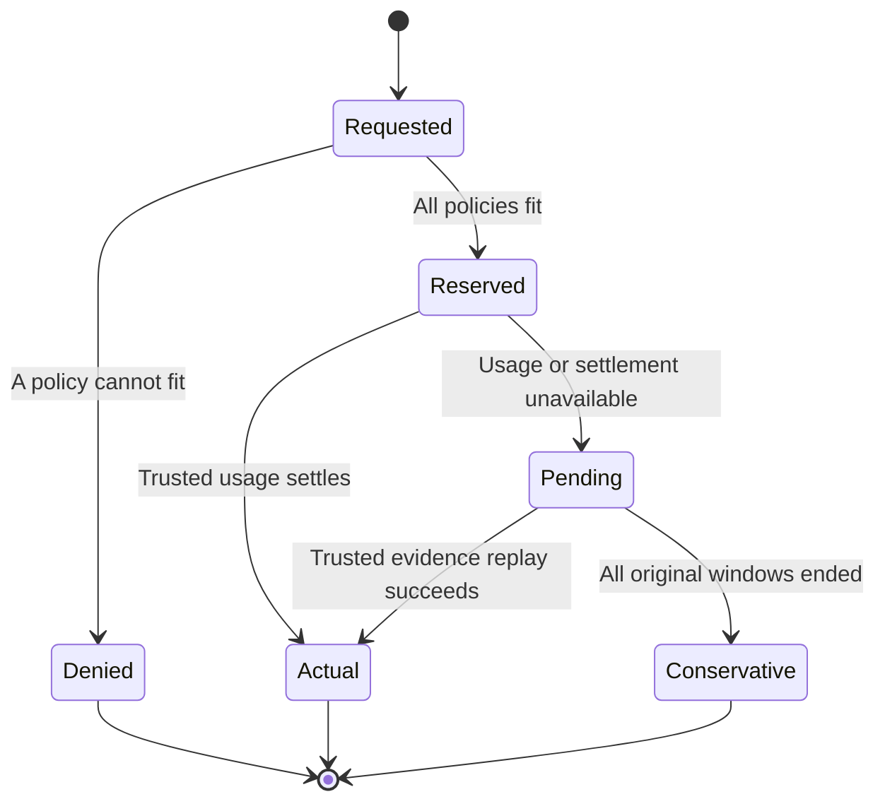

# Understanding reservations, settlement, and cached-token costs

A **reservation is a temporary hold against a caller's configured allowance**.
It is not an Azure payment authorization, model-capacity reservation, or additional
provider charge. After execution, trusted usage replaces the hold with the amount
the request actually consumed.

Think of a hotel's credit-card hold: reserve enough for the possible bill, then
replace the hold with the final bill. Here, "bill" means our internal usage
accounting at configured catalog prices, not an Azure invoice.

> **The key tradeoff:** this implementation is cache-aware when settling usage,
> but it does not assume future cache hits when admitting requests. A request
> that would ultimately be cheap can still be rejected if its maximum reservation
> does not fit.

## Contents

- [Why reserve before execution?](#1-why-reserve-before-execution)
- [Follow one request](#2-follow-one-request)
- [Watch the budget change](#3-watch-the-budget-change)
- [How cached tokens change the final cost](#4-how-cached-tokens-change-the-final-cost)
- [Why a cheap request can still be denied](#5-why-a-cheap-request-can-still-be-denied)
- [How concurrent requests stay within the budget](#6-how-concurrent-requests-stay-within-the-budget)
- [How streaming settles without buffering the response](#7-how-streaming-settles-without-buffering-the-response)
- [Failures, retries, and conservative finalization](#8-failures-retries-and-conservative-finalization)
- [What dashboard numbers mean](#9-what-dashboard-numbers-mean)
- [Other limits and service units](#10-other-limits-and-service-units)
- [Implementation and test map](#11-implementation-and-test-map)

## 1. Why reserve before execution?

Admission happens **before** the model generates a response. At that point, the
gateway knows the submitted content and requested output cap, but not the final
output count, provider cache hits, or whether trustworthy usage will be returned.

Checking only completed requests would leave in-flight work unaccounted for.
Multiple concurrent requests could all see available budget and collectively
exceed it before any of them finishes.

For each applicable cost policy, the conceptual calculation is:

```text
available budget = configured limit
                 - finalized usage in that policy window
                 - outstanding reservations in that policy window
```

Redis stores the combined counter, rather than maintaining these two conceptual
subtotals separately. Reservations increase it; settlement applies a correcting
delta.

The Function owns these decisions. APIM authenticates the caller and enforces the
Function's allow/deny result. Observability systems do not approve requests.

**Code:** [`Engine.reserve()`](../src/apim_rate_limit_foundry/engine.py#L45),
[`RESERVE`](../src/apim_rate_limit_foundry/stores/scripts.py#L1), and the
[APIM reservation callout](../apim/fragments/reserve.xml.tftpl).

## 2. Follow one request

This diagram shows the **non-streaming** path. Streaming uses the same reservation
engine, with a different trusted usage observer described below.



### Reserve

APIM derives identity from authenticated context and chooses the configured model
and price version. It supplies bounded usage, not a client-selected cache discount.

For Chat Completions, the input bound uses serialized JSON UTF-8 bytes plus framing
padding. It is intentionally generous, **not an exact prompt-token count**. The
output bound is the requested maximum, not a prediction of the answer's length.
Messages uses a separately verified full-context input ceiling.

The Function selects matching policies and exactly one matching price card.
It records the intent, including the price snapshot and original policy-window
debits, before touching Redis. It does not return an allow until the admitted
usage record is durable.

For cost admission, cached hits are assumed to be zero. The conservative input
price is the highest applicable input price, which also protects against
Anthropic cache writes being more expensive than ordinary input.

**Code:** [Chat input/output bounds](../apim/policies/foundry-admission.xml.tftpl),
[Messages admission](../apim/policies/anthropic-admission.xml.tftpl),
[`validate_estimate()`](../src/apim_rate_limit_foundry/accounting.py#L75),
[`cost()`](../src/apim_rate_limit_foundry/accounting.py#L37), and
[`debits()`](../src/apim_rate_limit_foundry/accounting.py#L129).

### Settle

Trusted provider usage is normalized and checked against the admitted bounds.
Settlement uses the reservation's **pinned price snapshot**, so a catalog edit
does not retrospectively reprice an in-flight request.

Redis applies:

```text
counter adjustment = final amount - reserved amount
```

For a valid cheaper result, that delta is negative, returning unused allowance.
An actual-usage report exceeding the admitted hard bound is rejected; it is not
silently accepted as a larger charge.

**Code:** [`Engine.settle()`](../src/apim_rate_limit_foundry/engine.py#L252),
[`normalize_settlement_usage()`](../src/apim_rate_limit_foundry/normalization/settlement.py#L6),
[`actual_debits()`](../src/apim_rate_limit_foundry/accounting.py#L163), and
[`FINALIZE`](../src/apim_rate_limit_foundry/stores/scripts.py#L51).

## 3. Watch the budget change

Suppose a caller has a **$1 hourly budget**, with **$0.70 already finalized**.
A new request needs a **$0.20 reservation**, but ultimately consumes **$0.03**.

| Stage | Finalized usage | Outstanding holds | Available budget |
| --- | ---: | ---: | ---: |
| Before request | $0.70 | $0.00 | $0.30 |
| While request runs | $0.70 | $0.20 | $0.10 |
| After actual settlement | $0.73 | $0.00 | $0.27 |

```text
Reserve: counter changes from $0.70 to $0.90
Settle:  delta = $0.03 - $0.20 = -$0.17
Final:   counter changes from $0.90 to $0.73
```

We did **not** charge $0.20 plus $0.03. The final $0.03 replaces the hold.
"Refunded" or "released" means restored internal allowance, not money returned
by Microsoft.

If hourly and daily policies both match, each policy's counter receives the
appropriate debit. This is one request subject to two constraints, not two
financial charges. Do not sum policy debits to calculate unique consumption.

The same principle applies to token or page reservations. A request-count policy
normally remains at one request after successful settlement.

## 4. How cached tokens change the final cost

These are **illustrative prices**, not current model quotes:

| Category | USD per million tokens |
| --- | ---: |
| Uncached input | $2.00 |
| Cached input read | $0.20 |
| Output | $8.00 |

Assume the admitted input bound is 10,000 tokens and the output cap is 2,000:

```text
Input reservation:   10,000 x $2 / 1,000,000 = $0.020
Output reservation:   2,000 x $8 / 1,000,000 = $0.016
Total reservation:                           $0.036
```

The provider eventually reports 10,000 total input tokens, including 9,000 cached
tokens, and only 500 output tokens:

| Actual category | Tokens | Cost |
| --- | ---: | ---: |
| Uncached input | 1,000 | $0.0020 |
| Cached input read | 9,000 | $0.0018 |
| Output | 500 | $0.0040 |
| **Actual total** | | **$0.0078** |

```text
uncached input = total input - cached input
               = 10,000 - 9,000 = 1,000

released liability = $0.0360 - $0.0078 = $0.0282
```

OpenAI's total input already includes its cached subset. Counting 10,000 regular
input tokens **and** adding 9,000 cached input tokens would double-count.
Anthropic's raw fields have different semantics; normalization adds its separate
input/cache categories into the common total, then prices each disjoint subset.
Cache writes are also separated into 5-minute and 1-hour prices.

The released $0.0282 is **not all cache savings**: it also reflects less output
than the cap. Without caching, the same actual 10,000 input and 500 output tokens
would cost $0.0240. The cache-only saving is therefore $0.0162.

Provider prompt caching is not APIM response caching. The former still executes
the model and reports discounted input; the latter can avoid model execution.
Semantic response caching is not implemented here. Adding it would require
separate embedding/cache-cost and tenant-isolation design.

The implementation uses decimal arithmetic and rounds the total upward to integer
micro-USD; one USD equals 1,000,000 micro-USD.

**Code:** [`cost()`](../src/apim_rate_limit_foundry/accounting.py#L37),
[OpenAI normalization](../src/apim_rate_limit_foundry/normalization/openai.py), and
[Anthropic normalization](../src/apim_rate_limit_foundry/normalization/anthropic.py).

### Run the pricing example against the implementation

From the repository root, paste this into `uv run python -` (then end standard
input). It performs no Azure calls and uses the example catalog, not retail rates:

```python
import json
from pathlib import Path

from apim_rate_limit_foundry.accounting import cost
from apim_rate_limit_foundry.models import Price, Usage

catalog = json.loads(Path("examples/prices.json").read_text())
price = Price.model_validate(next(p for p in catalog if p["id"] == "sample-foundry-v1"))
bound = Usage(input_tokens=10_000, output_tokens=2_000)
actual = Usage(input_tokens=10_000, cached_input_tokens=9_000, output_tokens=500)
without_cache = Usage(input_tokens=10_000, output_tokens=500)

reserved = cost(price, bound, conservative=True)
settled = cost(price, actual, conservative=False)
cache_only_saving = cost(price, without_cache, conservative=False) - settled
assert (reserved, settled, reserved - settled, cache_only_saving) == (
    36_000, 7_800, 28_200, 16_200
)
print(f"micro-USD: hold={reserved}, actual={settled}, released={reserved - settled}")
```



This is pure price arithmetic, not authority to submit actual usage. Only the
trusted gateway/streaming path can finalize a real reservation.

## 5. Why a cheap request can still be denied

Take the same request, but leave the caller with only **$0.01 available**.
Its eventual cached cost might be $0.0078, but the $0.036 reservation does not fit.



The gateway cannot safely spend a cache discount the provider has not confirmed.
It chooses strict budget protection over optimistic admission.

This is the distinction between:

| Capability | Current behavior |
| --- | --- |
| Cache-aware final accounting | Yes, when trusted cache usage is reported. |
| Assuming cache hits before execution | No. |
| Avoiding every rejection of an ultimately cheap request | No. |
| Making provider TPM limits ignore cached tokens | No; provider quota rules are separate. |

This is an intentional limitation, not a claim that the original cached-token
admission problem has disappeared. Generous input bounds can increase the gap.
Large output caps also hold more allowance even when typical answers are short.

## 6. How concurrent requests stay within the budget

Suppose $0.30 remains and two concurrent requests each need $0.20.



The Lua reservation script checks **every matching policy first**, then updates
their counters only if all fit. There is no separate, race-prone read-then-write
decision in Python.

Policy keys include the policy, metric, period, tenant/application subscription, and UTC
window start. A wildcard-subscription policy gives each application a separate limit;
it does not create one shared tenant pool. Priority affects ordering, not whether
other matching rules are enforced.

Different users using the same APIM subscription share its counters; primary and
secondary keys and rotations also share them. The Entra principal is retained
as audit metadata, not a budget identity. Another subscription remains isolated.

Windows are fixed UTC minute/hour/day/calendar-month periods, not rolling
lookbacks. Settlement adjusts the original windows even if it arrives later.

**Code:** [`RESERVE` and `FINALIZE`](../src/apim_rate_limit_foundry/stores/scripts.py),
[`matching()` and `debits()`](../src/apim_rate_limit_foundry/accounting.py), and
[`window()`](../src/apim_rate_limit_foundry/accounting.py#L15).

## 7. How streaming settles without buffering the response

Normal JSON responses expose usage to an APIM outbound policy. SSE streams
usually report complete usage at their end. Buffering the entire stream to read
that usage would undermine incremental delivery.

The dedicated HTTP-streaming Function therefore forwards bytes while observing
bounded SSE events:



APIM pins the model, forces Chat usage reporting, and hashes the final request
body before reservation. The relay checks the hash and durable admission, then
claims a single upstream dispatch for that reservation. A client cannot submit a
different body or reuse that reservation for another upstream execution.

The observer requires protocol-appropriate terminal evidence: Chat final usage
and `[DONE]`, Responses terminal response usage, or Messages start/delta/stop
usage. Malformed, incomplete, duplicate, or oversized usage evidence is not
accepted as an actual charge. The observer retains bounded accounting metadata,
not prompts or generated content.

The relay uses the existing Engine implementation **in its own process**; it does
not make another HTTP call to the control-plane Function to settle.

**Code:** [APIM body binding and relay routing](../apim/policies/ai.xml.tftpl),
[`StreamRelay.claim()`](../src/apim_rate_limit_foundry/streaming/relay.py#L34),
[`StreamRelay._stream()`](../src/apim_rate_limit_foundry/streaming/relay.py#L161),
[`StreamUsage`](../src/apim_rate_limit_foundry/streaming/usage.py), and the
[streaming entry point](../stream/function_app.py).

## 8. Failures, retries, and conservative finalization

These are conceptual lifecycle states; the durable records use fields such as
`allowed`, `status`, and `estimated`, rather than one identical state enum.



| Situation | Accounting behavior |
| --- | --- |
| Complete trusted usage | Replace the reservation with normalized consumption at pinned prices. |
| Actual counts but unknown cache count | Retain conservative input pricing; usage may remain marked estimated. |
| Stream evidence persisted but settlement fails | Keep liability and retry trusted evidence before conservative reconciliation. |
| Provider error or genuinely missing/truncated usage | Do not assume zero consumption; retain conservative liability. |
| Same reserve/settle retried with identical accounting inputs | Replay idempotently; do not debit or release twice. |
| Same ID reused with conflicting inputs or settlement | Reject the conflict. |
| Unresolved admitted request after all applicable windows end | Finalize conservatively, without an automatic refund. |

The timer runs every five minutes. It first replays saved trusted stream evidence,
then handles eligible unresolved reservations. **It does not release every hold
after five minutes.** If a monthly policy applies, unresolved liability may remain
pending until that calendar month ends.

Finalization is immutable: an identical retry is safe, but a different late actual
settlement conflicts with a completed conservative settlement.

The method named `Engine.release()` is potentially confusing: today it invokes
**conservative settlement**, not a zero-charge cancellation.

A client closing its connection does not prove the upstream request stopped.
If the relay still obtains valid terminal usage, actual settlement remains valid.
If its observation really is interrupted, conservative liability remains.

### Known pre-dispatch failure limitation

The relay commits its one-shot dispatch claim **before** acquiring the provider
token and opening the upstream request. A token-acquisition failure can therefore
retain the full reservation even though no provider request was made.

This is an existing cost-fairness limitation identified in review, not fixed by
this documentation. A future change could distinguish demonstrably pre-dispatch
failures from ambiguous network failures; ambiguous dispatch must not be treated
as proof of zero usage.

**Code:** [`StreamRelay.open()`](../src/apim_rate_limit_foundry/streaming/relay.py#L92),
[`replay_stream_usage()`](../src/apim_rate_limit_foundry/streaming/replay.py#L12),
[five-minute timer](../function_app.py#L25),
[`Engine.release()`](../src/apim_rate_limit_foundry/engine.py#L401), and
[`Engine.reconcile()`](../src/apim_rate_limit_foundry/engine.py#L416).

## 9. What dashboard numbers mean

| Label | Meaning |
| --- | --- |
| Reserved maximum | Original maximum liability, not an additional actual charge. |
| Actual cost | Trusted usage priced using the pinned catalog; inspect the estimated flag for unknown cache details. |
| Pending conservative reservation | An admitted hold not yet replaced by a final settlement. |
| Conservative settlement | Finalized maximum liability because actual usage was unavailable. |
| Released liability | Reserved amount minus settled amount, restored to internal allowance. |
| Effective cost | Settlement if present; otherwise the reservation. Denied requests contribute zero cost. |

Never add reserved maximum and actual cost as if they were separate spend.
Similarly, multiple matched-policy debits are not distinct requests.

Dashboard queries deduplicate by reservation ID and join decisions to settlements.
They depend on telemetry ingestion and the selected time range: a settlement
outside that range may leave its admission appearing pending. They are operational
views, not a financial ledger or Azure invoice.

The portal's authorized usage summaries and **Caller spend & denials** view read
durable accounting records. The `/api/usage` view overlays settled values; it is
not an untouched copy of the original hold. Original durable `usage` and `intents`
records retain the reservation evidence and pinned price snapshot.

`X-RateLimit-Estimated: true` and remaining-budget response headers describe the
gateway's conservative admission snapshot; they are not proof that the eventual
stream failed to settle. Consult the settlement/report for final accounting.

**Code:** [streaming liability chart](../infra/modules/monitoring/queries/streaming-economics.kql),
[effective-cost query](../infra/modules/monitoring/queries/cost-liability.kql),
[usage summary](../src/apim_rate_limit_foundry/reports/usage_summary.py),
[caller summary](../src/apim_rate_limit_foundry/reports/caller_usage.py), and
[APIM response headers](../apim/policies/ai.xml.tftpl).

## 10. Other limits and service units

There are three separate layers:

| Layer | What it protects |
| --- | --- |
| APIM native throttling | Coarse request bursts and optional supported native token limits. |
| Custom Function reservations | Per-caller service/model allowances at configured prices or units. |
| Provider quota | The provider's own TPM/RPM/capacity rules, independent of custom budget approval. |

Custom admission does not guarantee provider capacity or prevent a backend 429.
Cached-token discounts in this ledger do not rewrite provider quota semantics.
Native APIM denials can occur before any custom reservation exists.

For cost policies, cache discounts change the charge. For a `tokens` policy,
the implementation counts total input plus output: cached input remains part of
that token total. Choose cost policies when the goal is differentiated economics.

Document Intelligence reserves an enforced page upper bound and settles analyzed
pages through its polling flow. Language reserves text-record units and settles
trusted service statistics. Neither is assigned artificial LLM token usage.

**Code:** [identity and native burst policy](../apim/fragments/identity.xml.tftpl),
[`debits()` and `actual_debits()`](../src/apim_rate_limit_foundry/accounting.py),
[document submission](../apim/policies/document-submit.xml.tftpl),
[document polling](../apim/policies/document-poll.xml.tftpl), and
[Language admission](../apim/policies/language-admission.xml.tftpl).

## 11. Implementation and test map

The [code guide](code-guide.md) owns the full module/entry-point map and extension
workflow. Focused behavior tests are
[engine](../tests/test_engine.py), [Redis](../tests/test_redis.py),
[protocol](../tests/test_protocols.py), [streaming](../tests/test_streaming.py),
[caller](../tests/test_caller_usage.py), and
[gateway](../apim/tests/test_policies.py) tests.
Dashboard wiring is covered by
[Terraform dashboard tests](../infra/tests/dashboard.tftest.hcl).

For policy setup and an end-to-end investigation, continue with the
[worked rate-limiting walkthrough](rate-limiting-walkthrough.md). For system-wide
component, configuration, recovery, and telemetry flows, see
[architecture](../ARCHITECTURE.md).
