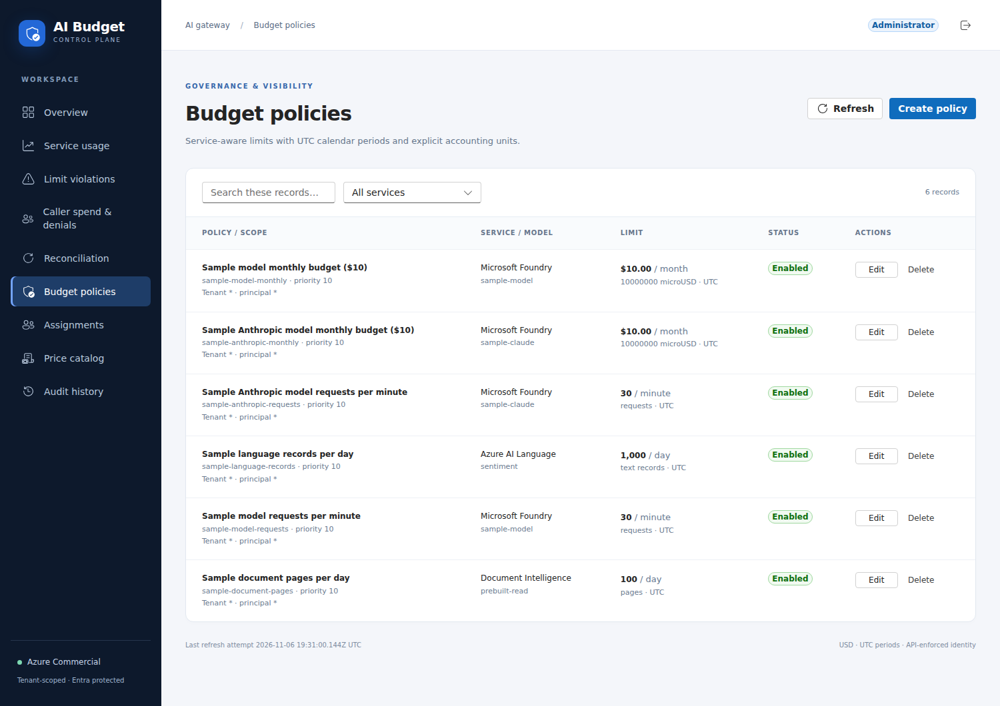

# AI Budget Control portal

Accessible React + TypeScript + Fluent UI v9 portal, hosted by a framework-free Node
server. Use Node **24 LTS**.

The managed inference account is Microsoft Foundry (`AIServices`). The model
inventory labels Chat, Responses and Messages by wire protocol; an OpenAI label
does not imply an OpenAI-kind Azure resource. Account upgrades preserve existing
inference origins, aliases and pinned prices.

```bash
npm ci
npm run lint
npm run typecheck
npm run test -- --run
npm run build
npm start
```

`npm start` serves `dist/` on `0.0.0.0:${PORT:-8080}`. Deploy `dist/`,
`server/`, and `package.json` together with `web/` as the working directory.
The production server needs only Node's built-in modules, not `node_modules`.
`npm run dev` uses Vite on loopback; the same runtime configuration is served
by its `/config.json` development middleware. Create `web/.env.local` for Vite,
or export settings in the shell for both servers. Never place secrets in Vite variables.

## Required production runtime settings

| Setting                                 | Meaning                                                                                                                                                          |
| --------------------------------------- | ---------------------------------------------------------------------------------------------------------------------------------------------------------------- |
| `AZURE_CLOUD`                           | Exactly `commercial` or `government`; no automatic cloud fallback                                                                                                |
| `AZURE_TENANT_ID`                       | Tenant-specific Entra GUID; `common`/`organizations` are rejected                                                                                                |
| `WEB_CLIENT_ID`                         | SPA application registration client GUID                                                                                                                         |
| `API_AUDIENCE`                          | Backend application ID URI, e.g. `api://<backend-app-id>`                                                                                                        |
| `API_SCOPE`                             | Full delegated scope under that audience, e.g. `api://<backend-app-id>/access_as_user`                                                                           |
| `API_BASE_URL`                          | HTTPS APIM `/portal` upstream in proxy mode; direct API collection root is used only for non-proxy local development                                             |
| `PORT`                                  | Optional Node listening port; default `8080`                                                                                                                     |
| `WEB_DEMO_MODE`                         | Optional; defaults off. Only exact `true` enables an in-memory local demo                                                                                        |
| `WEB_PLATFORM_AUTH_ENABLED`             | Terraform sets `true` for App Service; logout clears its session after MSAL sign-out. Defaults off for local development.                                        |
| `WEB_API_PROXY_ENABLED`                 | Terraform sets `true` in production. Enables the same-origin `/api/*` proxy; `false` retains direct local development.                                           |
| `PORTAL_APIM_SUBSCRIPTION_KEY`          | Server-only Key Vault reference for the APIM product key; required by the proxy and never sent to or exposed in the browser.                                     |
| `APPLICATIONINSIGHTS_CONNECTION_STRING` | Optional workspace-based Application Insights connection string with explicit cloud-specific `IngestionEndpoint`; enables privacy-filtered browser custom events |

`/config.json` is generated at server startup from these **public** settings;
it contains no client secret, Function key or APIM subscription key. When configured,
its optional `appInsights` field contains **public instrumentation routing only**:
`{connectionString, ingestionOrigin}`. See the privacy contract below.
In proxy mode it publishes `apiBaseUrl: "/api"` and `apiProxyEnabled: true`,
never the APIM key or upstream URL. The proxy accepts only allowlisted portal
routes and methods, requires the browser's `X-Portal-Access-Token`, forwards that
delegated token as upstream `Authorization`, and adds the server-side APIM key.
It never forwards cookies, App Service identity headers, client-supplied keys, or
arbitrary headers. Proxy upstream redirects, oversized bodies and missing or
unresolved Key Vault references fail closed. Browser API calls use the native
same-origin sign-in cookie and do not send an Authorization header to the web
audience.

An HTTP 401 does not necessarily mean the user's token expired: APIM also
returns it for missing or invalid subscription keys. After a deployment that
changes routing, reload the browser page to fetch current `/config.json`;
the in-app Refresh button only retries data using the already-loaded config.
Production calls must target same-origin `/api/*`, not APIM directly. Operators
should check APIM `LastErrorReason` and the server's Key Vault reference status
before changing Entra settings. Never put a product key in browser configuration.

The browser build is cloud-independent. Only the two supported Microsoft
authorities are accepted. API URLs may use HTTP only for loopback development.
All browser requests use access tokens for `API_SCOPE`, never ID tokens.

Register the deployed portal **origin** (and `http://localhost:5173` or
`http://127.0.0.1:5173` for development) as SPA redirect URIs.
Grant consent for the delegated API scope and Graph `User.Read`, and assign API app roles:
`RateLimit.Admin` or `RateLimit.Reader`. The UI reads role hints from the API
access token; the backend independently validates audience, tenant and roles,
and scopes data by tenant and application subscription. Reader access requires
an explicit assignment. `RateLimit.Gateway` alone cannot open portal data.
The production same-origin proxy does not require browser-to-APIM CORS. Direct
local development uses the delegated API token and requires exact portal origins.
Expose `X-Correlation-ID` if operators need to inspect backend correlation responses.
Terraform also protects the deployed website, assets and `/config.json` with native
App Service Entra authentication. The same single-tenant registration has a
**Web** redirect URI at `https://<portal>/.auth/login/aad/callback` and a **SPA**
redirect URI at the portal origin. App Service uses the dedicated web managed
identity and a federated credential instead of a client secret; it does not store
provider tokens. Do not copy the identity's federation setting into browser config.
The Web platform enables ID-token issuance for App Service's native hybrid
`code id_token` response; implicit **access-token** issuance remains disabled.
MSAL still uses authorization code + PKCE for delegated **API access tokens**.
The App Service sign-in cookie does not grant API roles or replace these tokens.
Sign-out clears MSAL/Entra and then the native App Service session. Local Vite/demo
development does not depend on App Service middleware.

### Remembered sign-in and SSO

The website's encrypted, Secure/HttpOnly App Service session cookie remains
platform-managed. MSAL uses `localStorage` so the API account/cache is shared
across tabs rather than discarded when a tab closes. MSAL v4 manages its cache
encryption and `msal.cache.encryption` session cookie; the portal does not put
passwords, access tokens or user profiles in a custom cookie, and does not use
the deprecated `storeAuthStateInCookie` option.

A remembered account obtains API tokens silently. If native App Service login
has succeeded but no API account is cached, the portal starts one top-level
MSAL redirect to reuse Entra's existing session, without forcing a fresh login
or using a hidden iframe. A per-tab non-secret attempt flag prevents failed
redirect loops; explicit sign-in remains available. Local development never
auto-redirects. Logout still clears MSAL/Entra and the native website session.

Persistence across browser restarts depends on Entra **Keep me signed in** and
your tenant's session/Conditional Access policies. Session expiry, cleared
browser data, denied consent and MFA can require interaction; this feature
does not extend or bypass them. See Microsoft's
[cache behavior](https://learn.microsoft.com/entra/msal/javascript/browser/caching)
and [SSO guidance](https://learn.microsoft.com/entra/msal/javascript/browser/single-sign-on).

The portal requests a separate delegated Microsoft Graph `User.Read` token for
the signed-in user's `/me` profile and photo only. Commercial uses
`graph.microsoft.com`; Government uses `graph.microsoft.us`. The profile image is
held in a revocable in-memory blob URL; denied consent, missing photos and Graph
errors fall back to initials. Profile names and photo data are never sent to
telemetry or persisted by the portal.

For intentional local demonstration:

```bash
WEB_DEMO_MODE=true npm run dev
# or after npm run build:
WEB_DEMO_MODE=true npm start
```

The prominent demo banner remains visible on every screen. Fixtures are not live
Azure prices and changes disappear on reload. Auth/config/API failure **never**
silently switches to demo mode. Never enable the demo flag on a shared production
deployment.

## Screens and server contracts

The [configuration reference](../docs/configuration-reference.md#api-contracts)
owns API routes, payloads, units and selection semantics. The browser types in
[`src/contracts.ts`](src/contracts.ts) mirror the server; do not treat them as an
independent accounting implementation.

| Screen                                      | Purpose                                                                                           |
| ------------------------------------------- | ------------------------------------------------------------------------------------------------- |
| Overview, Service usage, Limit violations   | Display returned usage and decision observations                                                  |
| Azure dashboard (Admin only)                | Render the deployed Azure dashboard charts and tables from server-returned tile metadata and rows |
| Application subscriptions                   | Read-only tenant-scoped `GET /subscriptions` collection                                           |
| Application subscription spend & denials    | Fetch `/usage/callers` rollups by application subscription; filter hour/day and service           |
| Budget policies, Price catalog, Assignments | Admin editing; policies and assignments bind application subscriptions                            |
| Model inventory                             | Read-only protocol/alias, provider deployment, pinned price and readiness, token bounds           |
| Reconciliation, Audit history               | Inspect returned history, not an independently maintained balance                                 |

The Azure dashboard is visible only to RateLimit.Admin because it contains workspace-wide telemetry. It requests `/dashboard?period=1h|24h|7d`; production maps this through the same-origin proxy, while direct local development uses the configured API root. The browser never sends KQL or workspace identifiers. The tile titles, axes, chart definitions and tabular values come from the deployed Azure dashboard. Per-tile query failures, empty results and server truncation are shown independently; request-level failures remain retryable. Each chart exposes a detail table. In local demo mode the dashboard uses clearly labeled fixtures and does not represent live Azure data.

Readers never send an arbitrary subscription selector to change authorization; the backend
scopes access and requires explicit assignment readers.
`/usage/callers` remains the compatible report route, but its rollups are keyed by
application subscription rather than a person.
GET failures remain visible and retryable. Failed saves retain the editor; failed
deletes retain confirmation. Filters/search are local display operations.
The [operator walkthrough](../docs/rate-limiting-walkthrough.md) demonstrates a
real configuration/allow/deny workflow.
Aliases are suggested in the policy and price editors, while manual entry and
wildcard policies remain available. Registry changes and price pins are
deployment-managed; see the [model registry](../docs/model-registry.md).



This is the deployed Commercial app with account identity hidden; rates and limits
are illustrative. See [capture provenance and the illustrated workflow](../docs/rate-limiting-walkthrough.md#screenshot-provenance).
The table configures limits, not live balances or protocol enablement.

## Accounting display and UI limits

The browser displays server-normalized usage and confidence flags; it does not
reprice provider payloads. Unknown protocols display as unrecognized. Missing
Anthropic cache-write counts display “Not reported”, not an invented zero.
See [reservation mechanics](../docs/reservation-system.md) for all pricing,
cache-subset and conservative-settlement semantics.

The overview shows configured policy limits, not live Redis balances or invoices.
Refresh is manual: there is no websocket, automatic polling, pagination or live
price feed. The sample API also scans collections without pagination; large-history
retention/partitioning is production work, not a guarantee supplied by the UI.
Prefer new catalog versions over editing old versions. Settlement still uses its
original price snapshot.

The portal does not execute inference, configure gateway capabilities, or establish
Government model availability. Its demo metadata and local unit tests do not prove
live cloud access or interactive sign-in. Source navigation and extension boundaries
are in the [code guide](../docs/code-guide.md).

## Privacy-safe observability

The production Node server still has **no runtime npm dependencies**. Keep the
App Service native Application Insights Node agent as the server HTTP exporter
(`ApplicationInsightsAgent_EXTENSION_VERSION=~3` and
`APPLICATIONINSIGHTS_CONNECTION_STRING` for the workspace-based component).
The Microsoft `@microsoft/applicationinsights-web` SDK is bundled by Vite, not
loaded from a CDN and not required by the static server.

Server code writes one JSON `portal_request` outcome per request, including
HEAD, rejected requests and premature response closure. Fields are `timestamp`,
`event`, generated UUID-v4 `correlationId`, allowlisted `method` (`OTHER` for
unknown methods), safe `route` (`runtime_config|page|asset|api_proxy|other`), numeric
`status` (`0` when aborted), `durationMs`, `outcome`
(`success|failure|aborted`) and fixed `errorCategory`
(`none|method_not_allowed|invalid_path|not_found|serve_error|connection_closed|proxy_disabled`
plus fixed `api_*` categories). Node logs its generated `X-Correlation-ID`; valid
browser correlation IDs are separately forwarded to APIM by the proxy.
`portal_started` includes port, cloud, demoMode and browserTelemetry.
`portal_server_error` includes only `startup_configuration|listen_error`.
These **console logs are not custom App Insights traces**: enable App Service
application/console logging and route `AppServiceConsoleLogs` to the intended
Log Analytics workspace using hosting diagnostic settings. Keep
`AppServiceHTTPLogs` separately if desired. The native HTTP agent has its own
request schema and collection/redaction settings, independent of this code.

The optional connection string must include a GUID `InstrumentationKey` and
explicit HTTPS root `IngestionEndpoint`. Commercial permits
`applicationinsights.azure.com` and its subdomains; Government permits
`applicationinsights.us` / `applicationinsights.azure.us` and their subdomains.
Credentials, non-default ports, query, fragment and non-root paths are rejected.
Missing, invalid or wrong-cloud optional telemetry **disables browser export**
without breaking authentication or the portal. Government never falls back to
a commercial endpoint. Only the validated exact ingestion **origin** is added
to CSP `connect-src`, with no wildcard. The browser independently revalidates it.
Only instrumentation key and ingestion origin are published; additional
connection-string fields (including authorization, application ID and live
metrics endpoint) are not published.

The instrumentation key is **not a read credential**: it routes writes but
grants no access to stored telemetry. Public `/config.json` makes the key and
ingestion endpoint observable to anyone who can load the portal. Treat the
endpoint/resource/region as public deployment metadata; keep data access behind
Azure RBAC and monitor ingestion abuse. Ingestion necessarily contacts the
configured Azure endpoint; normal transport metadata, including source IP and
browser networking headers, is outside the custom-event payload privacy filter.
Choose component IP-masking, retention, RBAC and data-processing policies
accordingly. Nothing here promises anonymous network traffic.

Only manually sanitized **custom events** are exported to App Insights
`customEvents` / workspace `AppEvents`; API dependency counts are represented
by `portal_api` events, not automatic `AppDependencies` URL records:

| Event                  | Custom dimensions                                                                                                                                                      | Custom measurements                             |
| ---------------------- | ---------------------------------------------------------------------------------------------------------------------------------------------------------------------- | ----------------------------------------------- |
| `portal_page`          | allowlisted `page`, `outcome=success`                                                                                                                                  | none                                            |
| `portal_api`           | `collection`, `method=GET/PUT/DELETE`, generated UUID-v4 `correlationId`, `outcome=success/failure`, `errorCategory=none/authentication/http/network/invalid_response` | `status`, `durationMs`, `requestCount=0/1`      |
| `portal_configuration` | editable `collection`, `action=create/update/delete`, `outcome=success/failure/cancelled`, `errorCategory=none/validation/api`                                         | none                                            |
| `portal_refresh`       | `outcome=success/partial_failure`                                                                                                                                      | `collectionCount`, `failureCount`, `durationMs` |
| `portal_bootstrap`     | `action=configuration/authentication/sign_in/sign_out`, `outcome=success/failure`                                                                                      | none                                            |
| `portal_browser_error` | `errorCategory=script/unhandled_rejection/render_error`                                                                                                                | none                                            |

`requestCount` is zero when token acquisition fails before an HTTP attempt and
one once fetch is attempted. If optional UUID generation fails, the API still
works and omits the correlation header/property rather than inventing an ID.

Pages and collections come from fixed UI/API enums, never browser locations.
The API sends its generated `X-Correlation-ID` to the backend so operators can
join an API outcome to backend logs. It does not reuse server static-request IDs
or arbitrary backend/header IDs. Form values (including policy limit, price, record ID, model, tenant, subscription
and reader IDs), identity/account/roles, Graph profile names/photos, searches,
headers, authorization, URLs/queries, bodies, response data, exception messages
and stacks are **never event properties**. Invalid or oversized measurements
are omitted. A final SDK initializer reconstructs allowed event data and strips
SDK user/session/operation/location context; all automatic page, dependency,
exception and diagnostic telemetry is dropped. Automatic fetch/XHR, route,
exception/rejection collection, request/response headers, cookies, SDK storage,
SDK diagnostics and remote CDN configuration are disabled. Global errors report
only fixed categories and never inspect the error or rejection reason.

Telemetry setup/export failures are best-effort and never fail saves, reads or
MSAL operations. Initial config failure cannot be sent from a fresh browser
because there is no validated destination yet; use the Node/hosting outcome.
StrictMode development can repeat lifecycle events. Page events count rendered
navigation, not audit-authoritative writes. Configuration events and API events
are separate results, not additive mutation counts. Demo mode remains explicitly
opt-in; if telemetry is configured for a demo, its navigation/configuration/refresh
events are exported, but the in-memory fixture API produces no HTTP API events.

## Authenticated GUI verification (operator harness only)

Use an isolated browser context and a separate ephemeral bundle of the **same
installed MSAL browser version**. Never add an auth bypass, test token endpoint,
fake JWT or token fixture to production code. The portal uses `sessionStorage`,
tenant-specific authority, `knownAuthorities` for its cloud, the configured
`WEB_CLIENT_ID`, origin redirect URI and delegated `API_SCOPE` from `/config.json`.
An existing approved operator delegated CLI token may be loaded using MSAL's
supported `getTokenCache().loadExternalTokens` API, then the real portal reloaded
in the **same tab/origin**:

1. Construct `PublicClientApplication` with the same configuration as
   `src/auth.ts`; call `await instance.initialize()`.
2. Use a genuine `AccountInfo` for the operator (`homeAccountId`, `environment`,
   `tenantId`, `localAccountId`, `username` from its actual account/client-info
   data). Do not manufacture an ID token; `id_token` is optional when an account
   is supplied. `client_info` may be supplied from the genuine token response.
3. Call `await instance.getTokenCache().loadExternalTokens(
{account, scopes: [config.apiScope], authority},
{access_token, token_type: 'Bearer', scope: config.apiScope,
expires_in: remainingLifetimeSeconds, client_info},
{expiresOn: actualExpiryEpochSeconds, extendedExpiresOn: actualExpiryEpochSeconds})`.
   MSAL requires nonzero `expires_in` even with `expiresOn`, and either response
   scope or request scopes. Only cache scopes the real token actually grants;
   verify tenant, API audience, delegated scope, expiry and Reader/Admin role
   against the real token/backend. Backend restrictions on the token's client
   (`azp`) still apply: caching does not turn a CLI-issued token into a SPA-issued one.
4. Optionally `instance.setActiveAccount(account)`, then reload the production
   portal without clearing sessionStorage. The portal takes `accounts[0]`,
   requests `API_SCOPE` using `acquireTokenSilent`, reads roles from the real
   access token, and sends that access token to the unchanged authenticated API.
   Account cache ownership and credential indexes are maintained by MSAL; do
   not handwrite storage keys. With no refresh token, expiration requires a new
   valid token or interactive auth. Discovery calls may still contact the
   tenant-specific authority. MFA is not performed by this harness.
5. Disclose that verification used an existing approved delegated session, not
   an interactive MFA sign-in. Disable screenshots/traces/network dumps that
   could capture tokens or operator PII; destroy the browser context afterward.

Prefer role/label selectors, not generated Fluent IDs or CSS class hashes.
The workspace provides Fluent's focus-restoration target for its programmatically
opened dialogs; closing an editor or deleting its opener row restores focus to
the stable workspace instead of leaving navigation hidden from assistive technology.
Wait for page DOM content and specific UI readiness rather than `networkidle`
because background telemetry may keep network activity alive.
Navigation: `getByRole('button', {name: 'Budget policies', exact: true})`.
Wait for `Refresh` to be enabled before editing; click `Create policy`.
In `getByRole('dialog', {name: 'Create policy'})` (or `Edit policy`), use
`getByLabel(/^ID/)`, `/^Name/`, `/^Service/`, `/^Model or deployment/`,
`/^Tenant scope/`, `/^Application subscription scope/`, `/^Accounting unit/`,
`/^Limit \(integer microUSD\)/` or `/^Limit \(whole units\)/`,
`/^UTC period/`, `/^Priority/`, and `getByRole('checkbox', {name: 'Policy enabled'})`.
Use `selectOption` values `foundry|document-intelligence|language`,
`cost|tokens|requests|pages|text_records` (service-dependent), and
`minute|hour|day|month`. Submit using `getByRole('button', {name: 'Save changes'})`.
Existing row buttons use exact names `Edit <record-id>` / `Delete <record-id>`;
deletion requires `Confirm delete` in `Delete this record?`.
Wait for the dialog to close and “Changes saved” / “Record deleted”; failures
keep the dialog open and expose an alert. `Search records` and `Filter by service`
are local filters only. Do not infer a live backend write from an optimistic UI.

Microsoft publishes the UI and identity libraries. Vite, React's community test
tools, ESLint and the TypeScript ESLint integration are development tooling;
there is no suitable Microsoft-maintained Fluent-compatible test runner or Vite
replacement required by this project.

Vitest uses the patched stable v4 line; it no longer depends on `tinypool`.
A narrow `@typescript-eslint/typescript-estree` override selects patched
`minimatch` v11 until upstream updates its v10 dependency range. Keep this
override until `npm audit` is clean without it.
